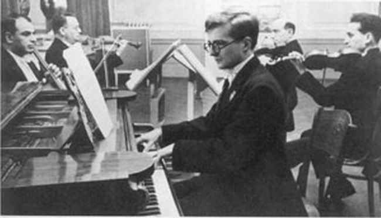
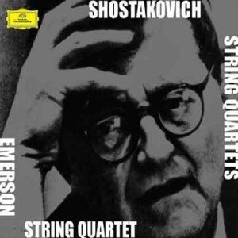
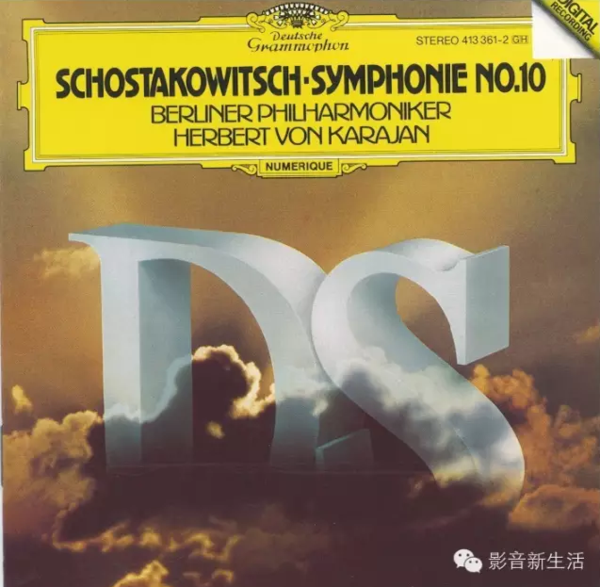
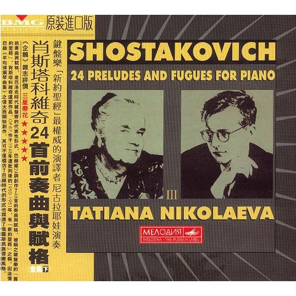
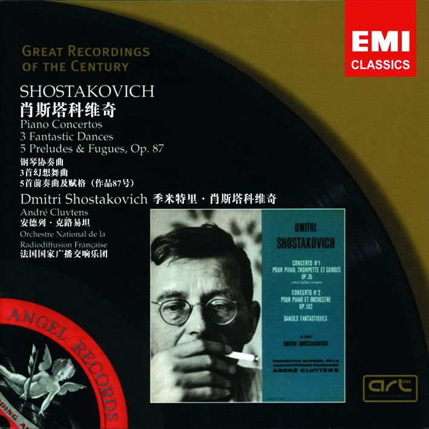
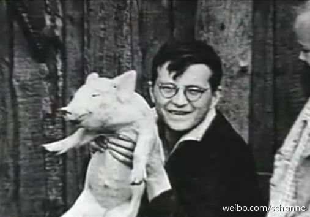

# 有哪些听了有流泪的冲动的古典音乐？

**作者**：[陈子敏](http://www.zhihu.com/people/91949509989e39acc6e55e4216ac260b)

**原文**：https://www.zhihu.com/question/30263604/answer/85161952

**发布时间**：2016-02-06T20:57:18

**编辑时间**：2019-05-11T10:29:31

赞同 12 · 收藏 12 · 喜欢 1 · 评论 1

**肖斯塔科维奇 c小调第八弦乐四重奏 op.110**  
此处推荐埃莫森四重奏的版本

**肖斯塔科维奇 e小调第十交响曲 op.93**  
推荐卡拉扬指挥柏爱版本

***强烈推荐***：**肖斯塔科维奇 前奏曲与赋格 op.87** 中的C大调（no.1）G大调（no.3）、e小调（no.4）、A大调（no.7）、降e小调（no.14）、降A大调（no.17）、F大调（no.23）——其实这个系列建议从头到尾全部听下来，因为各篇之间是具有连续性的。  
这几个应该都可以听哭人  
在此推荐**尼科拉耶娃**老太太的版本

实际上老肖曾自己录过其中第1、4、5、14、23、24首，说到这里，不得不推荐老肖的那张神唱片

该专辑同时收录了“**老肖PLAY老肖**”的三首幻想舞曲（op.5）和第一、第二钢琴协奏曲（op.35、op.102）。

**第二钢琴协奏曲 op.102** 第二乐章，其美丽醉人，十分符合题主的要求。

**老肖PLAY老肖系列**众所周知还有**d小调大提琴奏鸣曲**op.40，都是符合题主要求的。

下图放老肖萌照

