# 怎么比较奥黛丽赫本与费雯丽？

**作者**：[陈子敏](http://www.zhihu.com/people/91949509989e39acc6e55e4216ac260b)

**原文**：https://www.zhihu.com/question/24636201/answer/86702252

**发布时间**：2016-02-17T14:00:52

**编辑时间**：2022-03-02T09:52:26

赞同 501 · 收藏 122 · 喜欢 73 · 评论 22

破百赞了？？……

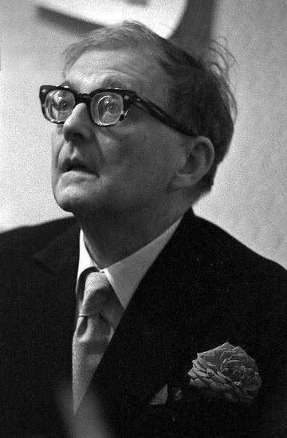

————————————————  
这都能拿到将近70赞……改日再更一个吧。  
————————————————

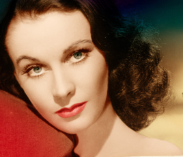

费雯丽让人想到拉斐尔画的圣母

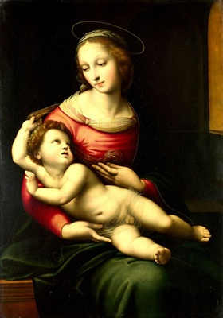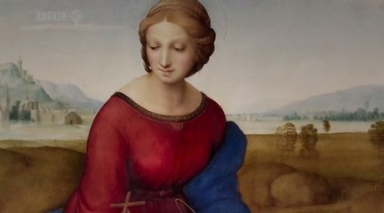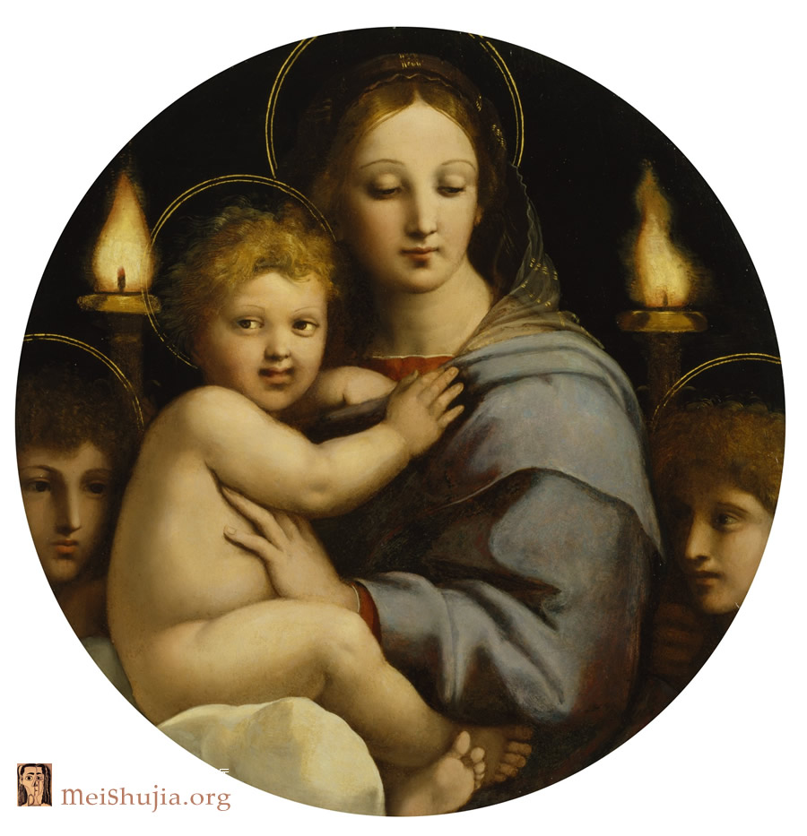

达芬奇的圣母

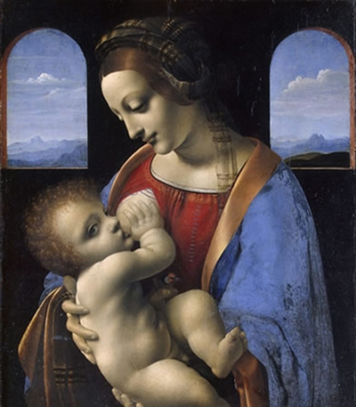

以及达芬奇的《吉内薇拉·班琪》

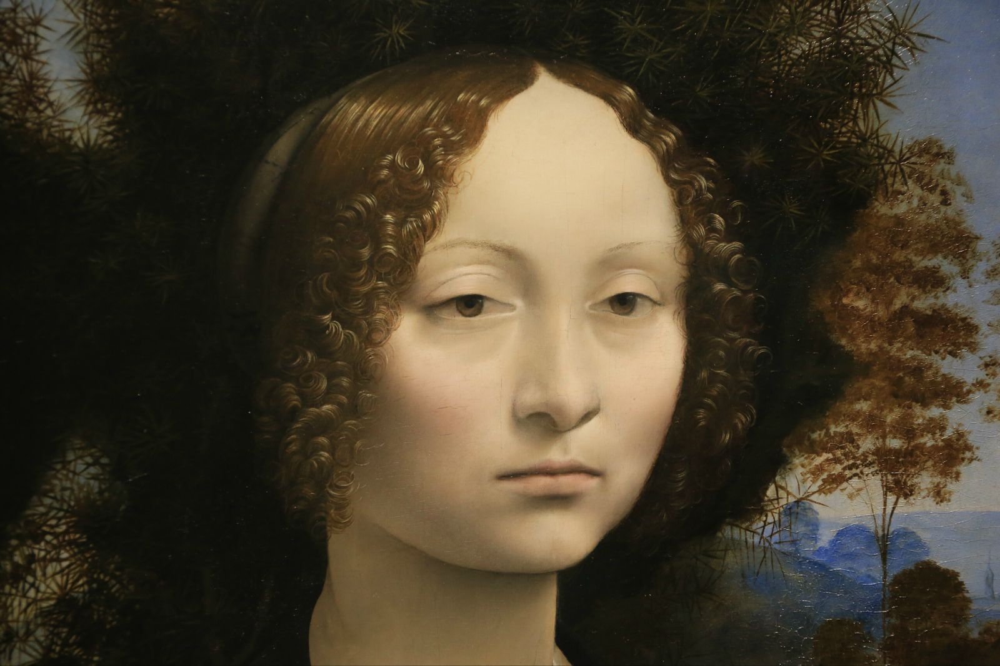

还有各种洛可可绘画中雍容华贵的妇人

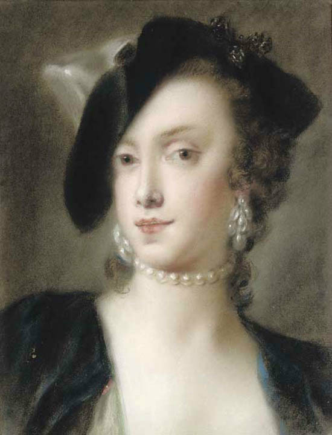

————————————————————————————————————————————————————————————————————————————————————

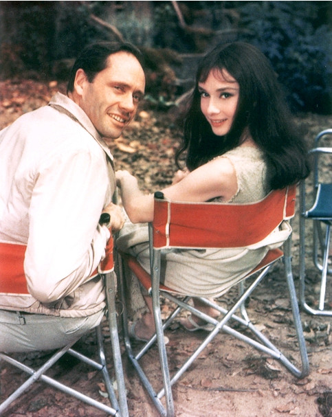

而赫本让人想到雷诺阿的《安德维普小姐像》

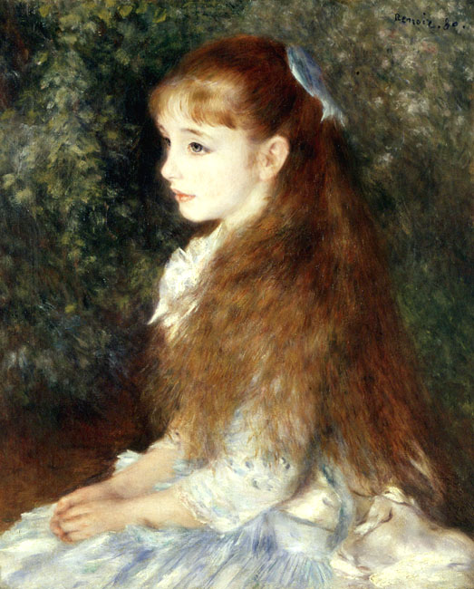

——以及雷诺阿画的一系列近代西方的日常生活景象（各种各样毛茸茸的人物（^-^））

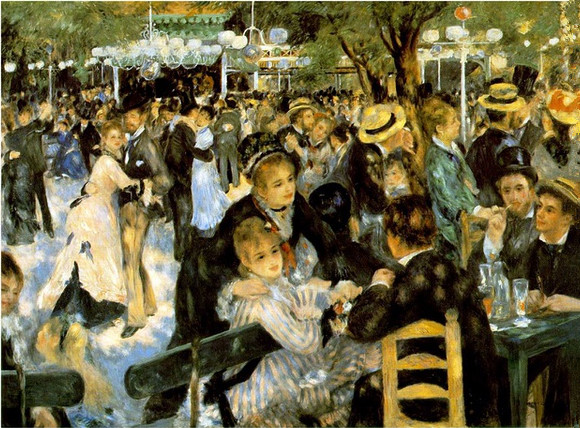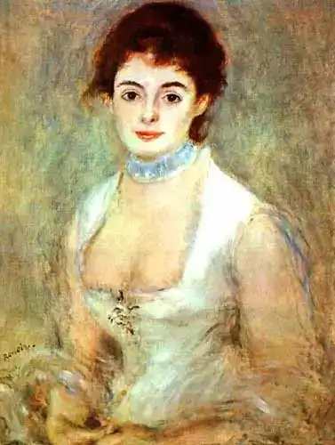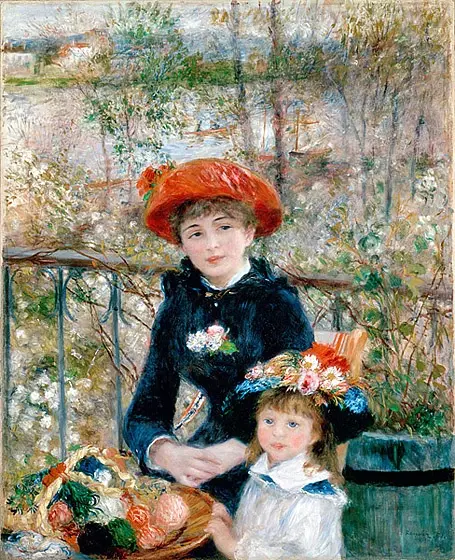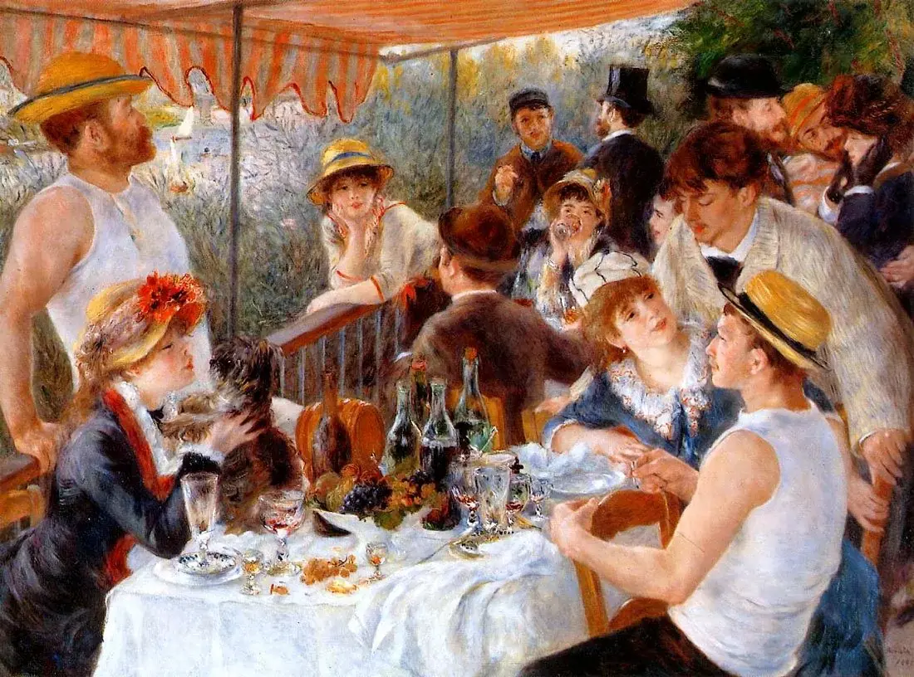

让人想到莫奈的妻子在罂粟花田上~

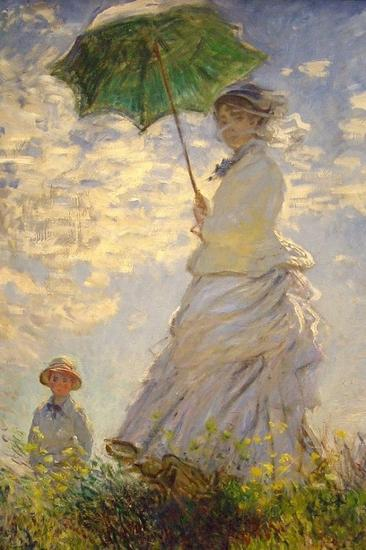

克拉姆斯柯依的《无名女郎》

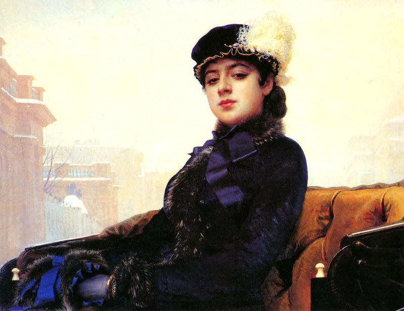

克拉姆斯柯依的《月夜》

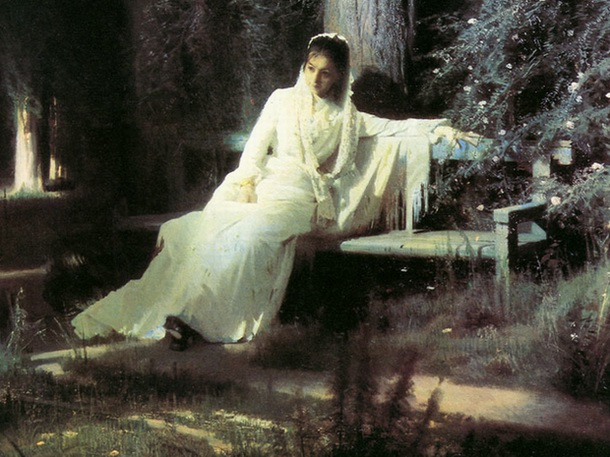

以及众多俄罗斯派与前印象画派肖像。  
也许可以这样说，费雯丽的气质是古典式的，是一种来自洛可可、文艺复兴时期的雍容华贵。  
而赫本的气质则是近代的，是来自工业文明之后的朝气蓬勃与时尚。  
相比之下，没有高下之分，只有气质的不同——来自两个不同世界的美好品质。
