# 哪一组漫画分镜让你感觉十分震撼？

**作者**：[陈子敏](http://www.zhihu.com/people/91949509989e39acc6e55e4216ac260b)

**原文**：https://www.zhihu.com/question/23034989/answer/91923251

**发布时间**：2016-03-22T23:05:47

**编辑时间**：2022-10-04T01:02:12

赞同 327 · 收藏 259 · 喜欢 68 · 评论 16

**一.手冢治虫**《**火之鸟·凤凰篇**》（1969），一直被认为是《火之鸟》系列的精粹。

这是**漫画史上最为人称道的光辉的一页**，在某些研究领域，《凤凰篇》被认为是《火之鸟》全十二篇中**最重要的一篇**。

其中后半部分，一共有三组让人永生难忘的分镜群。

**1**.我王的师父上人因种种原因看破红尘最后选择成肉身佛，挖出时我王悲伤激动不能自已的场景。

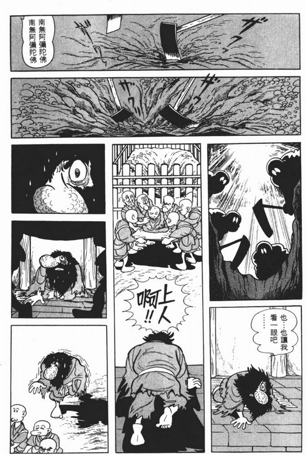

2.上人的肉身佛要拿去阴干，我王在肉身佛前对坐静思并顿悟的场景。

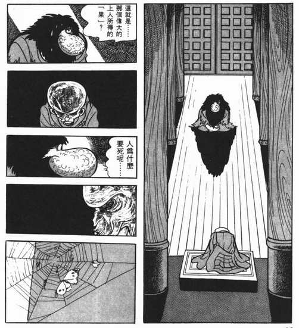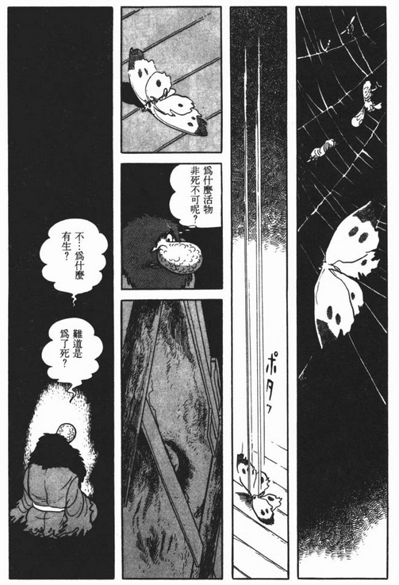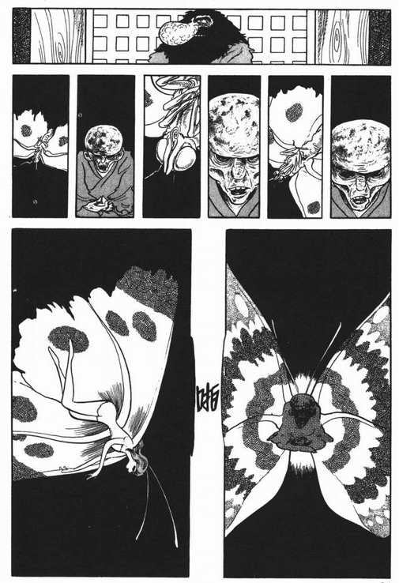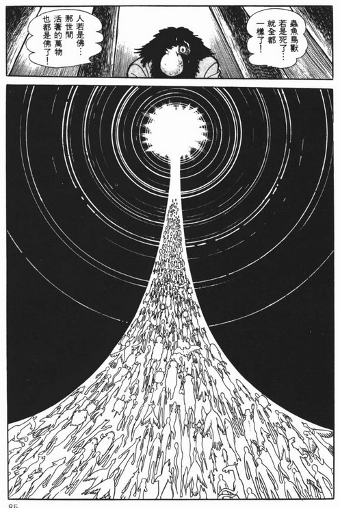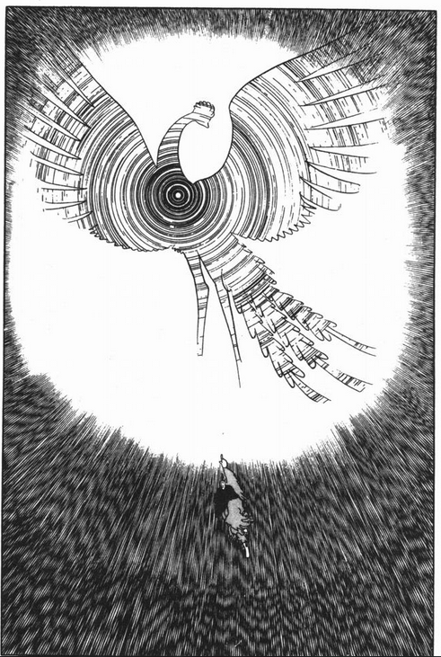

这组分镜在技术上展示了最高水平，堪称教科书般的分镜。这里的情节同时也道出了整个《凤凰篇》的主旨，手冢治虫有意用漫画承载类似《2001太空漫游》中的宗教体验。配合高超的分镜，我王的心理活动显得极具表现力。此时这部漫画已趋近尾声。

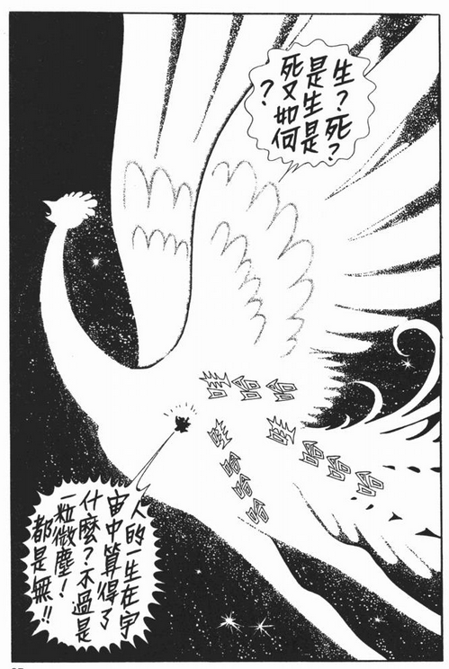

我王在火鸟的幻觉中顿悟

3.我王被茜丸阴险报复，砍下仅有的右手，被驱逐出场，艰难爬起步履蹒跚地离开众人的视线：

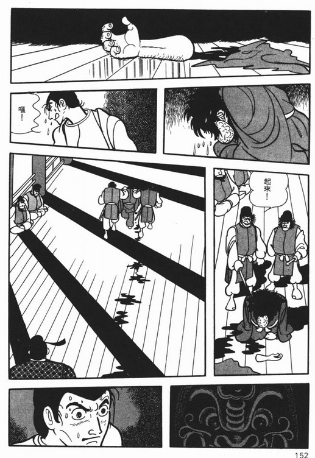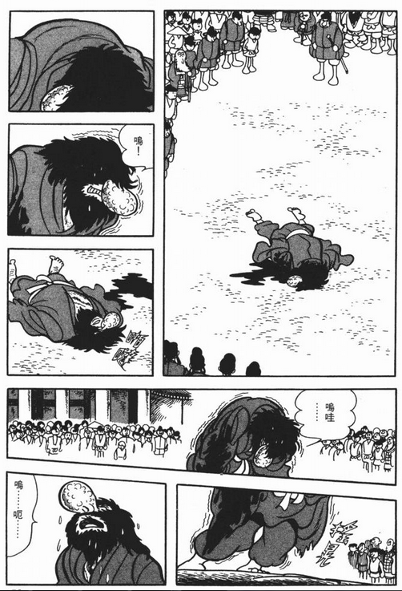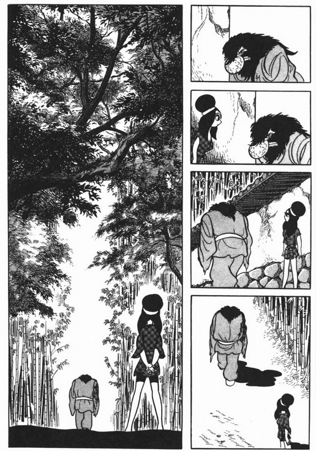

我王失去了双臂，在夕阳下流泪，赞叹造物的奇迹：

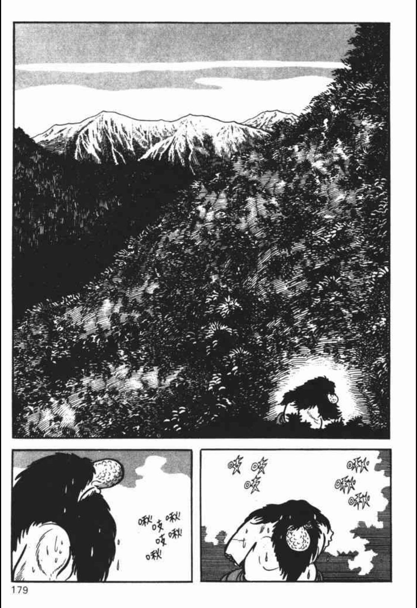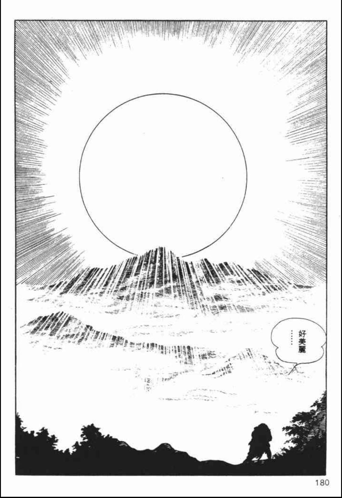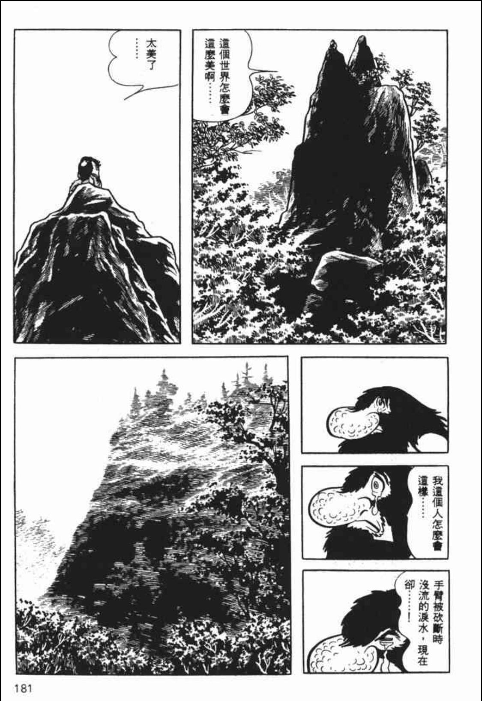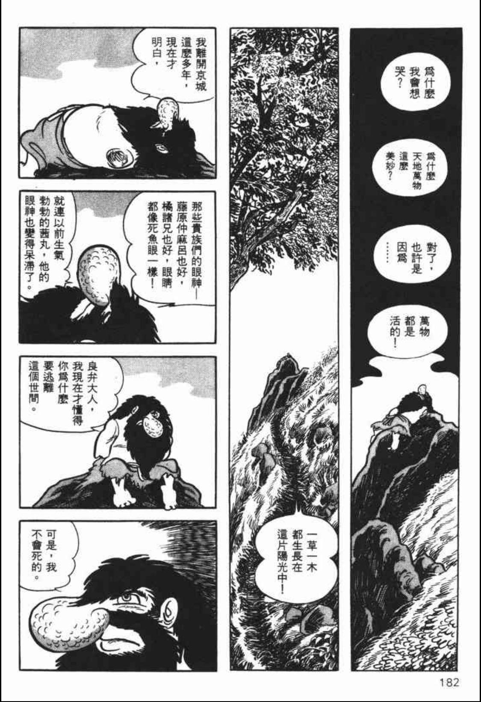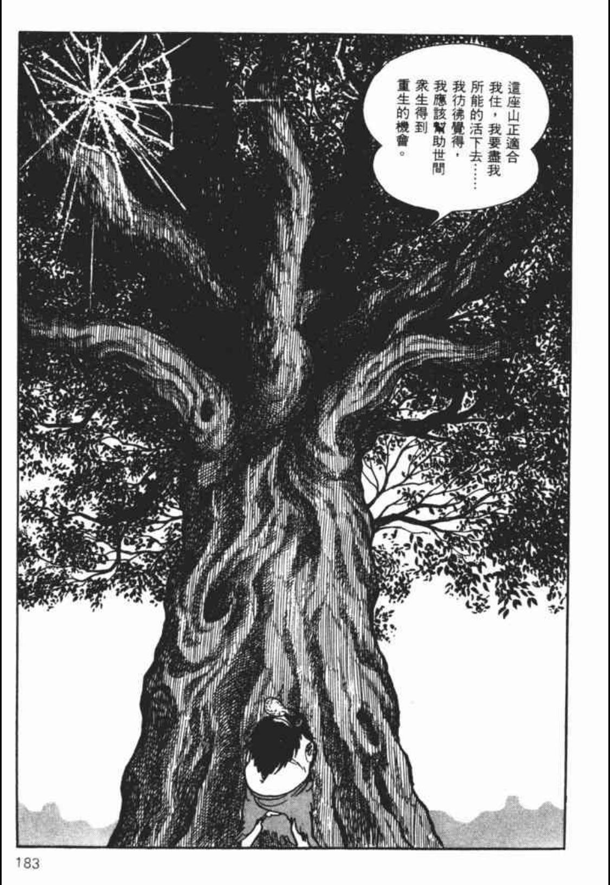

这里的分镜相对中规中矩，但从结构而言，以此作为《凤凰篇》的结束再好不过了。

**二.《火之鸟·宇宙篇》**
