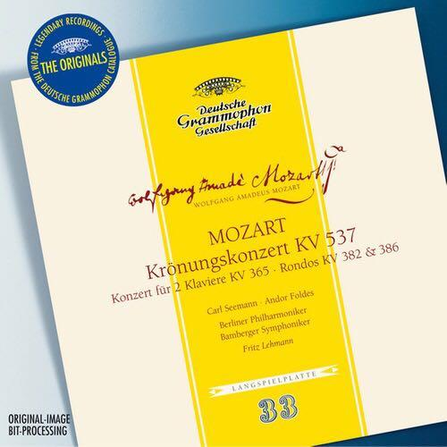
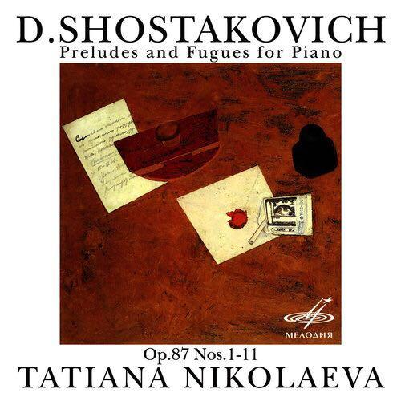

# 有哪些古典音乐给你种灵魂被一击而出的感觉？

**作者**：[陈子敏](http://www.zhihu.com/people/91949509989e39acc6e55e4216ac260b)

**原文**：https://www.zhihu.com/question/47313555/answer/105844202

**发布时间**：2016-06-14T00:30:31

**编辑时间**：2021-01-13T09:40:45

赞同 112 · 收藏 216 · 喜欢 35 · 评论 14

泻药。

莫扎特**D大调第二十六号钢琴协奏曲**（k.537）  
为什么是这么冷门的曲子？其实我以为这可能是莫扎特最好的钢琴协奏曲了。  
第一乐章给我的印象，从标题“加冕”出发结合开头的进行曲节奏，自然是庄重、严肃。但同时钢琴写作与管弦乐队的对比之下显得特别孤独。钢琴独奏的一些片段频繁使用低音下行、离调等手段，如泣如诉如怨如慕。展开部惊艳的乐队和钢琴的对话让人浮想联翩。  
第二乐章将这种失落感放大，到了第三乐章依然存在。许多论文指出，这首钢琴协奏曲带有**非常明显的自传色彩**。第一乐章展开部乐队齐奏和钢琴主奏的两次重复，除了制造音乐戏剧冲突以外，还暗示着一些脸谱化的歌剧形象。

莫扎特时代的音乐语言比较单一雷同，这首协奏曲却具有超时代的特征，难以想象。

推荐巴伦博伊姆指挥英吉利室内乐团并演奏的版本。

肖斯塔科维奇**二十四首前奏曲与赋格**（op.87）

一生推。  
重点推荐no.3、4、17  
考虑了一下，加一个no.23

第十七首 降A大调（赋格   
推荐Alexander弦乐四重奏演奏的版本，很精彩。利底亚调式的杰出运用与频繁的调式变换让作品具有一种复古色彩。  
2016年的一次经验，我在798的铁架高台上吹着风感受大地的气息和树叶摇动，瞬间醍醐灌顶，好像风吹草动和这个曲子拍号一致了。

第四首 e小调（前奏曲  
让我想到阴森、灰暗的傍晚。“目击众神死亡的草原上”。

频繁的转调、富有色彩的和声直击心灵。  
（这首前奏曲推荐肖斯塔科维奇自己的演奏版本）

与[@Mschoom](https://www.zhihu.com/people/28f221c2b42f9d0ed954f8086359c997)讨论时忽然想起，现在加上一首。  
第二十三首 F大调（前奏曲  
无法用语言形容。前22首前奏曲与赋格起落沉浮，仿佛二十二般劫难。二十二次惊涛骇浪过去，只留得“一片大地白茫茫真干净”。像是在回顾过去，感慨人生沉浮，前二十二次的浩劫与磨难在这里获得了无限的慰藉，或悲伤或欣喜，全都化作一气长叹。  
这个前奏曲与赋格让我想到一种救赎般的关怀。仿佛在d小调第二十四前奏曲与赋格“最后的审判”前的自白。总之这两首都是在宣告着24首前奏曲与赋格系列的完结。

**阿尔贝尼兹**《伊比利亚》  
第二乐章“港口”

**贝多芬**  
E大调钢琴奏鸣曲op.109  
降A大调钢琴奏鸣曲op.110第三乐章  
c小调钢琴奏鸣曲op.111  
d小调第九交响曲op.125第一乐章  
降B大调弦乐四重奏op.130  
升c小调第十四弦乐四重奏op.131第二乐章  
降B大调弦乐大赋格op.133

贝多芬大部分晚期作品都可以算在其中。

**勃拉姆斯**  
F大调第三交响曲  
d小调第一钢琴协奏曲  
两首单簧管奏鸣曲

**德彪西**  
两首阿拉贝斯克  
贝加莫组曲第二乐章  
儿童园地

（一种梦幻、空灵的联想，令人想起秋日午后的阳光和云朵。）

**肖斯塔科维奇**  
e小调第十交响曲op.93第一乐章  
升f小调第七弦乐四重奏op 108

c小调第八交响曲op 65  
c小调第八弦乐四重奏op.110  
降E大调第九弦乐四重奏op.117  
降e小调第十五弦乐四重奏op 144  
c小调第四交响曲op.43第一乐章

**莫扎特**  
d小调第二十钢琴协奏曲k.466  
A大调第二十三钢琴协奏曲k 488  
c小调第二十四钢琴协奏曲k.491  
g小调第三弦乐五重奏k.516  
g小调第四十交响曲k 550  
d小调安魂曲k.626

**巴赫**  
d小调半音阶幻想曲与赋格  
D大调第四勃兰登堡协奏曲  
bwv.998中的赋格

**蒙特威尔第**  
牧歌集第二卷  
奥菲欧

**兴德米特**  
小提琴奏鸣曲  
竖琴奏鸣曲

通常一个人听到曲子会起反应，都有很大的主观因素，比如似曾相识的音乐片段、契合于某段个人经历（或文艺作品片段）的氛围、具有生理刺激性的和声等等……让我觉得直击内心的曲子题主听了未必有反应，比如我推荐的那首《伊比利亚》第二乐章，它曾是我的闹钟铃，所以我脑中的意象与睡梦和夜晚有关。还有贝多芬的晚期作品，有人听了觉得艰深枯燥自命不凡、有人听了醍醐灌顶。
