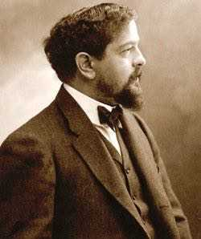
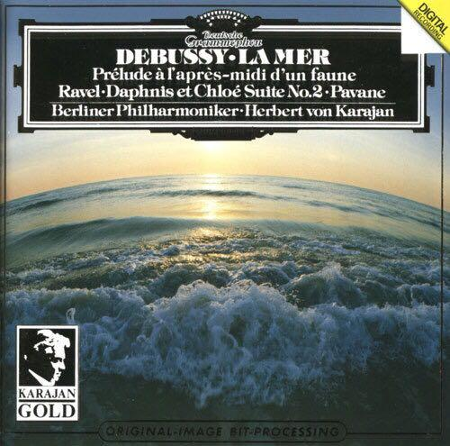
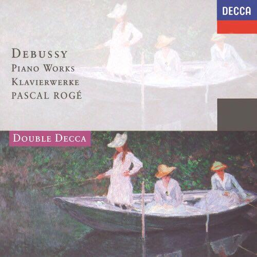
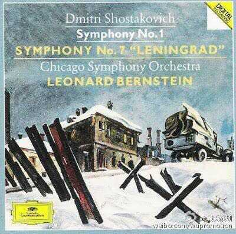

# 你听过哪些画面感极强的音乐？

**作者**：[陈子敏](http://www.zhihu.com/people/91949509989e39acc6e55e4216ac260b)

**原文**：https://www.zhihu.com/question/48058838/answer/108882421

**发布时间**：2016-07-01T23:28:45

**编辑时间**：2016-07-02T23:59:15

赞同 59 · 收藏 75 · 喜欢 17 · 评论 6

卸腰！

这个问题嘛 当然首推克劳德·德彪西

阿希尔-克劳德·德彪西（法语：Achille-Claude Debussy，1862年8月22日－1918年3月25日），法国人，是十九世纪末、二十世纪初欧洲音乐界颇具影响的作曲家、革新家，同时也是近代“印象主义”音乐的鼻祖，对欧美各国的音乐产生了深远的影响。

德彪西被称为印象派作曲家，首先就是因为他的音乐很有画面感，配合标题食用更佳。

比如交响诗《**大海**》

《牧神之午后前奏曲》以及钢琴作品《版画集》、《意象集》、《前奏曲》、《儿童园地》等，

其中所有分曲都是带标题的，是有指向的标题性作品。所以画面感爆表。

评论区提到《月光》，那是《Suite Bergamasque（贝加莫组曲）》里的第三分曲，因为其他乐章都不是标题音乐而是序曲、小步舞曲以及帕斯皮耶等舞曲，所以的确有必要单独说明。

—————————————————

最近超喜欢《**儿童园地**》！尤其是其中的《小牧童》。虽然标题有点匪夷所思找不到关联性，但是真的超好听啊，大概能让人联想到类似“风中飘零的落叶在水中点出漪涟”的画面来，标题用“落叶”什么的显然更适合。

  

再尔就是肖斯塔科维奇**C大调第七交响曲**《**列宁格勒**》。

第一乐章那个著名的“侵犯插部”就像伴随纳粹陆军前进的进行曲，经过十几个变奏，逐渐出现了坦克、飞机……

接下来介绍我的一生推

肖斯塔科维奇 **24首前奏曲与赋格**

e小调前奏曲

阴森、灰暗的傍晚。有种“目击众神死亡的草原上”的意境。频繁的转调、富有色彩的和声直击心灵。

（这首前奏曲推荐肖斯塔科维奇自己的演奏版本）
