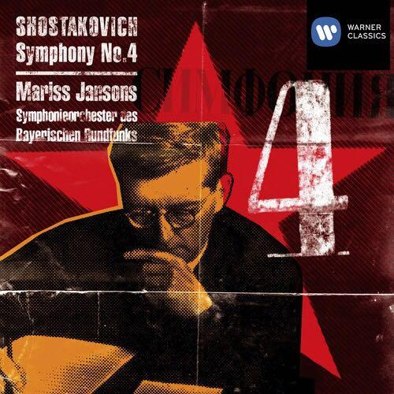
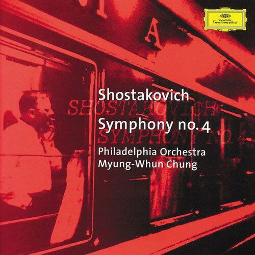
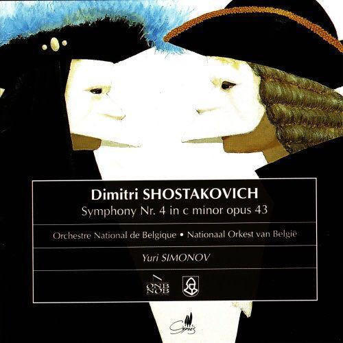
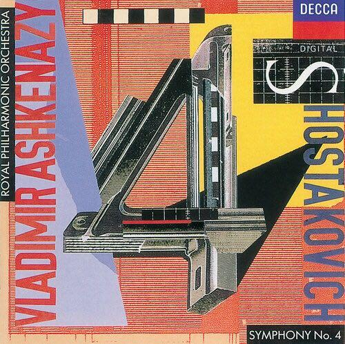

# 哪些音乐作品最好地传达了「恶魔」这一意象？

**作者**：[陈子敏](http://www.zhihu.com/people/91949509989e39acc6e55e4216ac260b)

**原文**：https://www.zhihu.com/question/20974042/answer/109334527

**发布时间**：2016-07-04T18:48:27

**编辑时间**：2020-08-14T18:53:02

赞同 56 · 收藏 66 · 喜欢 11 · 评论 5

**肖斯塔科维奇c小调第四交响曲 op.43**

**人类听觉最悲惨，最恐怖，最极限的体验都在这里了。**

三个乐章仿佛一座三层阿修罗炼狱。

最诡异的莫过于第一乐章展开部结束之后的定音鼓和铜管齐奏，渐强、渐强，仿佛整个宇宙的邪恶力量在无限放大步步逼近

……直到引出了恐怖的引子与再现部！

第三乐章是地狱的终点。荒诞、鬼魅、人类无法言喻的恐怖舞蹈。木琴伴随着诡异旋律就像人间恶人的奸笑，在地狱里则被放大成为骇人的、流着脓的巨型癞蛤蟆……

三个乐章全部高能
