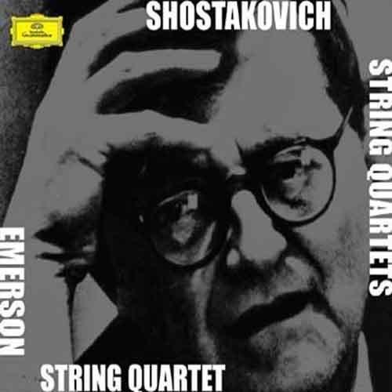
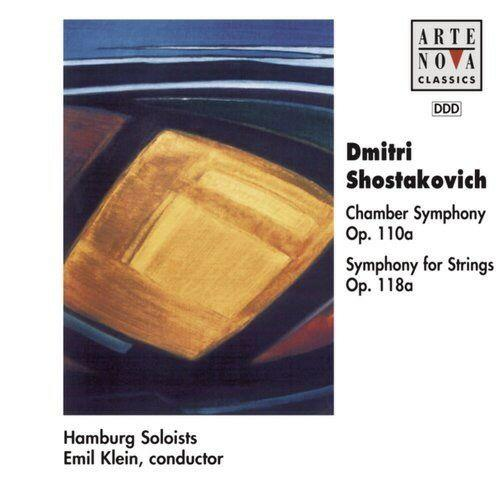

# 你听过哪些致郁系的古典音乐？

**作者**：[陈子敏](http://www.zhihu.com/people/91949509989e39acc6e55e4216ac260b)

**原文**：https://www.zhihu.com/question/49134445/answer/114446921

**发布时间**：2016-08-01T22:24:12

**编辑时间**：2018-07-06T15:56:35

赞同 72 · 收藏 60 · 喜欢 14 · 评论 27

敬告：此曲初听可能令您感到不适。  
肖斯塔科维奇c小调第八弦乐四重奏

作品op.110

就像垂死之人最后的心跳
