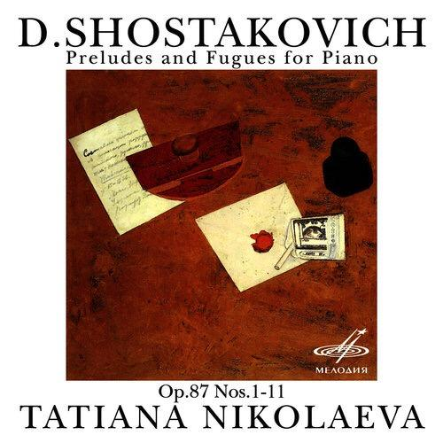
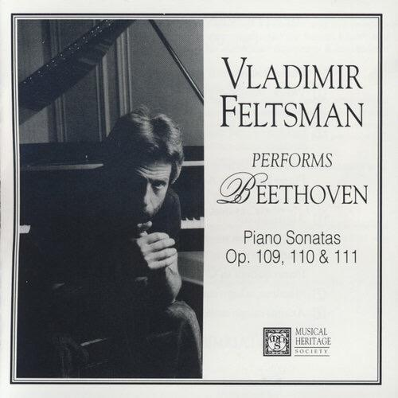
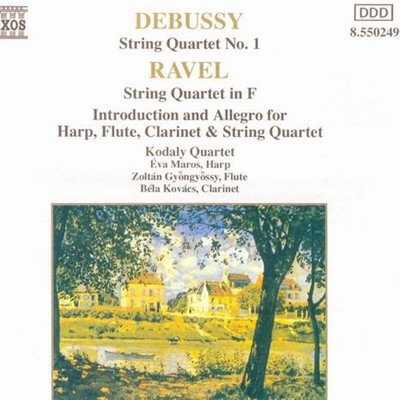
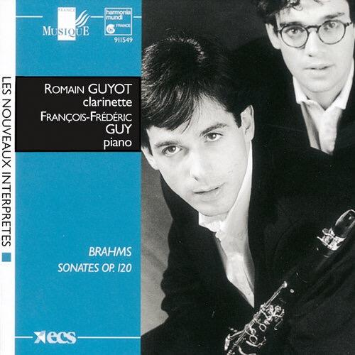

# 求推荐一些【甜过初恋】的古典音乐?

**作者**：[陈子敏](http://www.zhihu.com/people/91949509989e39acc6e55e4216ac260b)

**原文**：https://www.zhihu.com/question/49166362/answer/114610922

**发布时间**：2016-08-02T19:37:53

**编辑时间**：2016-08-03T09:04:03

赞同 6 · 收藏 18 · 喜欢 4 · 评论 6

肖斯塔科维奇

24 prelude and fugue op.87

24首前奏曲与赋格

F大调第23首

  

一定会喜欢上的。

  

呃，再举几个。

贝多芬

piano sonata in E major no.30 op.109

E大调第30钢琴奏鸣曲

  

这真是真正意义上的甜过初恋。

拉威尔

string quartet in F major

F大调弦乐四重奏

  
  

你们自己感受下。

  

呃还有！

勃拉姆斯

clarinet sonata in bE major，op.120 no.2

降E大调单簧管奏鸣曲

