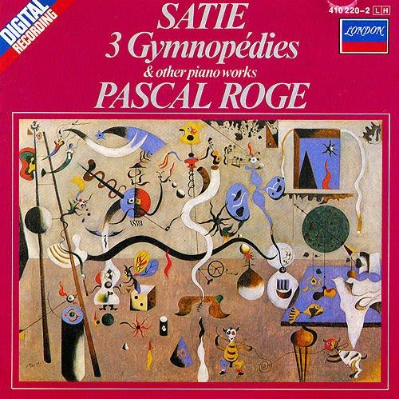
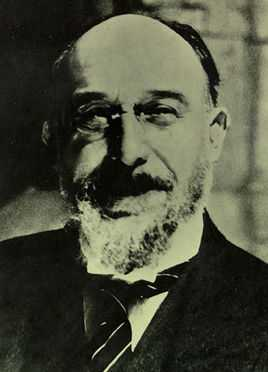
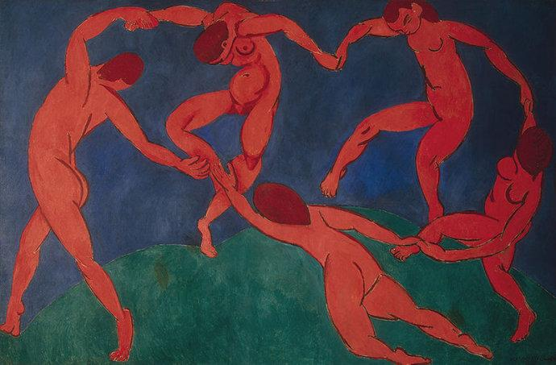

# 有哪些第一次知道名字的古典音乐的旋律一响起就有种"哦，原来是这首曲子"的感觉?

**作者**：[陈子敏](http://www.zhihu.com/people/91949509989e39acc6e55e4216ac260b)

**原文**：https://www.zhihu.com/question/53695628/answer/137345112

**发布时间**：2016-12-23T22:09:30

**编辑时间**：2018-01-18T02:24:27

赞同 37 · 收藏 35 · 喜欢 12 · 评论 11

有一首曲子，你们所有人一定都听过！

它的名字叫《裸体舞曲》

在了解这首曲子的具体信息之前，广大的单反文青恐怕就已经在无数书店、咖啡厅等各大文艺场所，或在各种New age钢琴曲歌单里听过这首曲子了吧。缓慢的三拍子、空灵的和声、随心而起的旋律，仿佛可以看到天空与街道、微风缓缓拂过绿叶…的确适合文艺青年赋闲时小酌一杯陶冶情操呢。

<http://music.163.com/#/m/song?id=22540895&userid=371326226>

*（萨蒂-《裸体舞曲》第一首-网易云音乐在线试听地址）*

它由19世纪末法国作曲家埃里克·萨蒂于1888年创作，一共分三首，其中以第一首最为著名。

> 这是一组由三首小曲组成的套曲，演奏时间总共也只有7分多钟。曲名原是指古希腊裸体男子所跳的一种仪式舞蹈，据萨蒂自己说是他当时读了法国作家福楼拜的《萨朗波》产生灵感而作的。乐曲优美而神秘、柔和而惆怅的意境恍如将听者带到广袤的荒野，躺在松软的草地上仰望着神秘的夏夜星空。1889至1897年创作的6首《玄秘曲》（Gnossiennes)被看成是《裸体舞曲》的姐妹篇，音乐空灵清澄，颇具东方色彩，技法也更体现出萨蒂的创新精神，节拍号和小节线的消失模糊了旋律行进中的节奏。使音乐显得飘忽与不稳而更具流动性。

至于萨蒂为什么要把他的这几首钢琴曲取名为《裸体歌舞》，后人们也是众说纷纭。有人说是他受了特拉托诗的启发，有人说是出自他古怪的习性，而给与他的曲子一个古怪的曲名。可是，不管怎么样，有一点是可以肯定的：诗人康特明·特拉托（J.P. Comtamine de Latour）曾写过一首名为《古人》的诗，其中确实有这样的诗句：

> 斜影切磋轻拍隐约成旋涡，
>
> 点滴成金色的风在闪亮的青石板路上飘过，
>
> 琥珀的微尘在烈火中相互辉映，
>
> 它们让自己在萨拉班蒂和裸舞中交汇。

*以上部分转自百度百科和*[萨蒂钢琴曲《裸体歌舞》中的诗意禅境\_明明\_新浪博客](http://blog.sina.com.cn/s/blog_5923c0940102ef5r.html)
