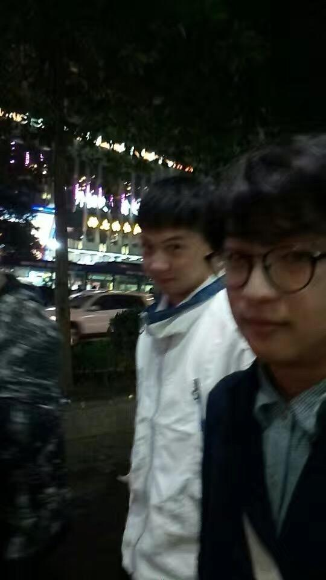
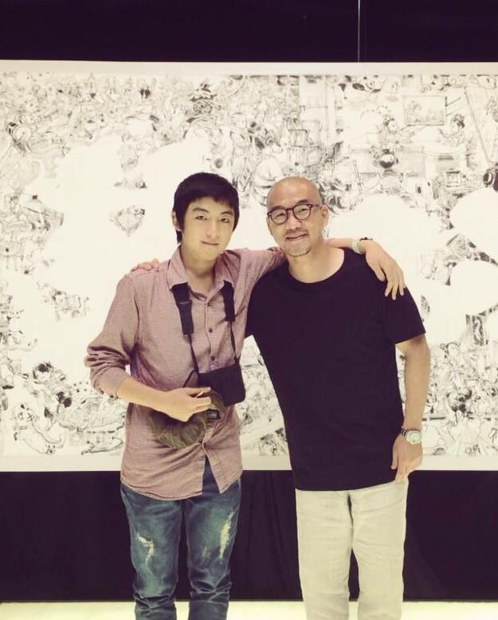
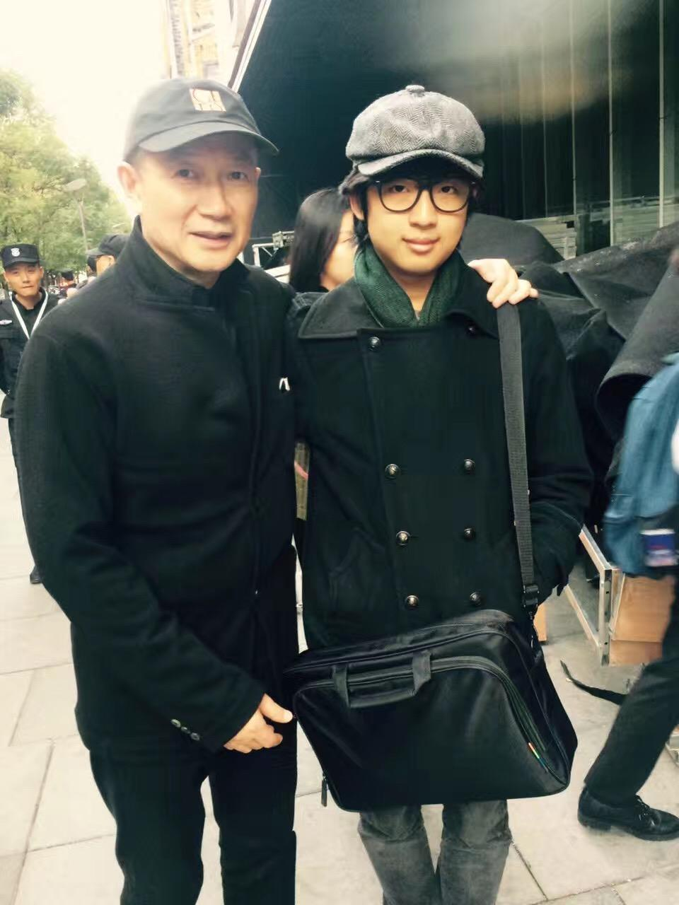

# 搞古典作曲长的帅或漂亮是一种怎么样的体验？

**作者**：[陈子敏](http://www.zhihu.com/people/91949509989e39acc6e55e4216ac260b)

**原文**：https://www.zhihu.com/question/58241247/answer/169470271

**发布时间**：2017-05-14T23:54:23

**编辑时间**：2018-06-26T01:35:00

赞同 5 · 收藏 1 · 喜欢 2 · 评论 15

谢[@半璧](https://www.zhihu.com/people/e352b1c4c5a784d98f4ac81093818110)老师邀，  
我现在好像形成了看到问题日志里的“匿名用户”就自然而然感觉是半璧老师的直觉了。

体验就是，搞古典作曲需要的不是颜值。有点颜值，对作曲老师而言是打压你膨胀自尊心的一个重要依据。当然我颜值并不高就是了。

不就是骗照么？

从颜值和作曲水平角度跟谭盾老师相比真的不及万分之一。
