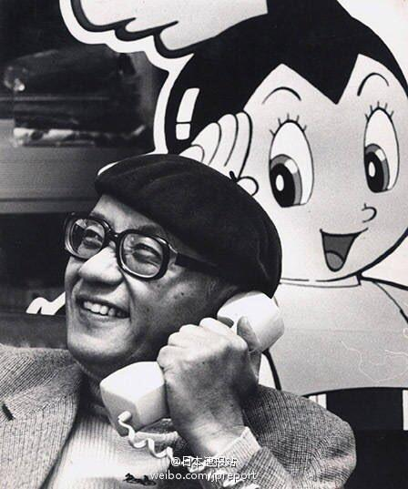
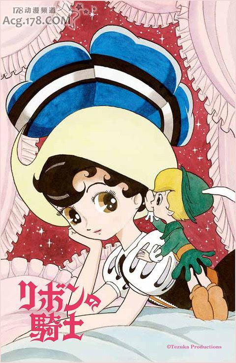
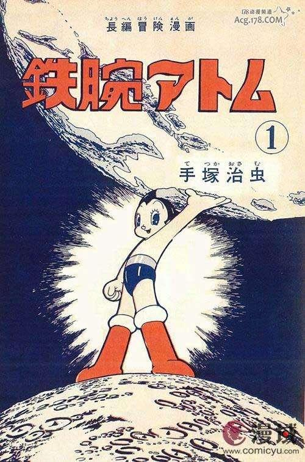
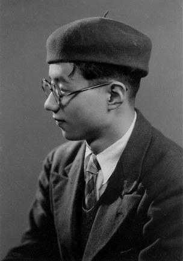
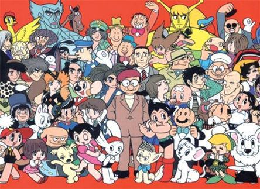
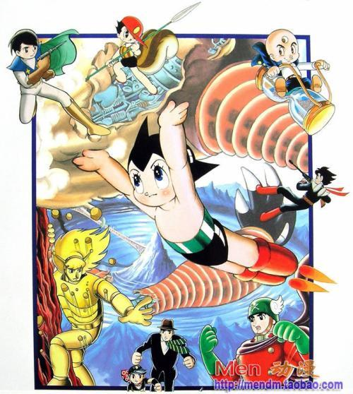

# 你认为最伟大的日本人是谁？有哪些原因？

**作者**：[陈子敏](http://www.zhihu.com/people/91949509989e39acc6e55e4216ac260b)

**原文**：https://www.zhihu.com/question/63195306/answer/208315831

**发布时间**：2017-08-03T23:02:27

**编辑时间**：2020-09-02T02:47:07

赞同 12 · 收藏 2 · 喜欢 1 · 评论 2

手冢治虫。

大众对他的“伟大”仅有一种神坛上不可亵渎的模糊的概念，为此需要清楚对列举出他的主要成就：

他奠定了整个日本漫画艺术形式的基础，也是推动日本漫画工业化最大推手，他首次在漫画创作中导入了助手制度。

他创作了近七百部漫画作品，其中有被公认为现代漫画起点的《新宝岛》、《SF三部曲》、第一部少女漫画《缎带骑士》、第一部医学漫画《桐人传奇》、第一部获得商业成功的医学漫画《怪医黑杰克》。还有最杰出的历史题材漫画《昭告阿道夫》，以及被誉为日本漫画顶点的《火之鸟》。

他的创作成功扭转了社会对漫画“有害图书”的偏见，他在早期积极与漫画家联合对陈腐的PTA进行上书抗议与斗争。

他同时也是日本动画工业最重要的几个建立者之一，在他的主导下，制作了日本第一部电视动画《铁臂阿童木》、第一部剧场版动画《森林大帝》（并在威尼斯电影节斩获圣马克银狮奖），第一部成人动画电影《千夜一夜物语》、第一个长篇tv动画特辑《熊猫book：一百万年地球之旅》，也留下了评价极高的十三部实验动画。他在一些独立动画作品（如《千夜一夜物语》、《埃及艳后》、《街角物语》、《展览会之绘》等）里大胆使用意识流与跨媒介手段，使动画变成了一种具有无限可能性的形式的大狂欢。

日本蓬勃发展至今的电视动画由他奠基，许多当时对低成本条件的妥协手段成功使日本商业动画得以在艰难的环境下也能催生一大批作品，久经考验不断发展，许多手段成为惯例。

毫不夸张的说，他以一己之力构建了几乎整个战后日本的精神文明，形成了强力的、至今具有旺盛生命力的日本文化奇迹。他为全日本的少年儿童创造了天马行空的梦想与快乐。

这个答案应该能够满足“最伟大的日本人”的所有严苛标准。
