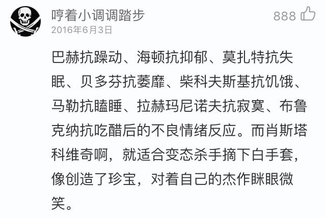

# 网易云音乐有哪些「尬到脸酸」的热评？

**作者**：[陈子敏](http://www.zhihu.com/people/91949509989e39acc6e55e4216ac260b)

**原文**：https://www.zhihu.com/question/62908408/answer/208336051

**发布时间**：2017-08-03T23:41:38

**编辑时间**：2017-09-03T11:01:24

赞同 99 · 收藏 8 · 喜欢 10 · 评论 27

交响乐评论区下言必称《猫和老鼠》；

  

还有那些在古典音乐评论区给每个乐章做阅读理解题的。

——————

评论区有人说要图，这样吧给你们看个文章。

[@马介甫](https://www.zhihu.com/people/abe1ee7e403dd0417a6b5cf93f97a9b9)  

<https://zhuanlan.zhihu.com/p/25558472>

——————

其实我觉得最尴尬的莫过于刷这条评论了，你几乎可以在所有热门古典单曲下看到这类评论，真的太贻笑大方了。

  

——————
