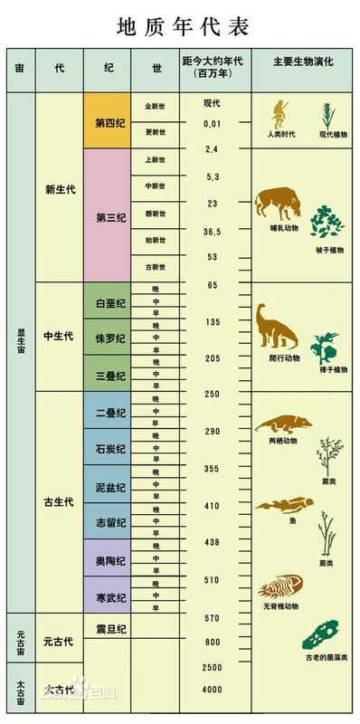

# 没文化可以有多可怕？

**作者**：[陈子敏](http://www.zhihu.com/people/91949509989e39acc6e55e4216ac260b)

**原文**：https://www.zhihu.com/question/26192324/answer/248635339

**发布时间**：2017-10-23T09:58:25

**编辑时间**：2018-06-05T06:03:24

赞同 15 · 收藏 2 · 喜欢 1 · 评论 5

2017年6月28日新浪新闻：  
《女孩有前十世记忆，诡异关键证据令人毛骨悚然》

> **女孩的'第一世'是2亿年前，她负责挖洞穴，甚至还记得被恐龙追的细节，还把骨头和石头制造的器具留在当时的洞穴里**

…………

？？？  
来来来我们重新复习一下地质年表和初中历史课：

**三叠纪**（英语：Triassic）是公元前2.5亿至2亿年的一个地质时代，它位于二叠纪和侏罗纪之间，是中生代的第一个纪。（百度百科）

**……**  
  
**旧石器时代**（Paleolithic；距今约300万年～距今约1万年），以使用打制石器（见石器）为标志的人类物质文化发展阶段。地质时代属于上新世晚期更新世[1]，从距今约300万年前开始，延续到距今1万年左右止。（百度百科）

……  
早期哺乳类才刚刚出现的时候你就超英赶美提前进入石器时代了

上来就直接一个二亿会不会太暴力了，先数一数有几个零啊……

不过三叠纪有两栖爬行类动物倒是真的，那这个新闻就很值得玩味了（逃
