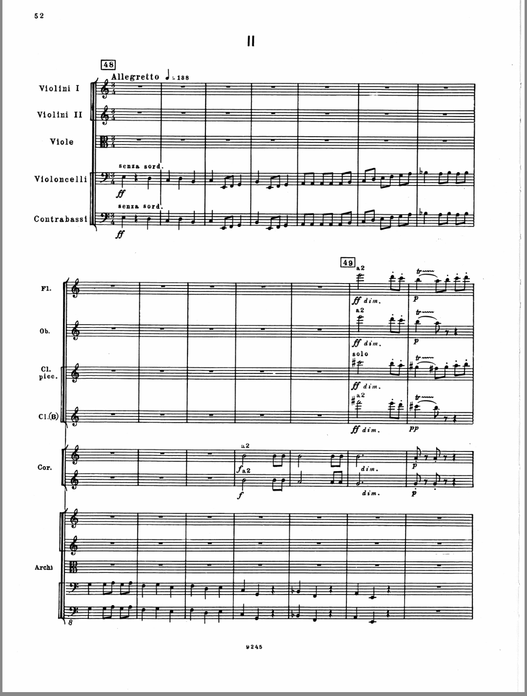
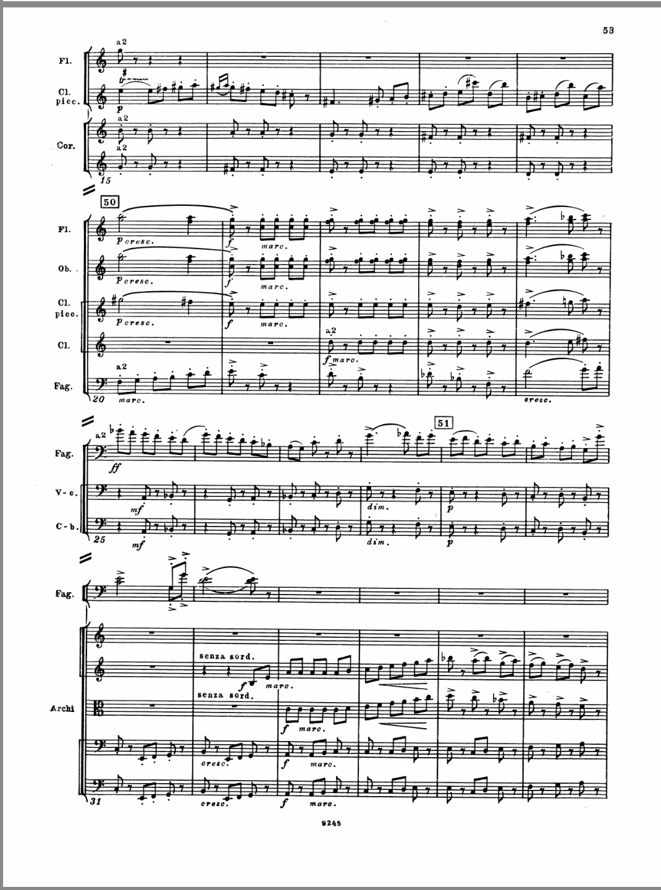
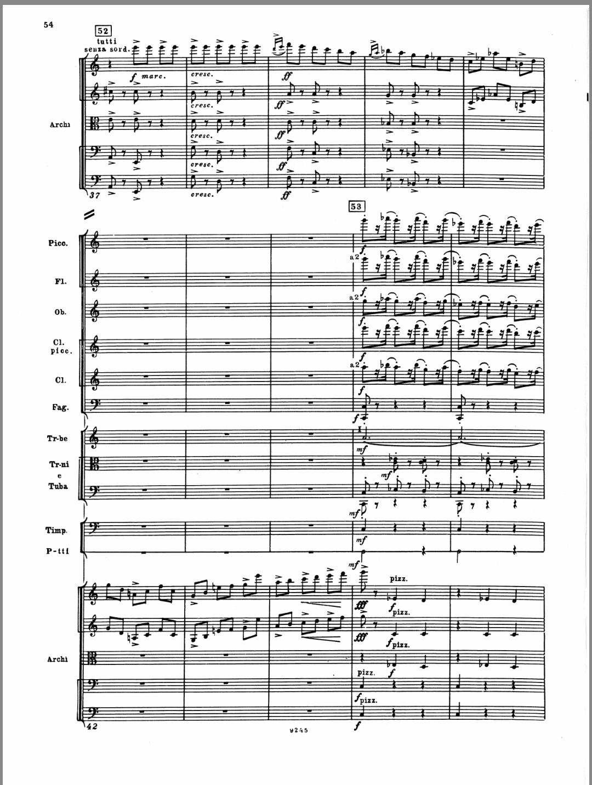
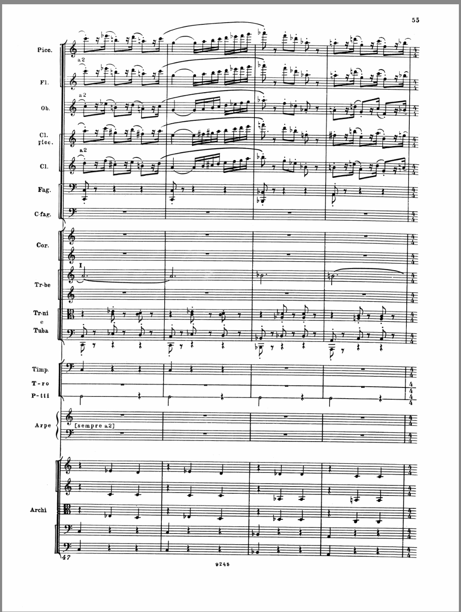
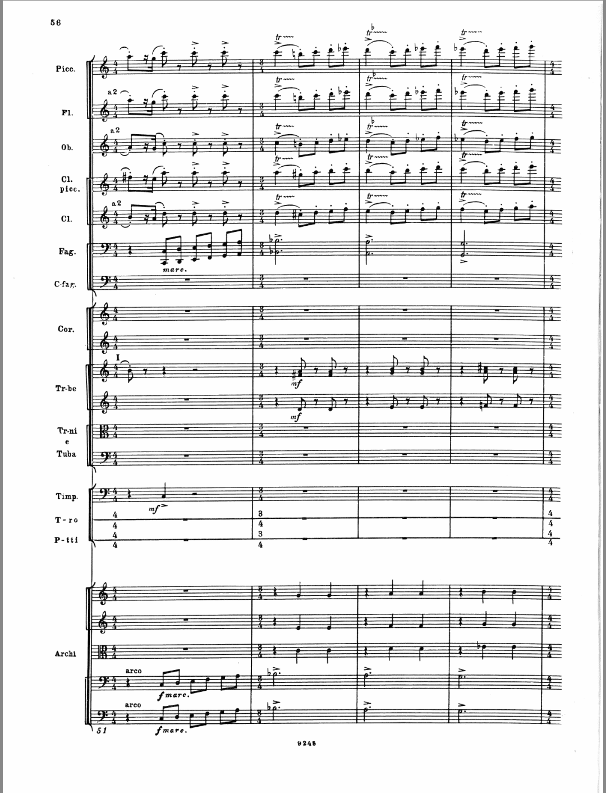
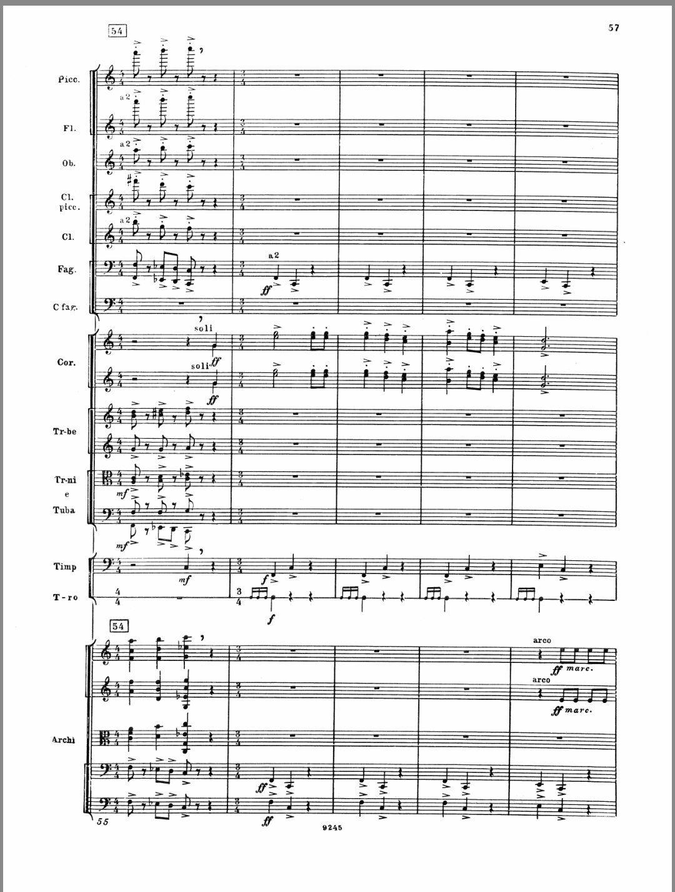
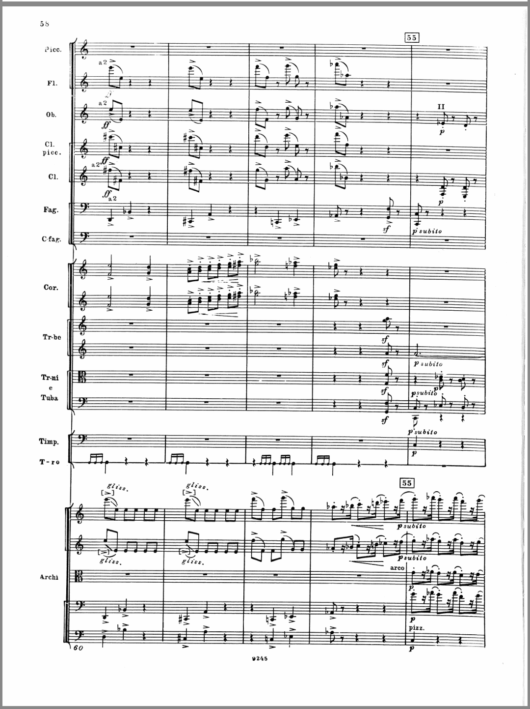
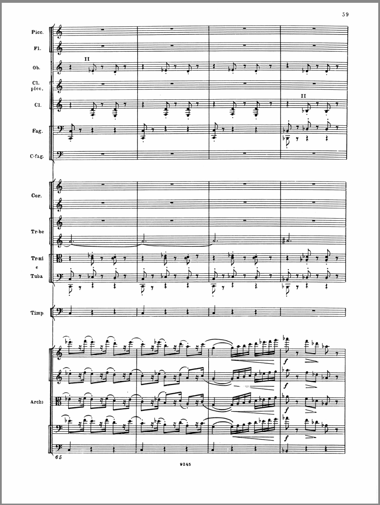
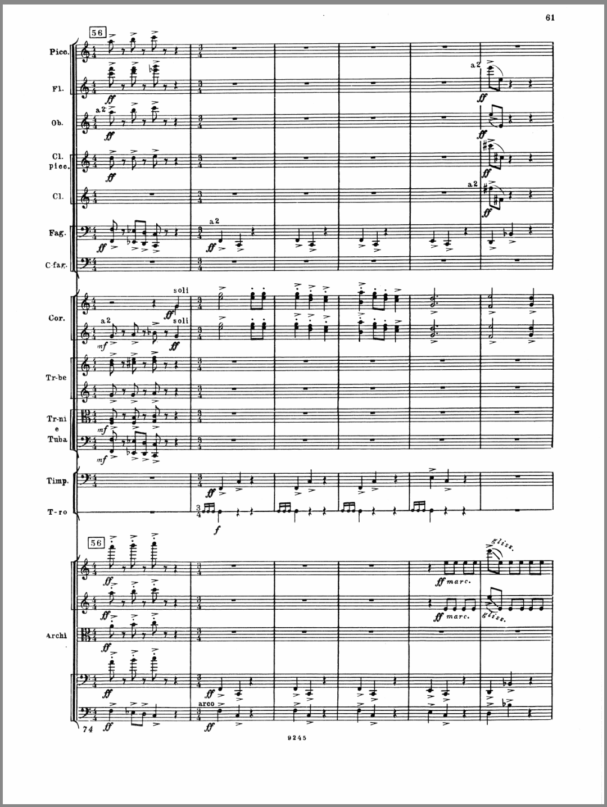
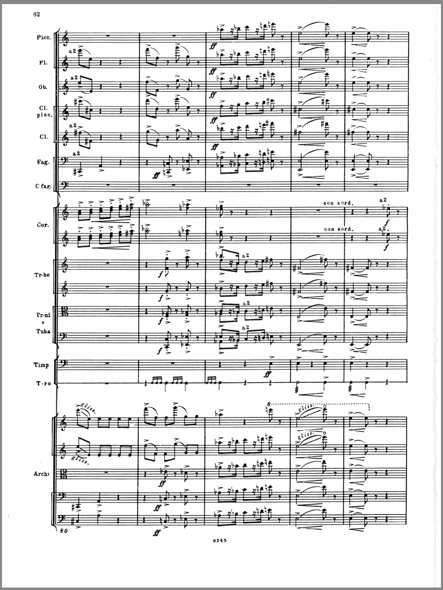

# 有什么交响曲乐章适合跳舞？

**作者**：[陈子敏](http://www.zhihu.com/people/91949509989e39acc6e55e4216ac260b)

**原文**：https://www.zhihu.com/question/269065613/answer/345176838

**发布时间**：2018-03-19T11:20:19

**编辑时间**：2018-03-20T20:43:18

赞同 3 · 收藏 0 · 喜欢 0 · 评论 4

谢邀。

肖斯塔科维奇

d小调第五交响曲第二乐章

————————————————————————————

评论区某位朋友称该乐章是五拍子，质疑其该怎么跳。

那么我们来列一下总谱：

纵观整个谐谑曲乐章，并没有发现有任何五拍子的段落。
