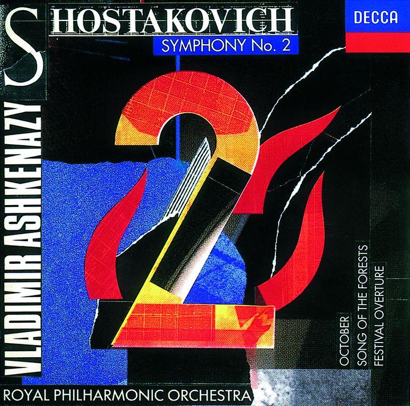
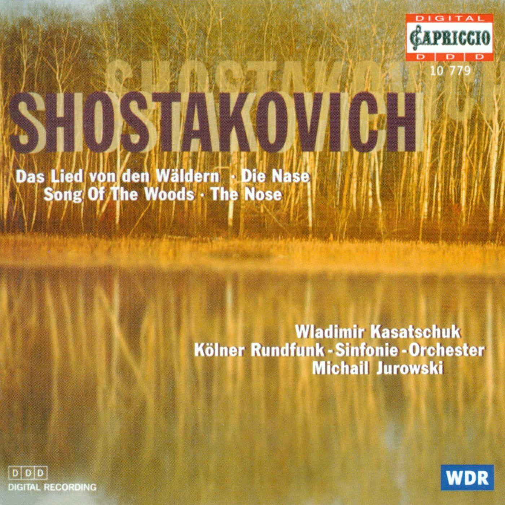
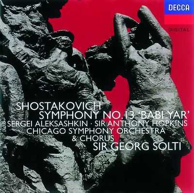
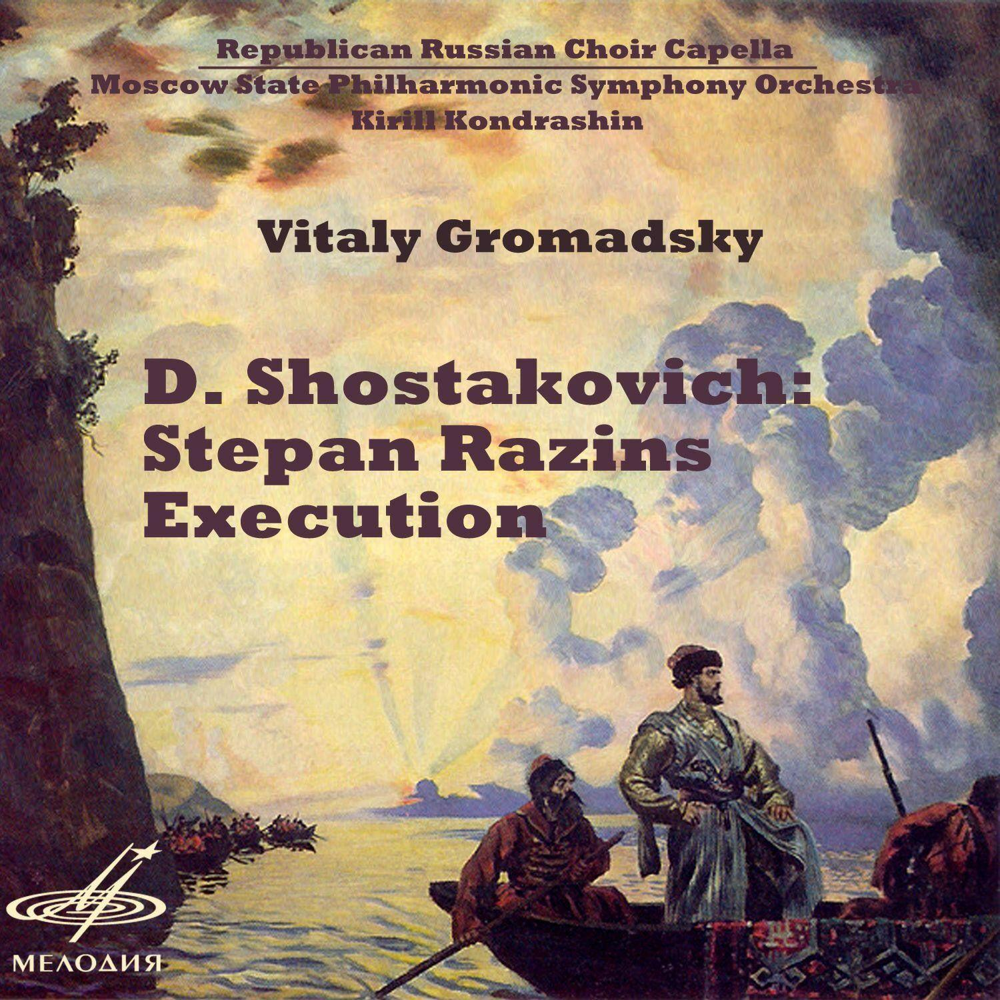

# 有哪些值得一听的合唱作品？

**作者**：[陈子敏](http://www.zhihu.com/people/91949509989e39acc6e55e4216ac260b)

**原文**：https://www.zhihu.com/question/269536588/answer/348904316

**发布时间**：2018-03-23T20:41:41

**编辑时间**：2018-04-28T17:05:05

赞同 78 · 收藏 82 · 喜欢 13 · 评论 5

那么这版我专门介绍一下肖斯塔科维奇的合唱作品：

清唱剧**《森林之歌》，op.81**

分享Brighton Festival Chorus/Royal Philharmonic Orchestra/Vladimir Ashkenazy的单曲《Shostakovich: Song of the Forests - Oratorio, Op.81 - 5. The young Communists forge onwards》: <http://music.163.com/song/472839732/?userid=371326226> (来自@网易云音乐)

清唱剧**《阳光照耀在祖国的土地上》，op.90**

分享Cologne Radio Children's Chorus的单曲《Uber unserer Heimat strahlt die Sonne, Op. 90》: <http://music.163.com/song/465633116/?userid=371326226> (来自@网易云音乐)

**降b小调第十三交响曲“娘子谷”，op.113**

分享USSR State Symphony Orchestra/Yevgeny Mravinsky/Evgeny Svetlanov/Moscow Philharmonic Orchestra的单曲《Symphony No. 13 in B-Flat Minor, Op. 113 "Babi Yar": II. Humour》: <http://music.163.com/song/445666428/?userid=371326226> (来自@网易云音乐)

参考[@Mschoom](https://www.zhihu.com/people/28f221c2b42f9d0ed954f8086359c997)的意见挑了他最满意的svetlanov指挥苏联国家交响乐团的录音版本，恢弘大气，尤其打击组的音响更是震撼人心。不过权衡各种原因还是换了一个solti指挥版本的封面，理由是好看（真的不是因为什么其他原因）。

清唱剧：**《斯捷潘·拉辛的死刑》**

分享Kirill Kondrashin/Moscow State Philharmonic Symphony Orchestra/Dmitri Shostakovich/Vitaly Gromadsky/Republican Russian Choir Capella的单曲《The Execution of Stepan Razin, Op. 119》: <http://music.163.com/song/532450778/?userid=371326226> (来自@网易云音乐)

