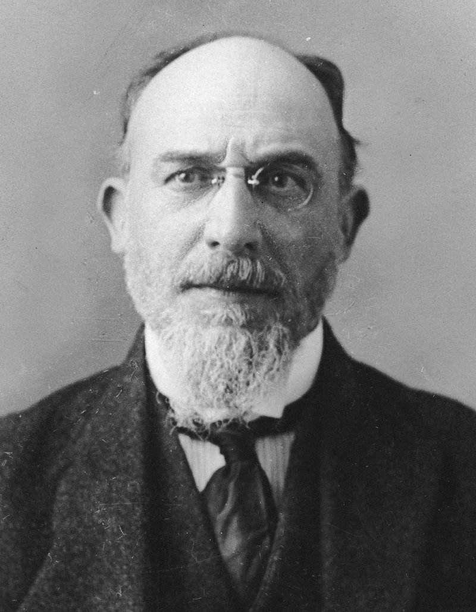
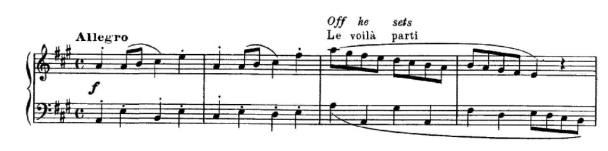
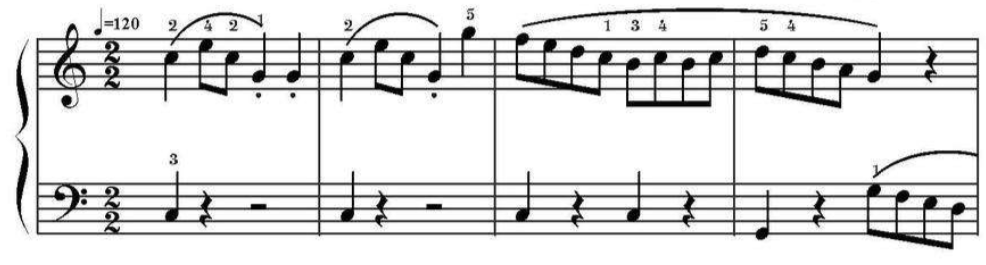

# 如何学习并仿写作曲家的作品（严肃音乐）？

**作者**：[陈子敏](http://www.zhihu.com/people/91949509989e39acc6e55e4216ac260b)

**原文**：https://www.zhihu.com/question/270074451/answer/352219169

**发布时间**：2018-03-28T00:42:48

**编辑时间**：2018-12-23T19:15:00

赞同 7 · 收藏 7 · 喜欢 2 · 评论 0

埃瑞克·萨蒂:《官僚小奏鸣曲》（sonatine bureaucratique）

埃瑞克·萨蒂

萨蒂于1916年创作的《官僚小奏鸣曲》是基于穆齐奥·克列门蒂（Muzio Clementi）的C大调小奏鸣曲（oo.36,no.1）仿写而成:

萨蒂:《官僚小奏鸣曲》前四小节

分享Aldo Ciccolini的单曲《Sonatine bureaucratique (1917) (2000 Digital Remaster): Allegro - Andante - Vivace》: <http://music.163.com/song/22543932/?userid=371326226> (来自@网易云音乐)

而该曲原版几乎所有琴童耳熟能详，心有余悸。由于简单流畅，适合初学者练习，是钢琴教师们的最爱:

克列门蒂:C大调小奏鸣曲前四小节

分享Jacques Miroe的单曲《Sonatina in C Major, Op. 36 No. 1: I. Spiritoso》: <http://music.163.com/song/444581954/?userid=371326226> (来自@网易云音乐)

萨蒂的钢琴小品总是灵巧动听，却又充满荒诞俏皮的讽刺。在魔改该曲的同时，也许怀有对刻板钢琴训练的深深怨念吧。
