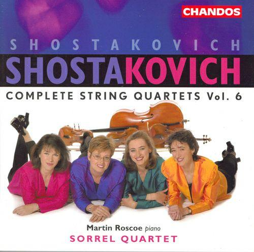

# 有什么古典音乐让你有春天的感觉？

**作者**：[陈子敏](http://www.zhihu.com/people/91949509989e39acc6e55e4216ac260b)

**原文**：https://www.zhihu.com/question/272201281/answer/366056326

**发布时间**：2018-04-13T18:42:21

**编辑时间**：2018-04-13T19:13:10

赞同 8 · 收藏 1 · 喜欢 0 · 评论 0

谢邀！

肖斯塔科维奇C大调第一弦乐四重奏，op.49

哦，标题是“春天”。

分享Sorrel String Quartet的单曲《String Quartet No. 1 in C Major, Op. 49: I. Moderato》: <http://music.163.com/song/546333731/?userid=371326226> (来自@网易云音乐)
