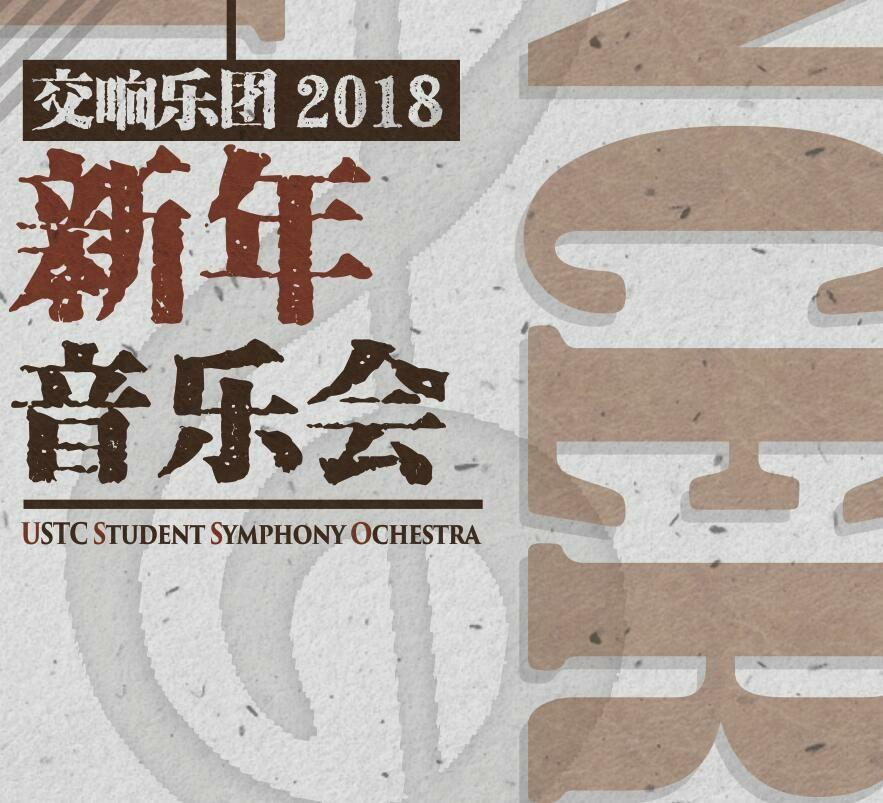
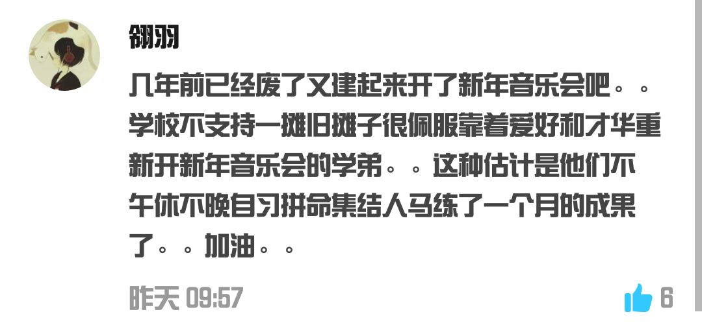

# 你听过哪些令人尴尬的古典音乐？

**作者**：[陈子敏](http://www.zhihu.com/people/91949509989e39acc6e55e4216ac260b)

**原文**：https://www.zhihu.com/question/272248661/answer/366385254

**发布时间**：2018-04-14T06:04:26

**编辑时间**：2018-06-09T12:14:13

赞同 57 · 收藏 26 · 喜欢 6 · 评论 20

谢邀，

请问这个问题可不可以延伸至“令人尴尬的古典音乐的演绎”？

直接上链接

中国科学技术大学学生交响乐团演绎肖斯塔科维奇第二圆舞曲：

<http://music.163.com/song/526682217/?userid=371326226>

尴尬的有点可爱。

仿佛听到了濒临废部的京吹部（？），业余乐队倒也不能强求了。

——————————————————————————

评论区有朋友解释了一下大体情况，之所以演奏成这样有其难言之隐：

感觉仿佛就是活生生的京吹部……不容易呀
