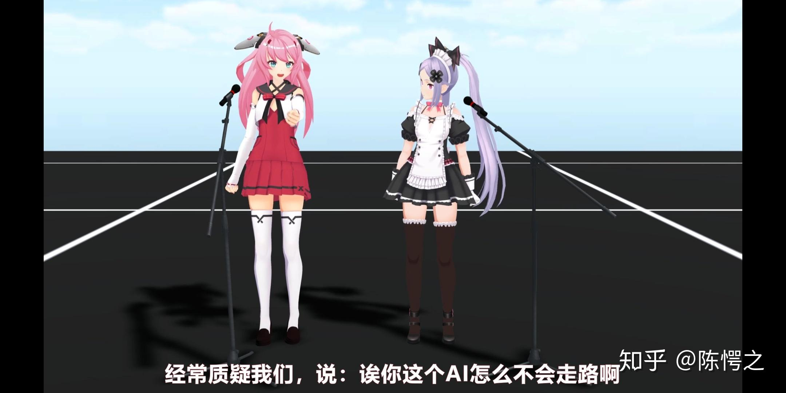

# 如何评价虚拟up主@虚拟次元的小希？

**作者**：[陈子敏](http://www.zhihu.com/people/91949509989e39acc6e55e4216ac260b)

**原文**：https://www.zhihu.com/question/64079932/answer/413604807

**发布时间**：2018-06-09T20:53:09

**编辑时间**：2018-07-03T11:31:48

赞同 11 · 收藏 0 · 喜欢 0 · 评论 8

客观评价。

模型很好，配音也相当动听。

文案方面，是迄今包括b站、n站、youtube在内的所有知名中英法日西俄vtuber、虚拟up主里最强的一个没有之一。（或许老鸨一家可以一战）

美中不足的是动捕技术方面不尽人意，角色不能随意行走；

而且早期团队人数较少工作量太大更新速度慢。现在团队扩充已经基本达成一周二更。

至于说到“跟风”甚至抄袭，请不要笑死人好吗。四天王以及全球近八百位虚拟youtuber不知道可以了解一下。siro，狐娘大叔，马叔等都比小希早，谁指责过他们“跟风”、抄袭？看到中国出了一个自己的就一个个高潮的不行，不经大脑就急得跳脚大喊抄袭，连行情都不清楚就来妄加评论，要不要再贻笑大方一点？
