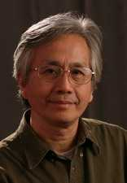

# 中国当代有哪些水平较高的电影或者动画作曲家？

**作者**：[陈子敏](http://www.zhihu.com/people/91949509989e39acc6e55e4216ac260b)

**原文**：https://www.zhihu.com/question/39251283/answer/468178020

**发布时间**：2018-08-13T20:48:40

**编辑时间**：2018-08-13T20:48:48

赞同 3 · 收藏 6 · 喜欢 2 · 评论 0

**金复载。**

曾经上海美术电影制片厂的第一配乐大师，曾为无数经典作品作曲。

而抛开动画不谈，其创作的音乐本身水平也达到了惊人的高度，作曲技术上展示了天才般的技巧，完全可以作为单独的音乐作品欣赏。早在1973年为严定宪执导的动画《小号手》创作的配乐里他就展示了非同凡响的才华，《哪吒闹海》、《雪孩子》和《宝莲灯》里技巧精湛震撼人心的配乐至今听到都会引起惊叹和感动。想起当年我看《哪吒闹海》哪吒含泪自刎一幕就为那感人至深的音乐潸然泪下，至今不能忘怀。

先生现已年过古稀，依然神采奕奕，活跃于各类教学与社会活动，希望金老师能够保持旺盛精力继续创作更加杰出的作品。

