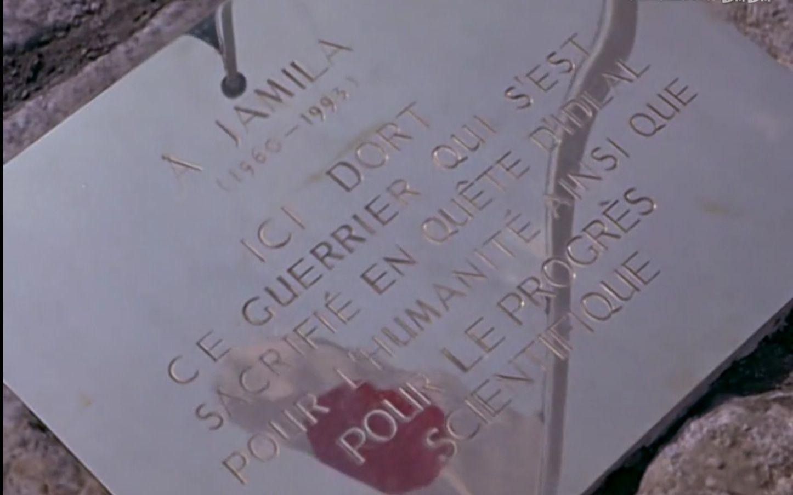
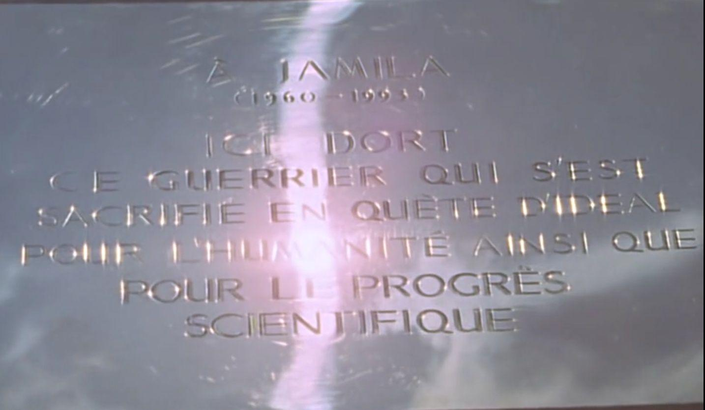

# 有哪些科幻作品中设定的事件发生时间已经过去了？

**作者**：[陈子敏](http://www.zhihu.com/people/91949509989e39acc6e55e4216ac260b)

**原文**：https://www.zhihu.com/question/60253584/answer/486220587

**发布时间**：2018-09-06T02:17:25

**编辑时间**：2018-09-06T02:19:40

赞同 13 · 收藏 1 · 喜欢 1 · 评论 1

《初代奥特曼》，1966年，

其中贾米拉死于1993年。

幸运的是，现实中的1993年，比《奥特曼》中设想的好太多了。
