# 电影或动画中暴力动作场面配古典音乐是怎样一种艺术风格？

**作者**：[陈子敏](http://www.zhihu.com/people/91949509989e39acc6e55e4216ac260b)

**原文**：https://www.zhihu.com/question/24488993/answer/521066127

**发布时间**：2018-10-30T06:11:18

**编辑时间**：2021-03-22T23:35:17

赞同 201 · 收藏 147 · 喜欢 41 · 评论 31

谢邀。

这种手法在电影学中称为“音画对比”，是音画对位（Counterpoint）的一种。

其中也包含“**音画对立**”。

最初这种手法是由苏联电影导演、演员、电影理论家费谢沃罗德·普多夫金（1893-1953）于1928年在《未来的有声电影》中所提出。

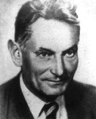

他首次将“对位”概念引入电影理论，并于1933年在电影《逃兵》中实验成功并大放异彩。而在当时，同样主张“音画对位”的电影导演还有谢尔盖·爱森斯坦、格里高利·亚历山德罗夫。

后来，将这种艺术风格成熟化并发扬光大的电影导演，首推**斯坦利·库布里克**。

在库布里克1956年执导的《杀手》中，“音画对立”的手段初见端倪。

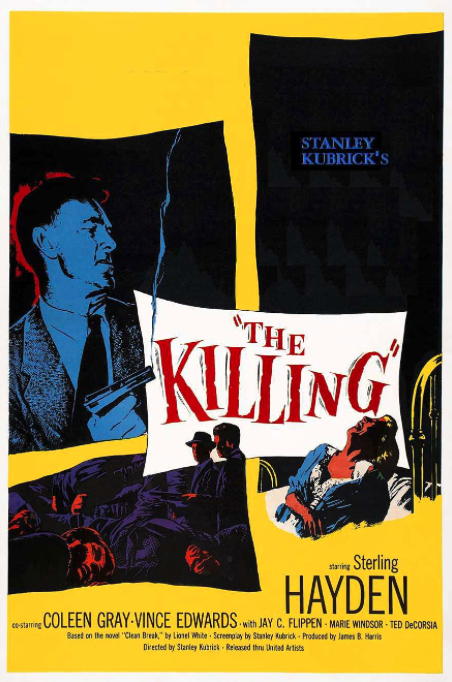

《杀手》（1956）

在男配角中枪回到公寓一幕，

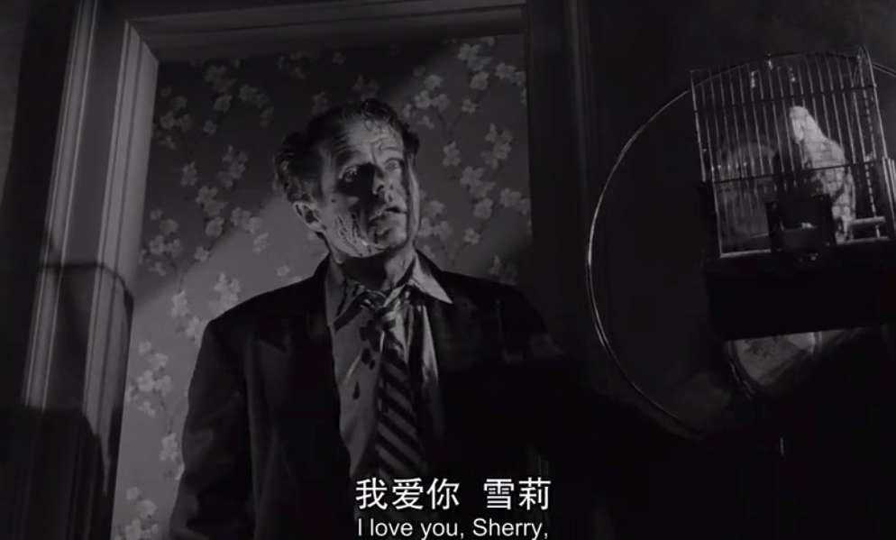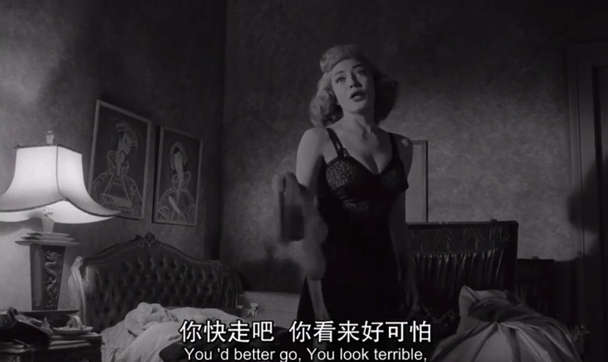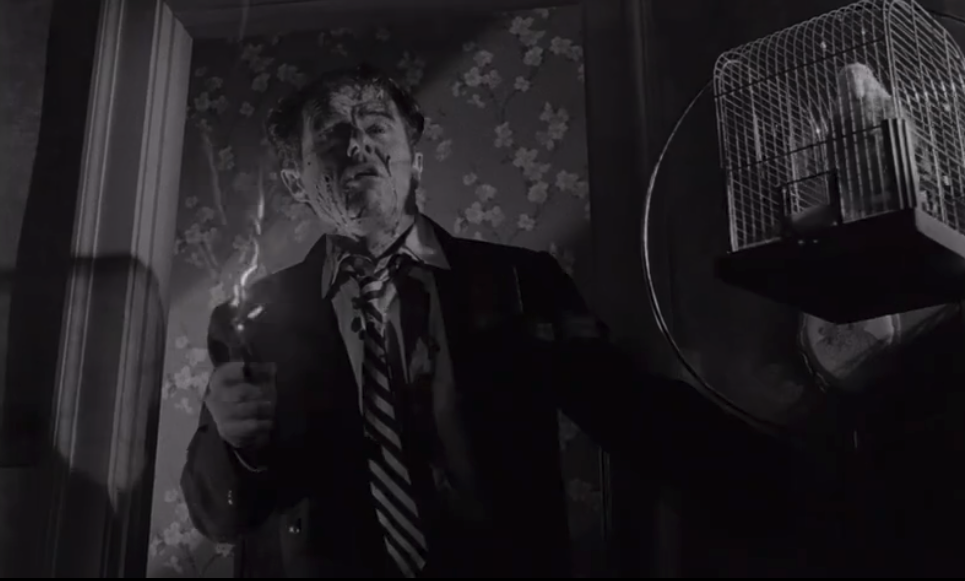

因为被情人抛弃男子绝望到了极点，在开枪射杀了他的情人后，男子与鸟笼一起倒下。

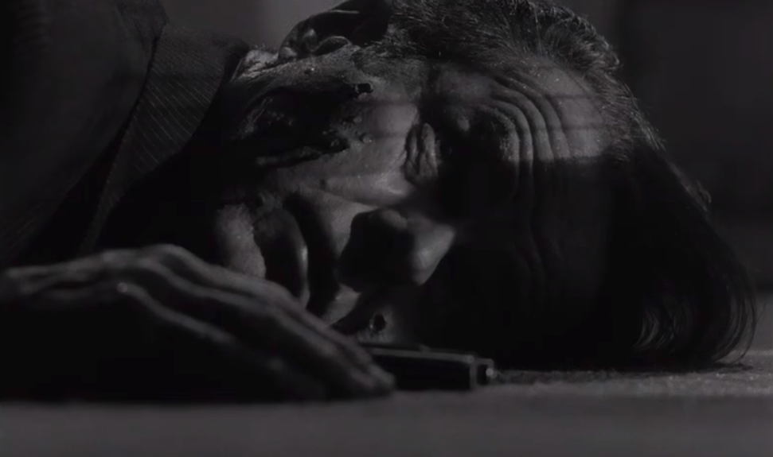

奥尔加

此时的背景音乐是收音机里诙谐而俏皮的爵士萨克斯solo。

与情节悲惨、绝望的基调所迥异的爵士音乐使这段画面极具表现力。这也许是库布里克逐渐走向“残忍的黑色幽默”的第一步。

而在1963年的《**奇爱博士**》中，这种手法则更加疯狂。

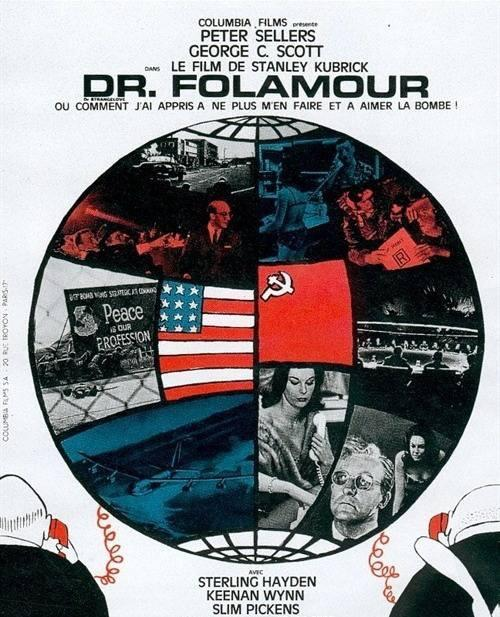

《奇爱博士》（1963）

在影片结尾，地球上的所有核弹同时爆炸，世界末日最终来临，这时音乐响起《**we‘ll meet again**》（我们还会再相遇）。

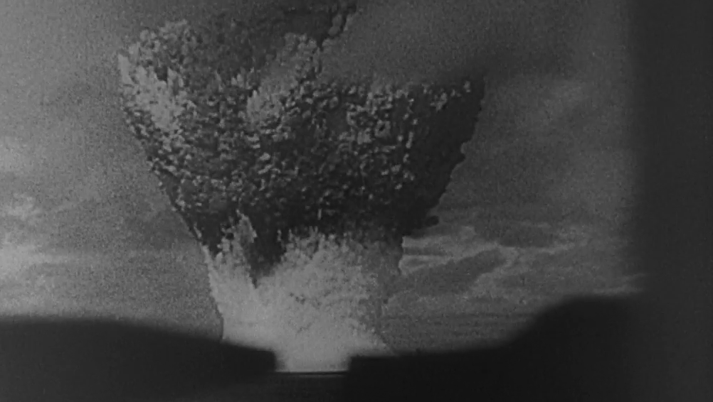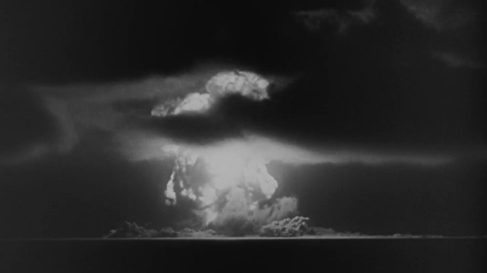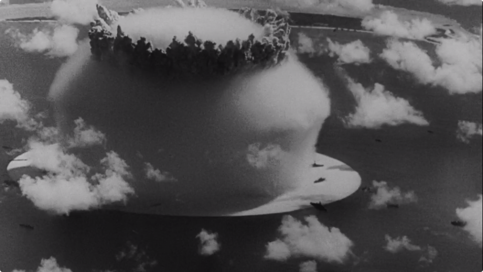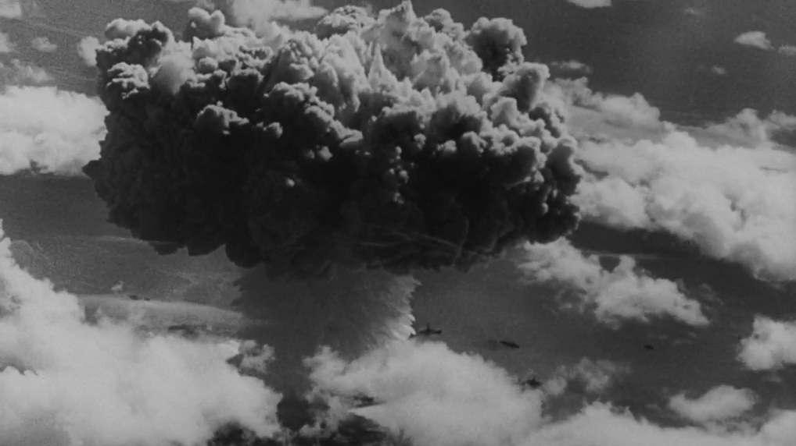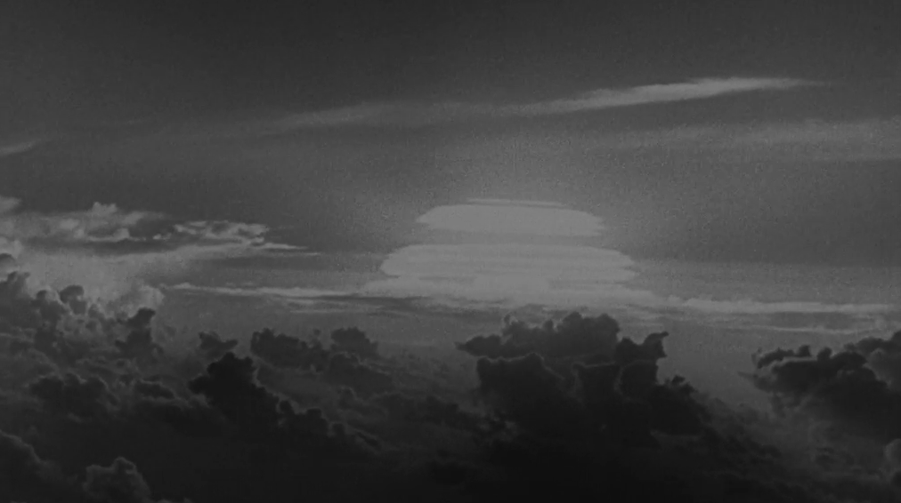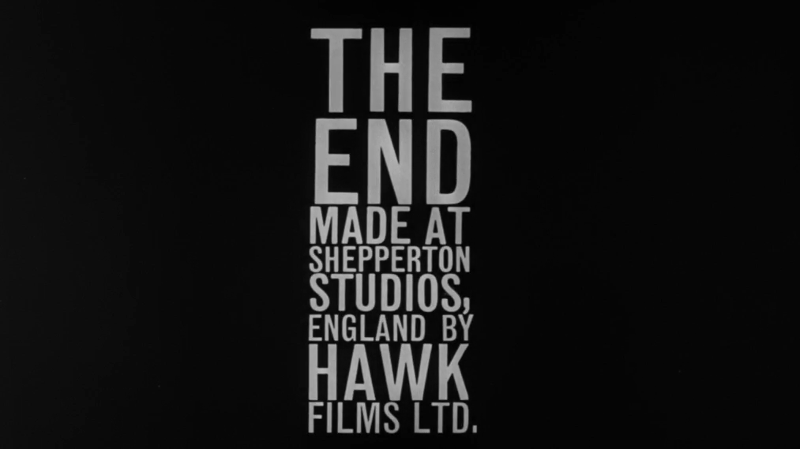

在欢声笑语中打出GG

 [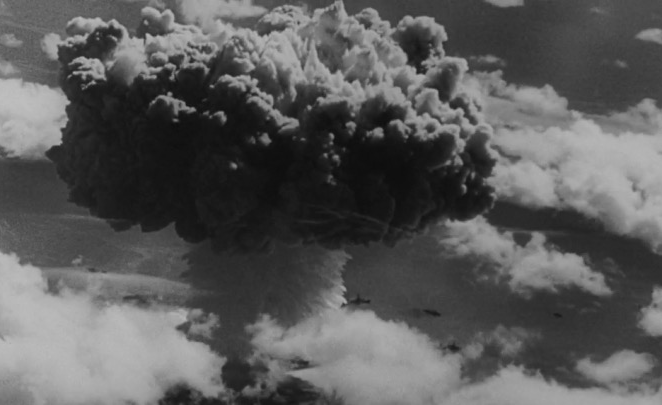  《奇爱博士》中的“音画对立”实例 https://www.zhihu.com/video/1040432002423554048](https://www.zhihu.com/video/1040432002423554048) 

《we‘ll meet again》是二战时期的英国著名战争歌曲，由薇拉·琳恩演唱，在欧美国家相当于妇孺皆知的主旋律金曲，至今家喻户晓。为了理解当年这首歌曲配上核弹爆炸的画面给当时观众带来多么巨大的震撼，请在脑中自行将bgm替换为《难忘今宵》，以获得最佳体验：

 [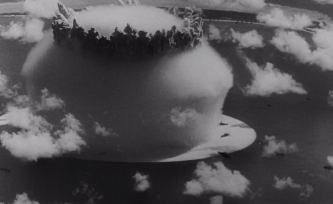  《难忘今宵》 https://www.zhihu.com/video/1040432420029329408](https://www.zhihu.com/video/1040432420029329408) 

库布里克的“音画对立”在这里已经成为了他的招牌。

附带一提，题主提到EVA，在《新世纪福音战士剧场版：Air·真心为你》中，第三次冲击下人类全体灭亡的画面配上《Komm, süsser Tod》、以及《福音战士新剧场版：破》中三冲的画面配上《翼をください》，也有向《**奇爱博士**》致敬的意味。

类似的还有泽野弘之的《aLIEz》。我们可以把类似手法统称为**核爆神曲。**

而库布里克真正将“音画对立”发扬到淋漓尽致的作品，则是1972年的《**发条橙**》。

这也是最符合题主问题的答案，用古典乐衬托暴力的始祖。

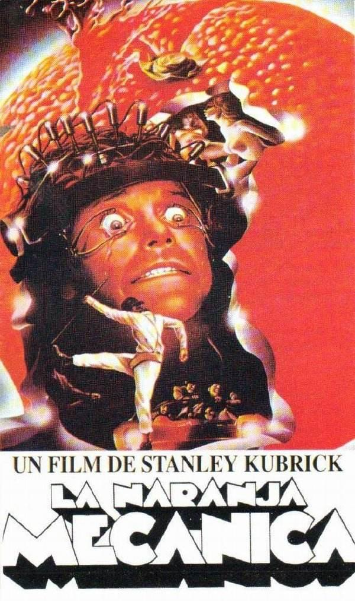

《发条橙》（1972）

作为库布里克电影创作的顶点，它至今仍是“音画对立”的最高代表与最重要的实践案例。

用罗西尼优雅而恢弘的《贼雀》序曲配小混混的暴力斗殴场面：

 [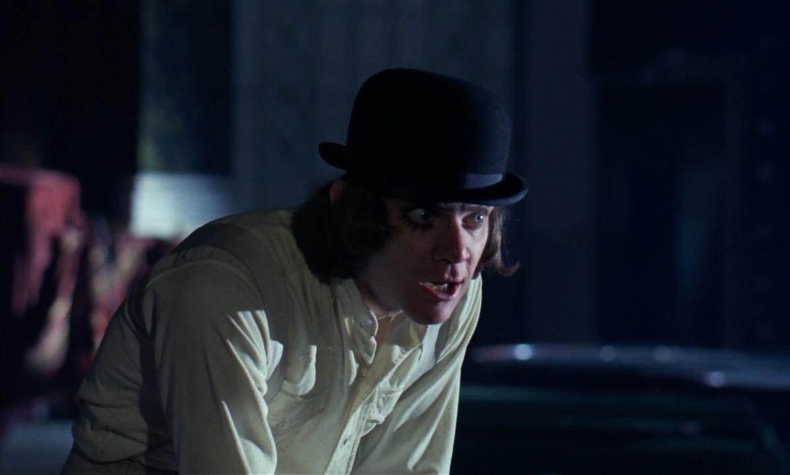  罗西尼：《贼雀》序曲 https://www.zhihu.com/video/1040450114401107968](https://www.zhihu.com/video/1040450114401107968)   [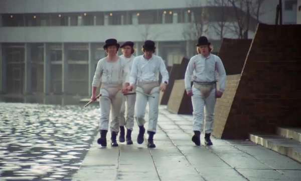   https://www.zhihu.com/video/1040562754935087104](https://www.zhihu.com/video/1040562754935087104) 

用罗西尼的《威廉退尔》序曲配Alex与两位少女快进的床戏：

 [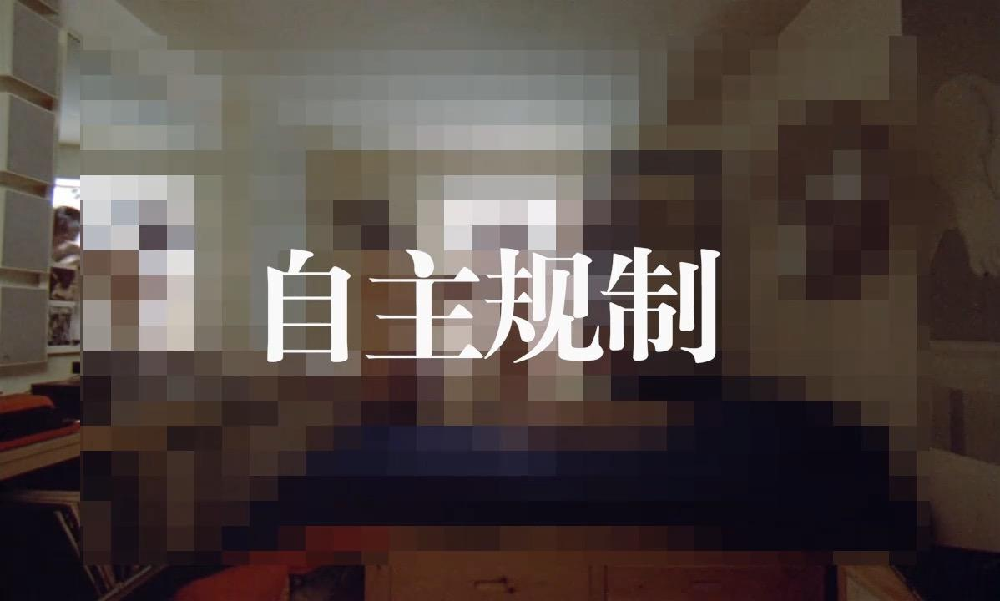  罗西尼：《威廉退尔》序曲 https://www.zhihu.com/video/1040540742082646016](https://www.zhihu.com/video/1040540742082646016) 

题主提到庵野秀明用欢乐颂配初号机与二号机搏斗，那我们看看库布里克是怎么用欢乐颂配纳粹轰炸的画面吧：

 [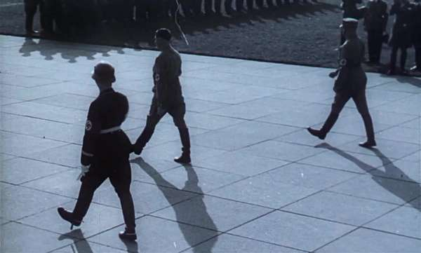  贝多芬：d小调第九交响曲 https://www.zhihu.com/video/1040469087540817920](https://www.zhihu.com/video/1040469087540817920) 

—————————————————————————————————————————

如果只算古典音乐的话，那么这种艺术风格的形成，确实是起源于《发条橙》的。

## 视频

[视频](videos/1040432420029329408.mp4)

[视频](videos/1040450114401107968.mp4)

[视频](videos/1040540742082646016.mp4)

[视频](videos/1040469087540817920.mp4)
