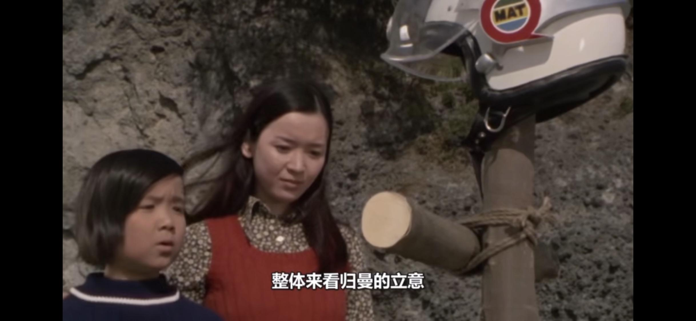
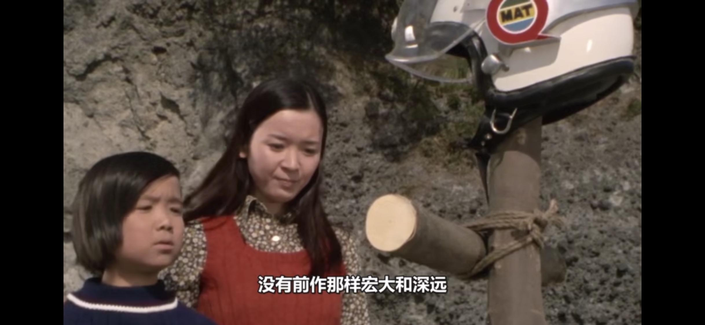
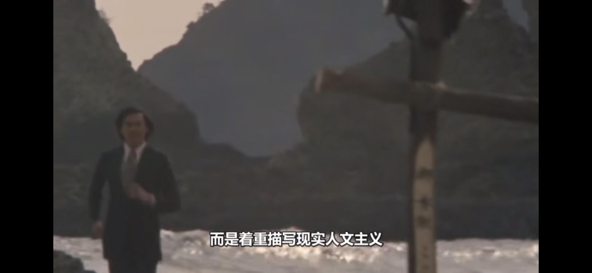
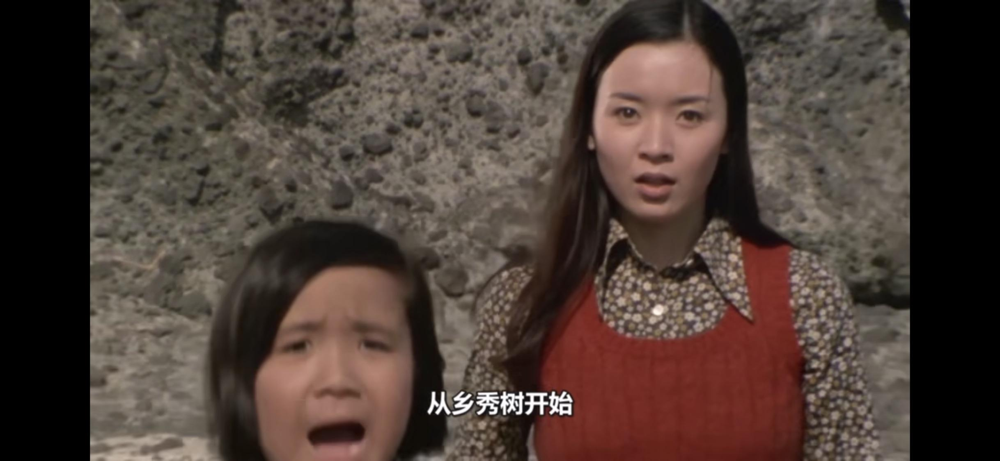
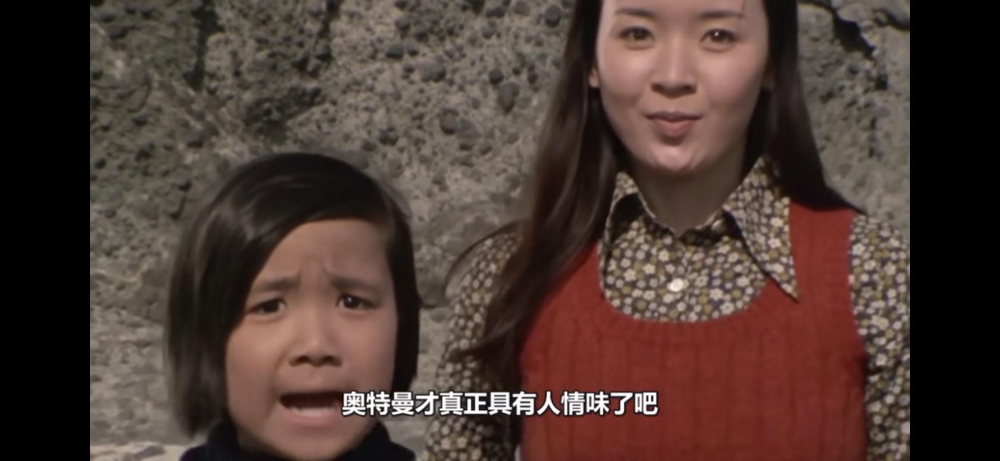
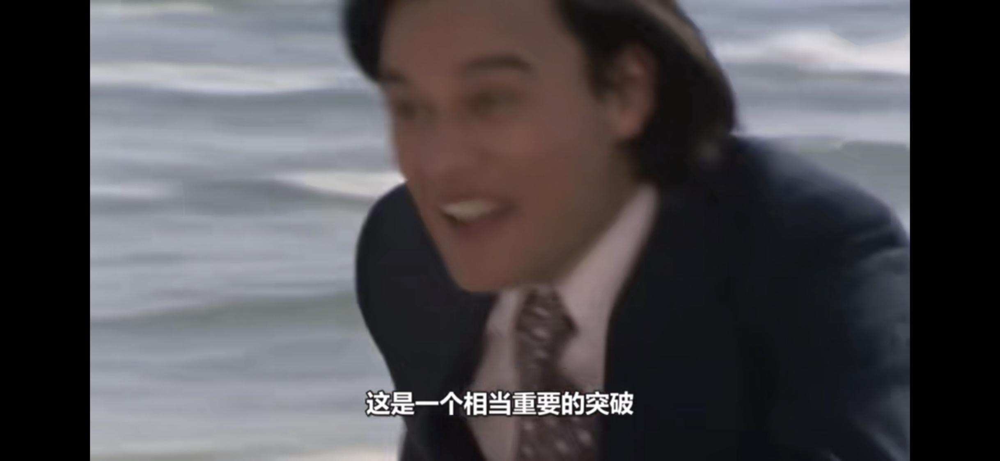
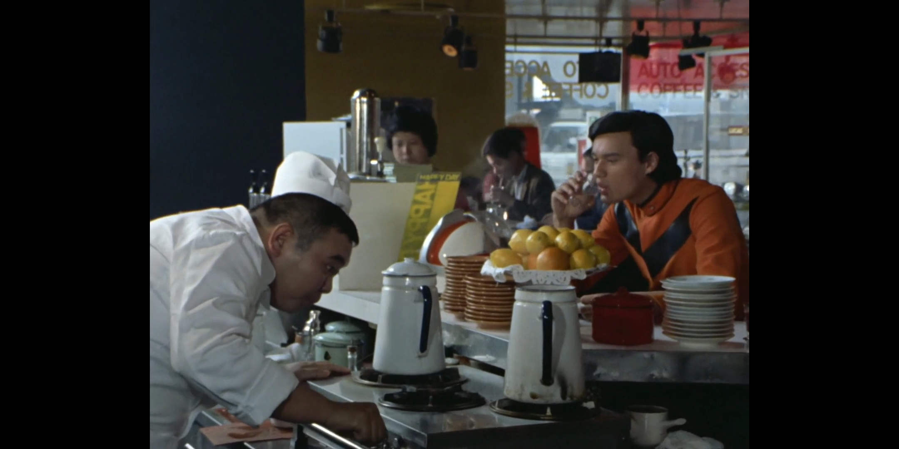

# 为什么没人吹《归来的奥特曼》这部作品？

**作者**：[陈子敏](http://www.zhihu.com/people/91949509989e39acc6e55e4216ac260b)

**原文**：https://www.zhihu.com/question/303763584/answer/542605224

**发布时间**：2018-11-30T23:20:19

**编辑时间**：2020-06-07T08:32:03

赞同 77 · 收藏 21 · 喜欢 9 · 评论 17

10月31日更新：

这个回答被营销号抄去当文案了。没想到我也有今天。

以后我也是被营销号抄袭过的答主辣。

2019.1.17，原答案:

其实归曼在在昭和系作品里被吹程度是仅次于赛文的吧。昭和系大部分名剧集都出自赛文和归曼这两部作品，更有“昭和三大问题作”之首《怪兽使者与少年》这样被日本宅圈称为“传说の回”的名作。其中有些部分说是奥特系列最伟大的剧集（如《怪兽少年的复仇》、《天使与恶魔之间》、《不可饶恕的生命》等）也不为过的。至少从剧本、导演、灯光、模型、表演等方面水平来看，归曼的制作水平说是昭和系列前列并不夸张。

也许归曼的整体立意没有前作《奥特曼》、《奥特赛文》那样宏大和深远、放眼整个人类历史进行思考，而着重在描写现实中昭和时代的人文风貌，市井阶层的小市民生活之类的（太阳怪兽宾斯达那集开头是乡秀树早上去早餐店吃饭来着，非常的平易近人），可以说这也是一种很有趣味的风格吧。

奥特喝茶

从乡哥哥开始，奥特曼才真正具有人情味，这也是一个相当重要的突破了。

另外，归曼的音乐是昭和第一，没有异议吧？冬木透真是天才。
