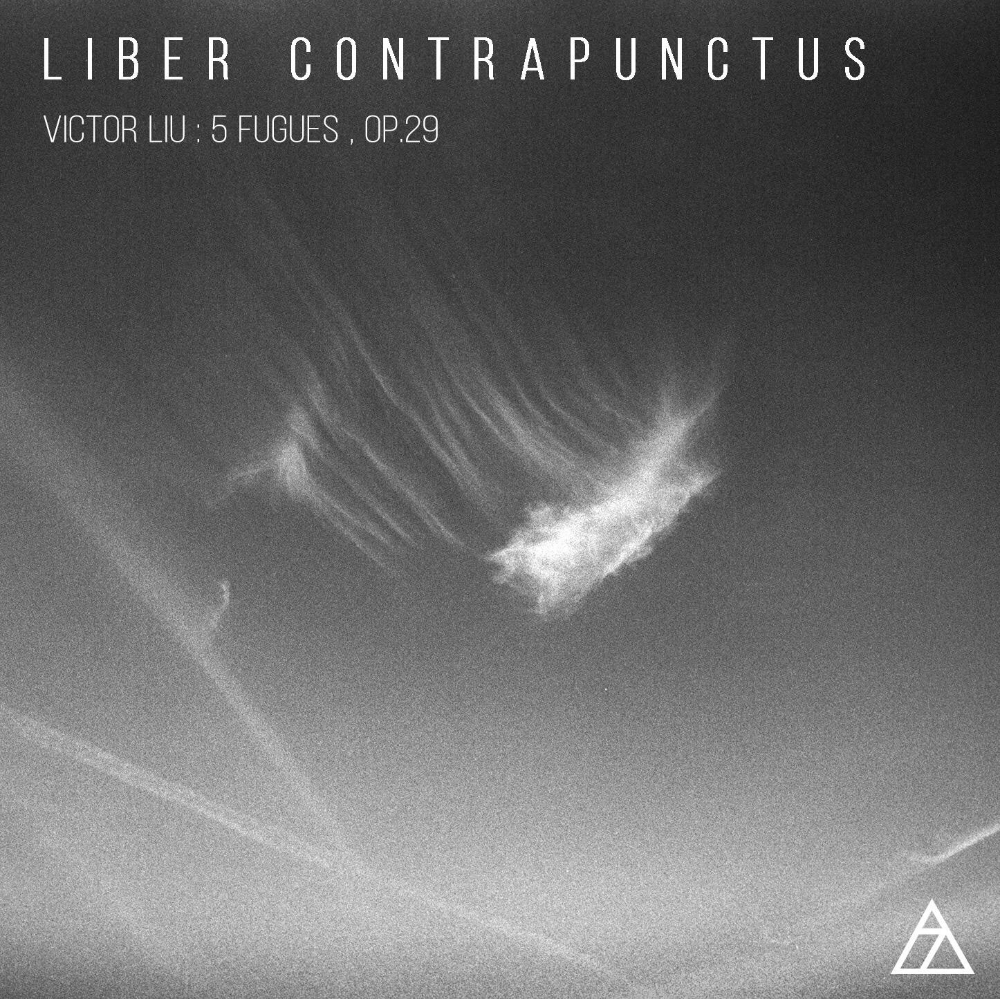

# 你最喜欢的一首赋格作品是什么？

**作者**：[陈子敏](http://www.zhihu.com/people/91949509989e39acc6e55e4216ac260b)

**原文**：https://www.zhihu.com/question/307570833/answer/592707490

**发布时间**：2019-02-09T05:19:34

**编辑时间**：2019-02-23T10:28:47

赞同 19 · 收藏 14 · 喜欢 8 · 评论 2

感谢邀请。

喜欢的赋格当然有很多，听了那么多年音乐也实在找不出一个最喜欢的来。

例如老肖的op.87里的大部分赋格都极其精彩；欣德米特的LudusTonalis里的所有赋格；巴赫的d小调半音阶赋格；贝多芬的大赋格、莫扎特的幻想曲与赋格之类的……这些作品都是曾经的聆听体验中使我留下深刻印象并为之震撼的作品。但要谈起近来最喜欢的赋格作品，无疑是这首：

[V.A.S.:Triplefugue in E flat major, op. 29, no.5](https://www.xiami.com/song/1803955345)

作曲家Victorius Aurelius Sinensis的作品第二十九，以社团“Delta7”名义发表，其中最后一首降E大调第五赋格，题献给我。作曲家本人声称这是系列创作中最完美的一首赋格。除了极大的荣幸以外，也再也没有什么可以形容我的感情了。

我不必也无能为力去用作曲技术来解析这个作品，一个三主题赋格，其技巧之精妙绝伦自然不需要多说。作为五首赋格中的终曲，它展现了前四首剑拔弩张的片段中所没有的性格——在斗争和悲痛之后，最终与自己和解。

