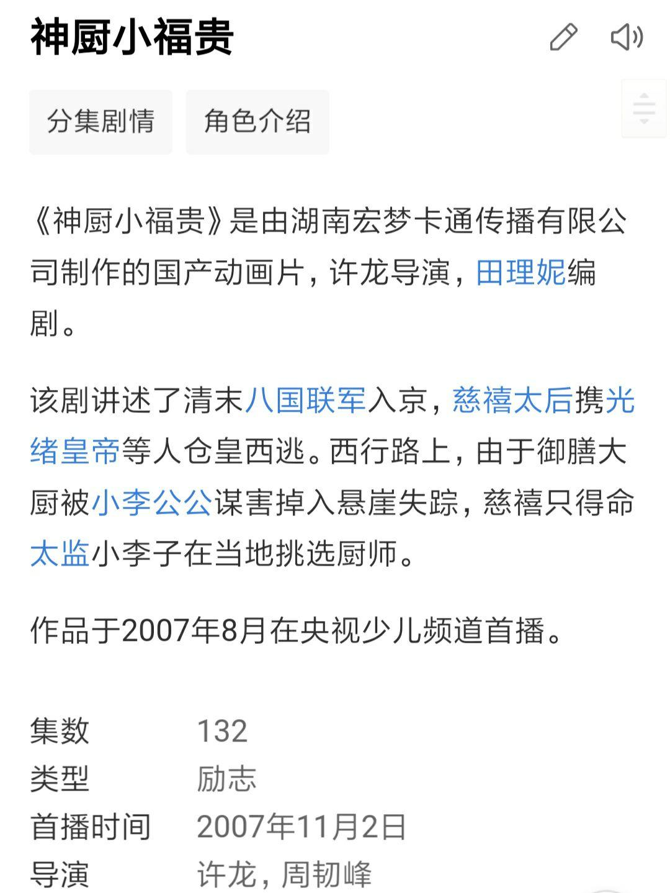
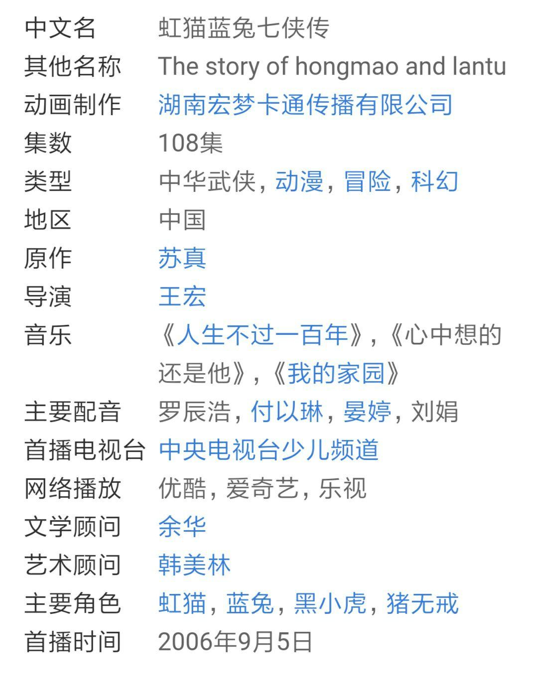
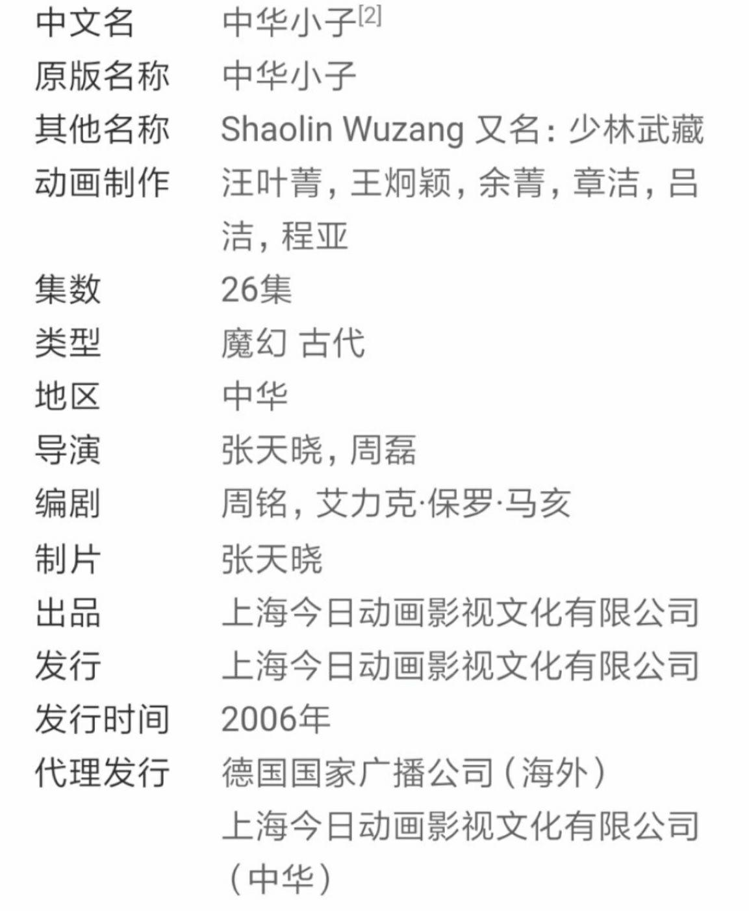
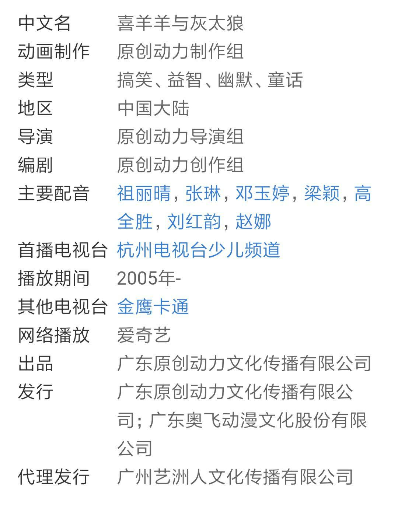
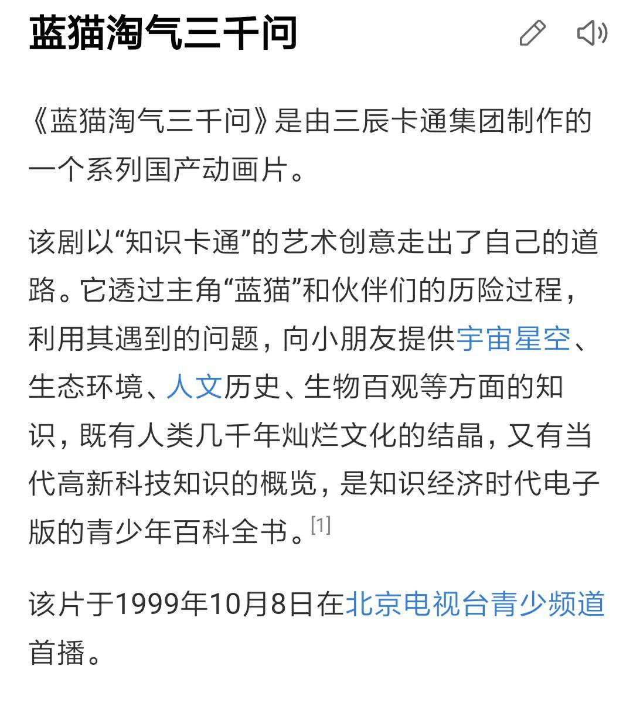

# 喜羊羊到底是谁的童年？

**作者**：[陈子敏](http://www.zhihu.com/people/91949509989e39acc6e55e4216ac260b)

**原文**：https://www.zhihu.com/question/314349059/answer/612986815

**发布时间**：2019-03-03T14:08:22

**编辑时间**：2019-03-06T18:36:50

赞同 29 · 收藏 0 · 喜欢 2 · 评论 2

泻药。

是我的童年。

同样，显然对于那些报菜名以厚此薄彼的小朋友们而言，也不可能不是他们的童年，**只是到了一定年纪，青春期逆反心理作祟，一定要通过批臭喜羊羊来标榜自己的成熟**；再加上皈依者狂热，站队显示忠诚也不需要过脑子，**甚至不惜拿比喜羊羊还晚了2年播出的《神厨小福贵》来作为自己童年充实的典范。**

说白了，就是中二病发，羞于承认而已。

我们来对比一下题目中出现的所有动画的播出年份:

## 《神厨小福贵》，首播于**2007年：**

## 《虹猫蓝兔七侠传》，首播于**2006年**；

## 《中华小子》，首播于**2006年**；

## 而受小朋友们嗤之以鼻的《喜羊羊与灰太狼》，首播于**2005年**；

四部动画中，其他三部首播时间都晚于《喜羊羊与灰太狼》，所以这些小朋友们是在标榜自己生于2005年后有着受优越文化滋养的童年，是05后对00后的鄙视链？

而题目中唯一一部首播时间早于《喜羊羊与灰太狼》的动画，是《蓝猫淘气三千问》，首播于**1999年**。

## **所以您到底是05后还是95后啊？您的童年怎么做到跨度这么大的？**
