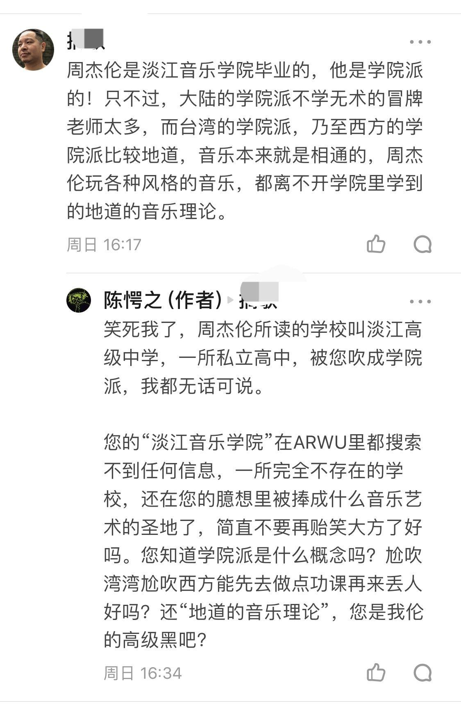

# 学院派认可周杰伦的作曲实力吗？

**作者**：[陈子敏](http://www.zhihu.com/people/91949509989e39acc6e55e4216ac260b)

**原文**：https://www.zhihu.com/question/317141922/answer/633401021

**发布时间**：2019-03-27T02:37:45

**编辑时间**：2019-05-03T01:18:41

赞同 165 · 收藏 16 · 喜欢 15 · 评论 19

不要自己在脑中臆想出一个虚幻缥缈的不存在的“学院派”好吗？

您知道学院派长什么样吗？

这样？

[Piano Concerto:Movement I - 郑明勋/Sunwook Kim/Seoul Philharmonic Orchestra - 单曲 - 网易云音乐](http://music.163.com/song/473145221/?userid=371326226)

这样？

[Le Marteau sans Maitre I - Linda Hirst](http://music.163.com/song/1310742371/?userid=371326226) 

还是这样？

[Prelude, Interlude and Fugue:Fugue - Michael Habermann](http://music.163.com/song/465390273/?userid=371326226) 

嗯？

[Tchivorodef: A Gaze at the Dusk on August 3rd, Op.23](https://www.xiami.com/song/1809987315)

您告诉我您说的学院派不是这些，那你脑子里想的学院派是什么样的？跟周杰伦有半点关系吗？

Wlop达不到学院派和周杰伦有什么关系？Wlop毕竟有意看齐学院派写实风格，倒还可以从结构、色彩等指标来客观评价他的水平。周杰伦一个和学院派写作方向相反的通俗音乐人，您是哪根筋搭错了拿“达不到学院派”来奚落他？

归根结底，刚玩了个知乎就来鹦鹉学舌模仿人家搞镜像问题，幼稚不？

———————————————————————————

这题目改成这样更不知所云了。

再重申一遍: **井水不犯河水**，学院派不研究周杰伦，周杰伦不写学院派。

听明白了吗？

———————————————————————————

奇文共赏

