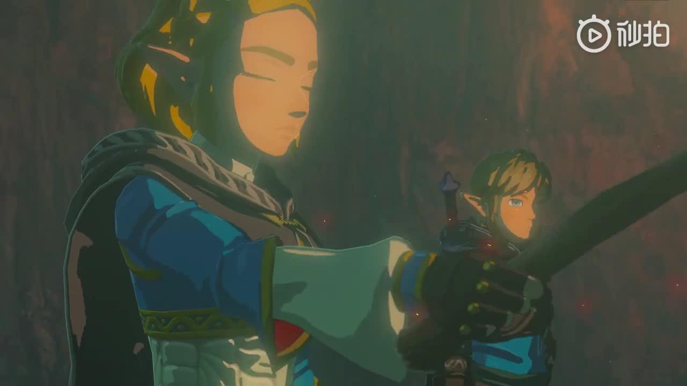
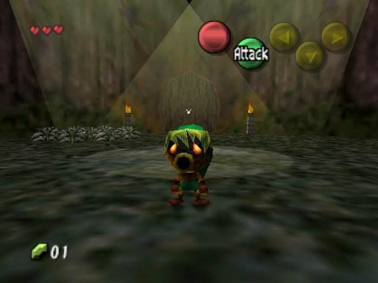
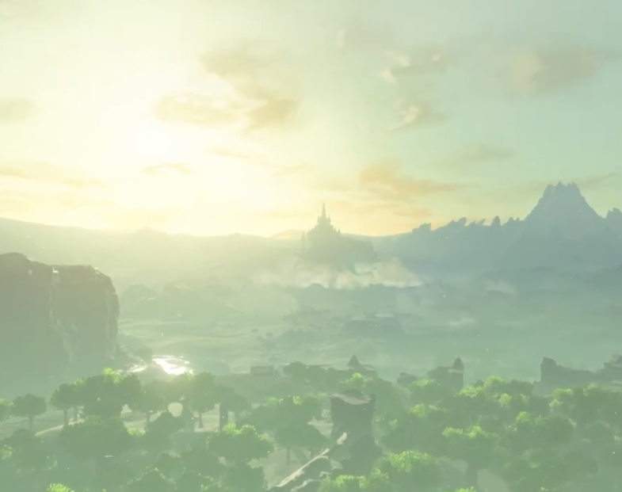
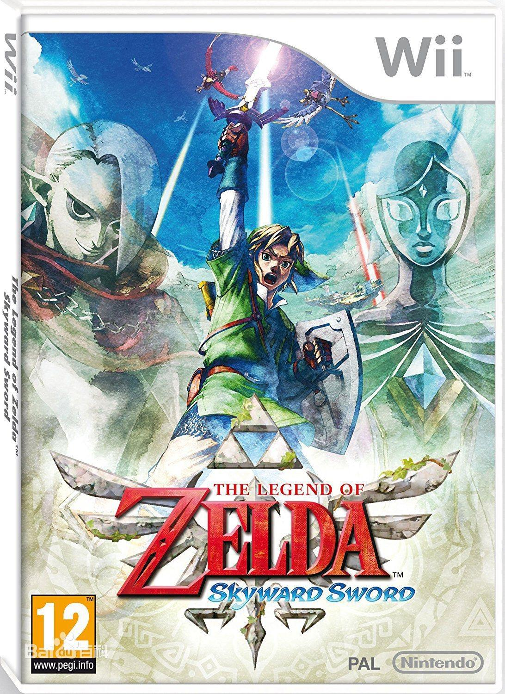

# 如何评价 E3 任天堂发布会上公布《塞尔达传说：旷野之息》续作开发中的消息？

**作者**：[陈子敏](http://www.zhihu.com/people/91949509989e39acc6e55e4216ac260b)

**原文**：https://www.zhihu.com/question/328961922/answer/712588364

**发布时间**：2019-06-12T02:09:50

**编辑时间**：2021-01-05T15:56:24

赞同 71 · 收藏 12 · 喜欢 5 · 评论 19

自己试着将PV倒放了一下看看，发现开头的旋律倒放后和塞尔达摇篮曲有着牵强的相似，与“女神之诗”不可以相比。本着塞学家大胆假设小心取证的精神，就不作展开吧。

 [  倒放版塞尔达新作预告片 https://www.zhihu.com/video/1122120412053528576](https://www.zhihu.com/video/1122120412053528576)  

---

不出所料，《旷野之息》的下一作很合理的沿用原来的引擎，以同一个林克为主角，**也必然会是一部基调黑暗的作品**。

就好比它：

当年《时之笛》（1998）发售两年之后，以相同的引擎和大量沿用的素材制作、以同一个林克为主角，却基调迥异的《梅祖拉假面》问世（2000）。

在“王道剧情”的《时之笛》大获成功后，阴暗诡异的《梅祖拉的假面》宛如“邪道”，充斥着死亡、虐恋、与世纪末的悲观绝望，与《时之笛》形成截然相反的鲜明对比。而在2017年，《旷野之息》夺得满堂彩，通关后的玩家就开始设想下一作的塞尔达会是什么样。

在当时n64平台的硬件条件下，《假面》自然而然沿用《时之笛》的引擎与美术风格，甚至人物和其他素材的建模都几乎照搬。《旷野之息》的渲染引擎和美术风格也足够完善，新作没有必要推倒重来另起炉灶，完全可以以原来引擎，对原先大量积累的建模素材和渲染风格物尽其用。

现在，《旷野之息》的地位已可与《时之笛》平起平坐，我也顺水推舟、大胆想象过塞尔达的下一作能否和《梅祖拉的假面》一样走邪道路线，与“王道”的《旷野之息》构成硬币的两面。现在看来可以印证我的观点了。

---

## 在看第二遍的时候我才发现城堡并非倒塌，而是在上升。

## 所以这是天剑前传！？？？？

时间线首尾相连，也许这会印证以往塞学界著名的无限循环时间线理论。

## 视频

[视频](videos/1122120412053528576.mp4)
