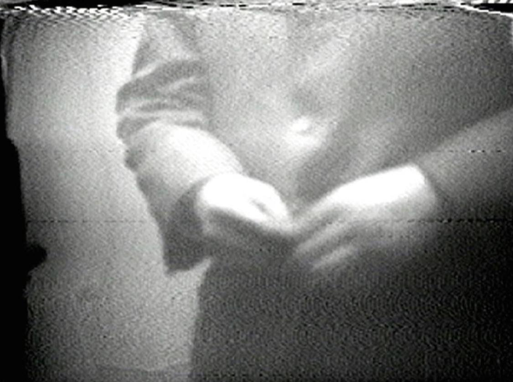
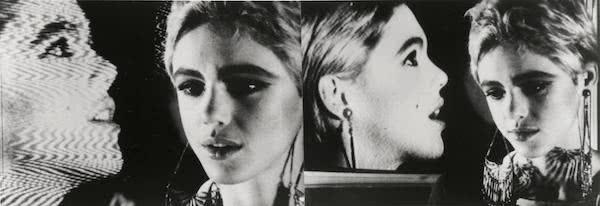
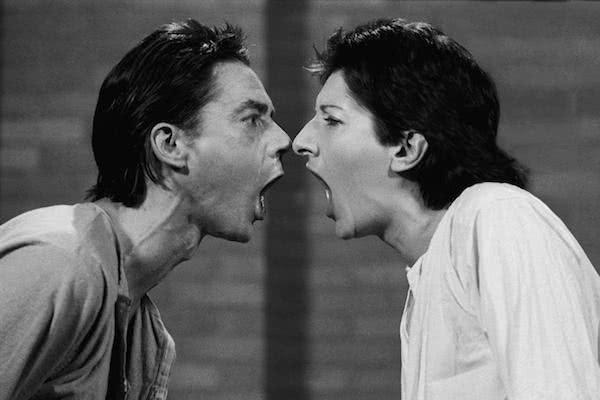
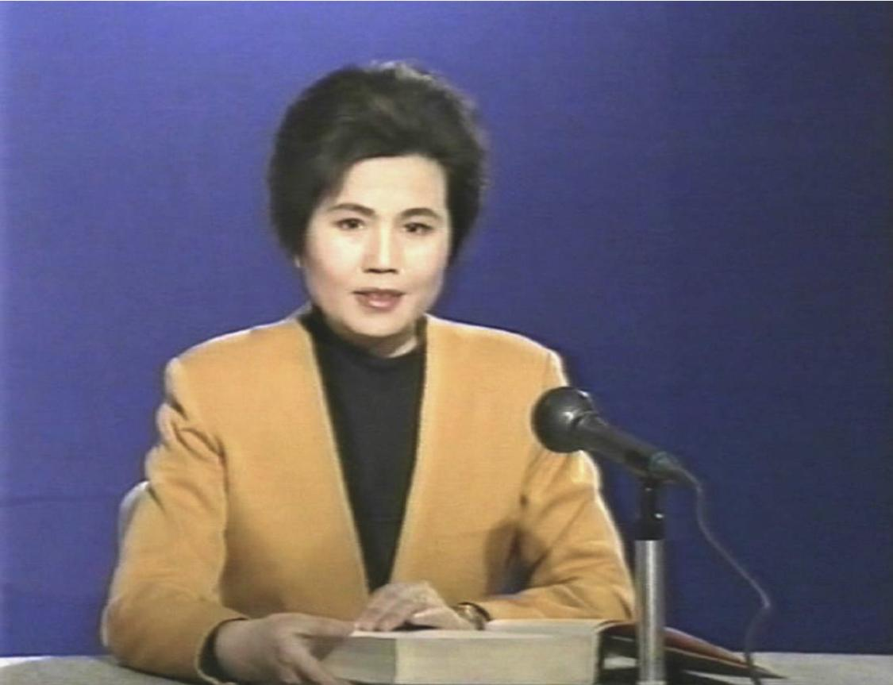

# 有没有视频可以称得上艺术？

**作者**：[陈子敏](http://www.zhihu.com/people/91949509989e39acc6e55e4216ac260b)

**原文**：https://www.zhihu.com/question/331644039/answer/730020211

**发布时间**：2019-06-27T20:29:58

**编辑时间**：2019-06-28T12:49:49

赞同 4 · 收藏 15 · 喜欢 3 · 评论 0

即录像艺术（Video Art）。

白南准(Nam June Paik)于1965年某日购买了索尼Portapak相机并用其拍摄了被公认为第一部录像艺术作品的《扣子偶发事件》，时长2分钟，拍摄了在纽约公园大道上罗马教皇将大衣扣子系上的镜头并重复解开的过程。白南准也被誉为“录像艺术之父”。

Nam June Paik：Button Happening，1965

同年沃霍尔的双投影作品《外与内》（1965），是早期录像装置艺术的范本之一。该作为拍摄“工厂女孩”——女演员伊迪·塞奇威克（Edie Sedgwick）和一段记录她本人的录像之间的互动，呈现女孩轻快交谈的多重影像。

Andy Warhol: Outer and Inner Space, 1965

阿布拉莫维奇（Marina Abramovic)作品《AAA-AAA》（1978）。录像中，阿布拉莫维奇与乌雷面对面持续发声，他们逐渐提高音量，并拉近彼此距离。当一方失声或换气时，另一方持续叫喊。两位艺术家通过声嘶力竭的对峙，测试了身体的极限。

Marina Abramovic: AAA-AAA，1978.

我国著名的录像艺术作品有张培力的《水——辞海标准版》（1991）：

张培力《水——辞海标淮版，单屏录像（PAL 格式），有声，彩色，9分35秒，1991年

张培力也被称为“中国录像艺术之父”。
