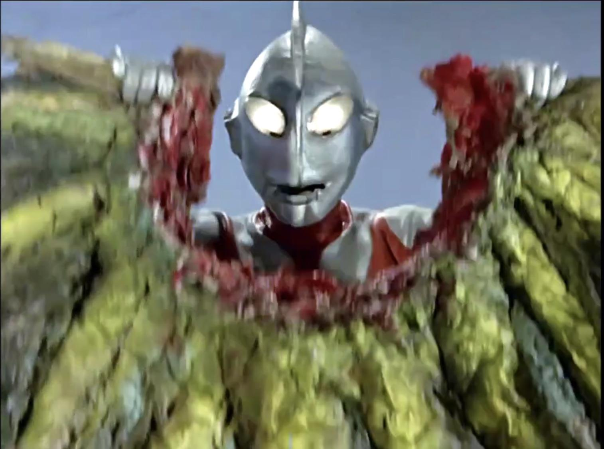
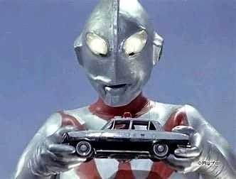
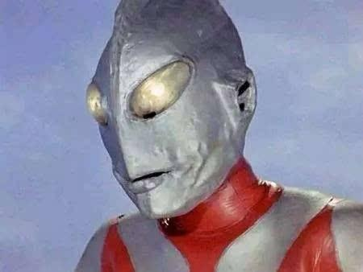
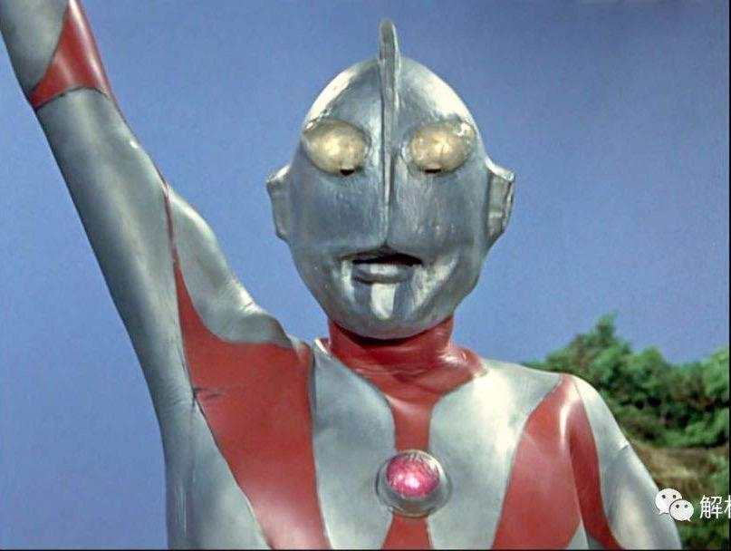
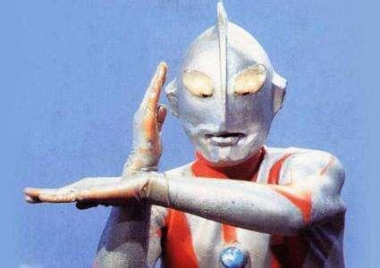
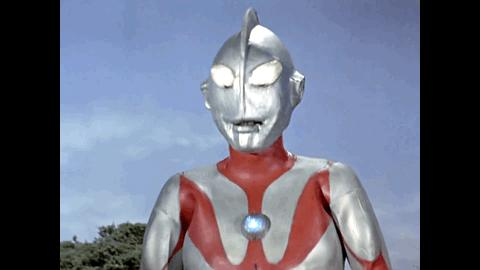
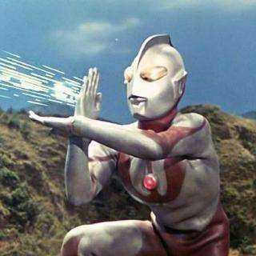

# 为什么恐怖谷理论对奥特曼不适用？

**作者**：[陈子敏](http://www.zhihu.com/people/91949509989e39acc6e55e4216ac260b)

**原文**：https://www.zhihu.com/question/335617966/answer/770305933

**发布时间**：2019-08-01T02:00:58

**编辑时间**：2021-01-22T10:24:00

赞同 2592 · 收藏 158 · 喜欢 228 · 评论 69

忘了硫酸脸是吧。

不是因为单纯的丑，是因为这张嘴会动啊

甚至还会笑！

在这个动图里可以看见古谷敏的牙

改成B型皮套后就没有类似的恐怖谷效应了，正如其他答案所说，从这开始奥特曼的脸孔才变得接近神像而非人类。

