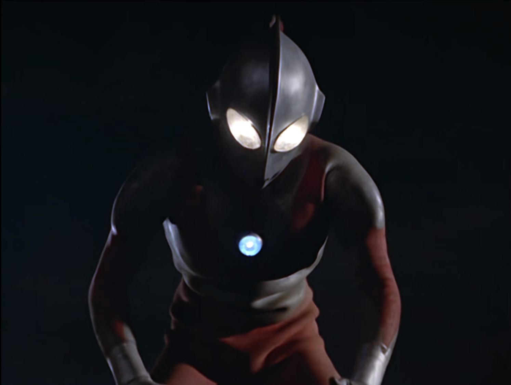
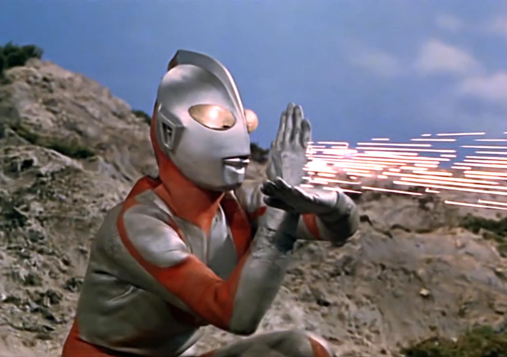
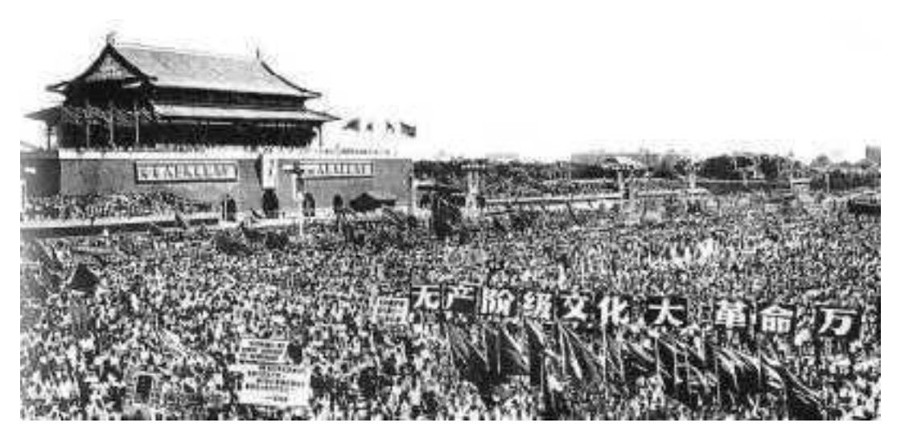
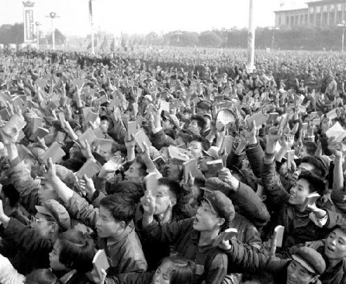

# 历史上有哪两件事听起来不在同一个年代，实际上却同时发生的？

**作者**：[陈子敏](http://www.zhihu.com/people/91949509989e39acc6e55e4216ac260b)

**原文**：https://www.zhihu.com/question/333199024/answer/800341000

**发布时间**：2019-08-24T01:23:29

**编辑时间**：2023-10-13T03:28:08

赞同 14 · 收藏 3 · 喜欢 3 · 评论 3

初代《奥特曼》于**1966年7月17日**在日本TBS电视台首播。

一个月后（**1966年8月17日**），我国开始了全国性的大串联：

