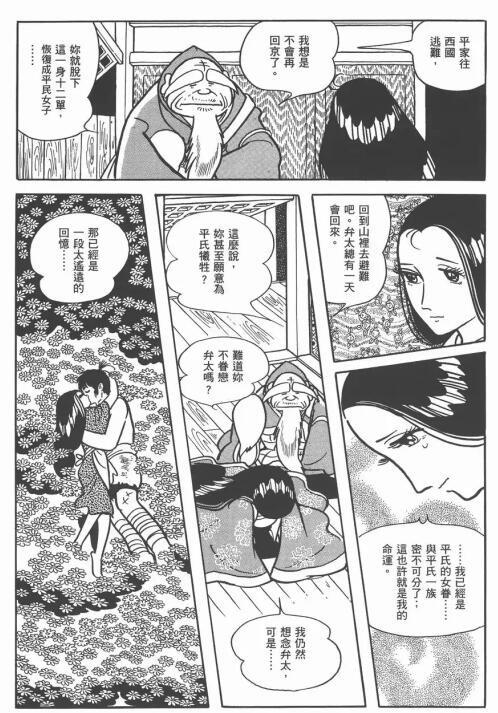

# 有哪些漫画里作者画到后面无法控制角色的例子？

**作者**：[陈子敏](http://www.zhihu.com/people/91949509989e39acc6e55e4216ac260b)

**原文**：https://www.zhihu.com/question/343280582/answer/827124499

**发布时间**：2019-09-18T02:05:31

**编辑时间**：2019-12-30T18:55:59

赞同 21 · 收藏 9 · 喜欢 5 · 评论 2

《火鸟·乱世篇》吧，女主变成平家的侍女之后…算是斯德哥尔摩综合症吗？

乱世篇看到最后真的自闭。
