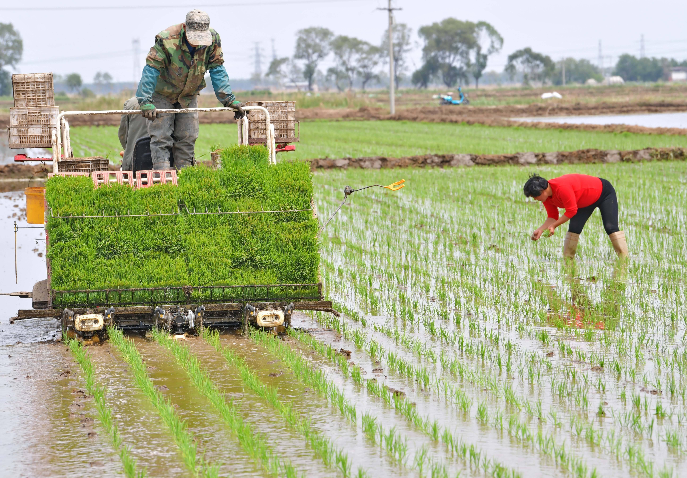
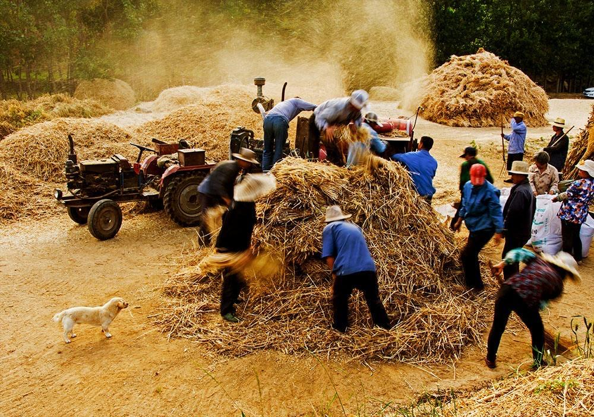
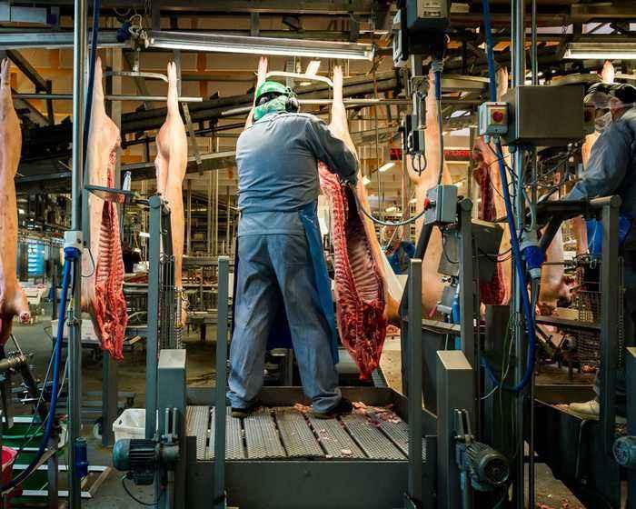
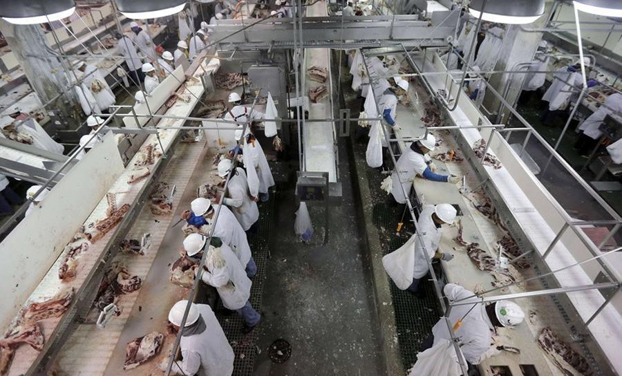
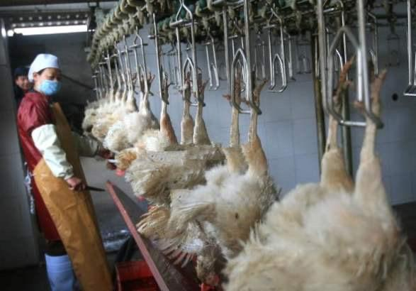
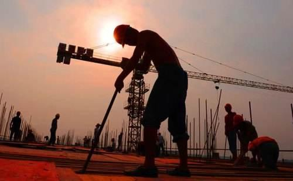
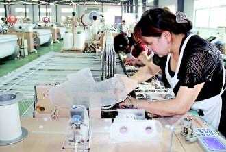
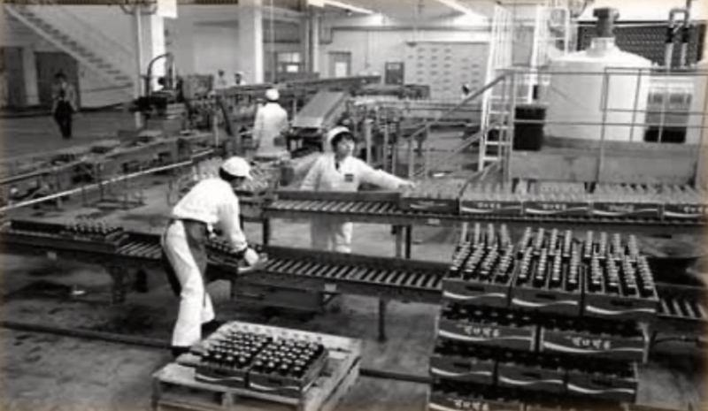

# 现在许多富人提倡贵族精神，当下中国需要贵族精神吗？

**作者**：[陈子敏](http://www.zhihu.com/people/91949509989e39acc6e55e4216ac260b)

**原文**：https://www.zhihu.com/question/27136527/answer/896457552

**发布时间**：2019-11-16T15:17:52

**编辑时间**：2019-11-16T16:59:56

赞同 18 · 收藏 1 · 喜欢 2 · 评论 1

才刚吃饱没几天就要学人家当贵族处处高人一等，想玩才子佳人阳春白雪那一套顾影自怜矫揉造作的玩意那就划清界限互不相犯自己玩去呗，但你有种别吃他们种的水稻啊：

别吃他们种的面：

君子不近庖厨，“贵族”们自命清高当然眼不见为净，那就不要让荤腥玷污了嘴

也别住房子了，他们盖的：

也别再享受各类轻工业车间流水线日夜卖血制造出的便利商品：

在我国经济发展不均衡的当下，别忘了你的“贵族精神”是建立在吸血廉价劳动力的基础上的。
