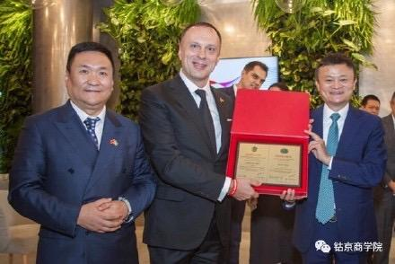

# 为什么马云可以指挥中国顶级的中国爱乐乐团？

**作者**：[陈子敏](http://www.zhihu.com/people/91949509989e39acc6e55e4216ac260b)

**原文**：https://www.zhihu.com/question/360036597/answer/931122006

**发布时间**：2019-12-11T12:02:18

**编辑时间**：2021-07-31T23:02:55

赞同 38 · 收藏 3 · 喜欢 3 · 评论 4

因为乐队指挥的很大部分作用是体现在排练阶段的。

在排练中指挥需要打磨各声部的配合情况，纠正各个声部的演奏错误，监督乐队是否根据总谱要求达到预期效果。除了还原谱面上的标记以外，谱面未加约束的部分则是指挥自由发挥的空间，可以按照自己的理解和艺术需要来进行处理。这些都是在排练过程中指挥对乐队演奏细致的打磨来达成的。

除了打拍子以外，指挥也需要时时提示乐手，在某声部经过了长休止后即将进入时，指挥必须指示准备。

如果反复排练，或者曲目本身难度较低，在正式登台演奏的时候确实乐队不需要指挥也能照常演奏，拉德斯基进行曲就属于后者。不过马云就算指挥个更难的曲子也会有人给他事先搭好架子让他上去表演跳舞的。

另外，马云还是乌克兰国立柴可夫斯基音乐学院名誉教授呢。校友可是有拉赫、鲁宾斯坦和格拉祖诺夫哦。

