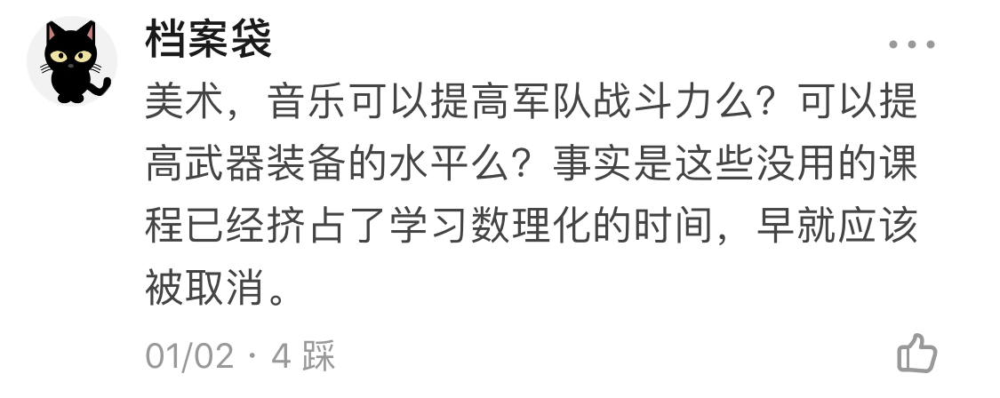

# 我国缺少针对大众的古典音乐教育吗?

**作者**：[陈子敏](http://www.zhihu.com/people/91949509989e39acc6e55e4216ac260b)

**原文**：https://www.zhihu.com/question/363153544/answer/959493860

**发布时间**：2020-01-02T11:01:24

**编辑时间**：2020-05-27T08:03:03

赞同 249 · 收藏 10 · 喜欢 12 · 评论 6

评论区现身说法

不是“古典音乐教育”的缺失，甚至不是音乐教育的缺失，而是缺少接受非功用目的性的一切教育的闲情逸趣，等到美术课音乐课不再会被数理化占课了的时代，再来谈是否缺少古典音乐教育吧。
