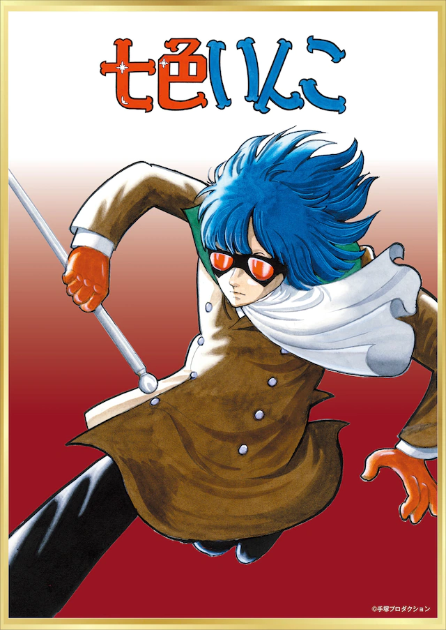
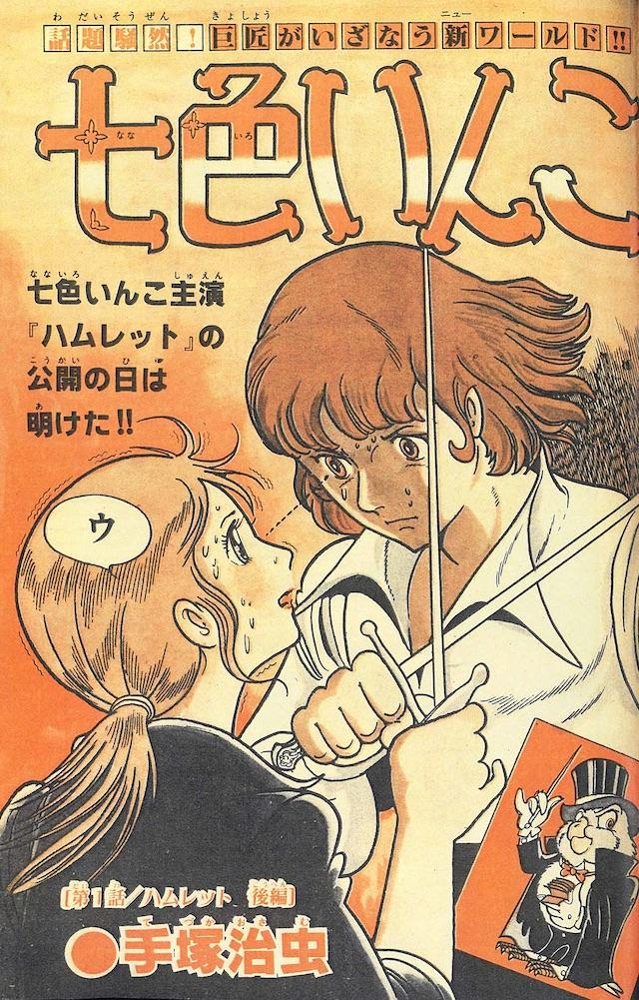

# 日本动漫里很少出现子女与父母的矛盾吗？

**作者**：[陈子敏](http://www.zhihu.com/people/91949509989e39acc6e55e4216ac260b)

**原文**：https://www.zhihu.com/question/376055742/answer/1081658683

**发布时间**：2020-03-16T07:20:26

赞同 6 · 收藏 3 · 喜欢 0 · 评论 0

类似套安利的方式我在知乎见过十个。EVA这种以亲子矛盾为剧情发展动力的就不提了，说个没那么有名的：

《七色鹦哥》（1981）

