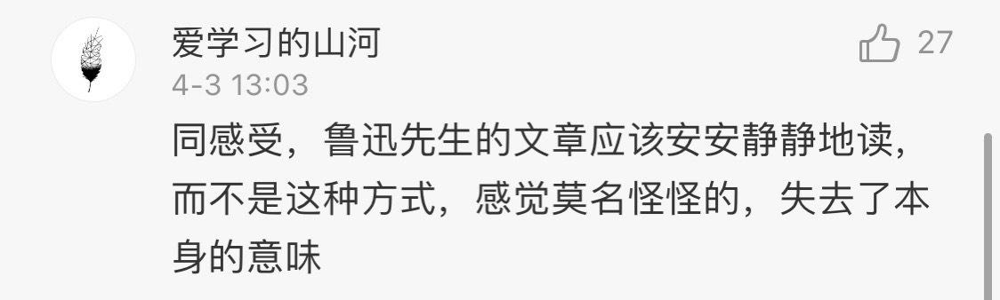

# 如何看待北大学生将鲁迅作品改成 Rap？

**作者**：[陈子敏](http://www.zhihu.com/people/91949509989e39acc6e55e4216ac260b)

**原文**：https://www.zhihu.com/question/384811505/answer/1125670653

**发布时间**：2020-04-03T17:48:55

**编辑时间**：2021-05-27T14:40:01

赞同 3359 · 收藏 446 · 喜欢 245 · 评论 144

> **如果“尊重”就是将经典一律当作雷池而不敢越之半步，那么遗忘就是对经典最好以及最彻底的“尊重”。**  
>   
> **杀死一种文化最高明的方法就是将其捧上神坛敬而远之。**

[拿什么拯救濒临遗忘的手冢治虫宇宙？](https://zhuanlan.zhihu.com/p/47838743)

---

对于文化程度不高又急于附庸风雅的小资群体而言，不经大脑将文学经典盲目抬高是成本最低又不必暴露自己斤两的办法。

看见名著就想凑热闹，奈何没有读过，又非要说点什么，只好装腔作势来一句不痛不痒的“我总觉得有点玷污经典…”以显示存在感。

想要附和又怕贻笑大方，那只好摆出一副深藏功与名的嘴脸，一个劲把名著推上象牙塔，把作家神格化，抬高到你们一般人不敢企及的高度，故弄玄虚营造文化阶级壁垒吓唬你，狐假虎威扛起保卫经典的大旗规定你不能“玷污经典”。这样，就算没有读过，既沾了名著的风雅，又显得自己好有原则，真是一举两得。

这种成本极低的方法历来为我国网络卫道士所喜用。要知道截图中的这些人，除了中学课文以外，未必翻过一页鲁迅著作。

---

的确，写过《故事新编》的鲁迅绝无可能粗暴反对对经典进行现代演绎的行为，对“故词新唱”反而报以鼓励的态度。

当然作品具体改编水平如何是另一回事，但“将鲁迅作品改编成rap形式”这个行为本身是不可能包含任何类似“亵渎”、“玷污”这些主观价值判断的，之所以觉得“亵渎”，只是因为这些人发自内心对rap这种形式抱有偏见而已。

我们没法要求这些人能够通读《故事新编》，但读完《“题未定”草》这样的杂文可以是一分钟的事情。尤其对那几位主张鲁迅作品要“安安静静地读”的网友。在这里摘录几段：

> 抚慰劳人的圣药，在诗，用朱先生*【1】*的话说，是“静穆”：  
>   
> 　　“艺术的最高境界都不在热烈。就诗人之所以为人而论，他所感到的欢喜和愁苦也许比常人所感到的更加热烈。就诗人之所以为诗人而论，热烈的欢喜或热烈的愁苦经过诗表现出来以后，都好比黄酒经过长久年代的储藏，失去它的辣性，只剩一味醇朴。我在别的文章里曾经说过这一段话：‘懂得这个道理，我们可以明白古希腊人何以把和平静穆看作诗的极境，把诗神亚波罗摆在蔚蓝的山巅，俯瞰众生扰攘，而眉宇间却常如作甜蜜梦，不露一丝被扰动的神色？’这里所谓‘静穆’自然只是一种最高理想，不是在一般诗里所能找得到的。  
>   
> 　　古希腊——尤其是古希腊的造形艺术——常使我们觉到这种‘静穆’的风味。‘静穆’是一种豁然大悟，得到归依的心情。它好比低眉默想的观音大士，超一切忧喜，同时你也可说它泯化一切忧喜。这种境界在中国诗里不多见。屈原阮籍李白杜甫都不免有些像金刚怒目，愤愤不平的样子。陶潜浑身是‘静穆’，所以他伟大。”  
>   
>   
>  古希腊人，也许把和平静穆看作诗的极境的罢，这一点我毫无知识。但以现存的希腊诗歌而论，荷马的史诗，是雄大而活泼的，沙孚*【2】*的恋歌，是明白而热烈的，都不静穆。我想，立“静穆”为诗的极境，而此境不见于诗，也许和立蛋形为人体的最高形式，而此形终不见于人一样。至于*【3】*亚波罗之在山巅，那可因为他是“神”的缘故，无论古今，凡神像，总是放在较高之处的。这像，我曾见过照相，睁着眼睛，神清气爽，并不像“常如作甜蜜梦”。不过看见实物，是否“使我们觉到这种‘静穆’的风味”，在我可就很难断定了，但是，倘使真的觉得，我以为也许有些因为他“古”的缘故。  
>   
> 　　我也是常常徘徊于雅俗之间的人，此刻的话，很近于大煞风景，但有时却自以为颇“雅”的：间或喜欢看看古董。记得十多年前，在北京认识了一个土财主，不知怎么一来，他也忽然“雅”起来了，买了一个鼎，据说是周鼎，真是土花斑驳，古色古香。而不料过不几天，他竟叫铜匠把它的土花和铜绿擦得一干二净，这才摆在客厅里，闪闪的发着铜光。这样的擦得精光的古铜器，我一生中还没有见过第二个。一切“雅士”，听到的无不大笑，我在当时，也不禁由吃惊而失笑了，但接着就变成肃然，好像得了一种启示。这启示并非“哲学的意蕴”，是觉得这才看见了近于真相的周鼎。鼎在周朝，恰如碗之在现代，我们的碗，无整年不洗之理，所以鼎在当时，一定是干干净净，金光灿烂的，换了术语来说，就是它并不“静穆”，倒有些“热烈”。这一种俗气至今未脱，变化了我衡量古美术的眼光，例如希腊雕刻罢，我总以为它现在之见得“只剩一味醇朴”者，原因之一，是在曾埋土中，或久经风雨，失去了锋棱和光泽的缘故，雕造的当时，一定是崭新，雪白，而且发闪的，所以我们现在所见的希腊之美，其实并不准是当时希腊人之所谓美，我们应该悬想它是一件新东西。  
>   
> 【1】“朱先生”指朱光潜。  
> 【2】“沙孚”（Sappho）通译萨福，约公元前六世纪时的古希腊女诗人。她流传至今的作品只有两三篇完整的短诗和一些断片，内容主要是歌颂爱情和友谊。  
> 【3】“亚波罗”通译阿波罗。

以上大概可以管窥鲁迅先生其文艺思想一斑。这段原文已经足以作为回应。

也许还有其他更具代表性的文字，权当抛砖引玉，有其他参考的朋友希望可以提供。
