# 有哪些好看的日本不良漫画？

**作者**：[陈子敏](http://www.zhihu.com/people/91949509989e39acc6e55e4216ac260b)

**原文**：https://www.zhihu.com/question/385767613/answer/1146161934

**发布时间**：2020-04-11T21:50:25

**编辑时间**：2022-03-10T10:12:33

赞同 7 · 收藏 11 · 喜欢 0 · 评论 4

## **《学园无聊男》（永井豪，1970）**

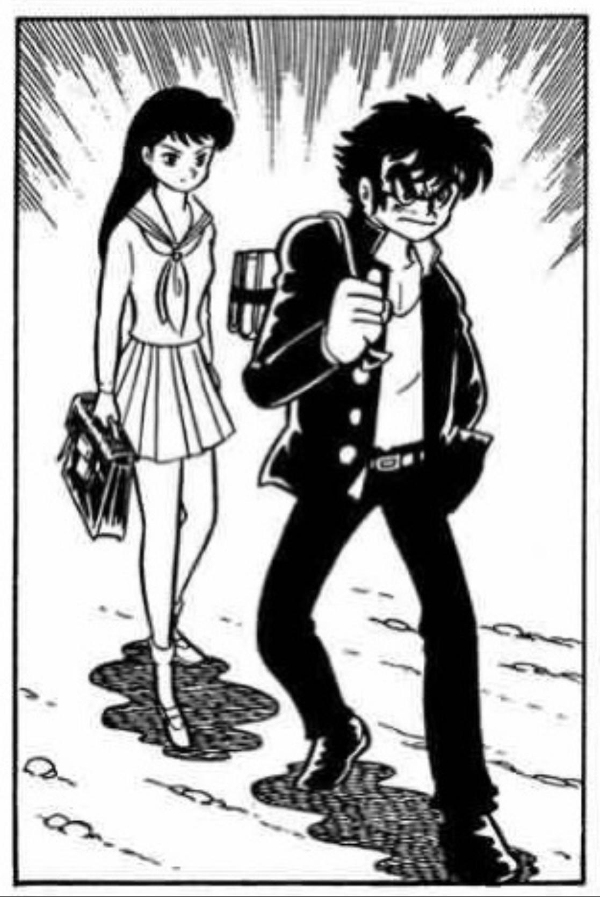

虽然《破廉耻学园》（1968）不属于“不良漫画”，毕竟相比于老师的丑恶行为，其中对学生的描绘其实还算是相对正面的。

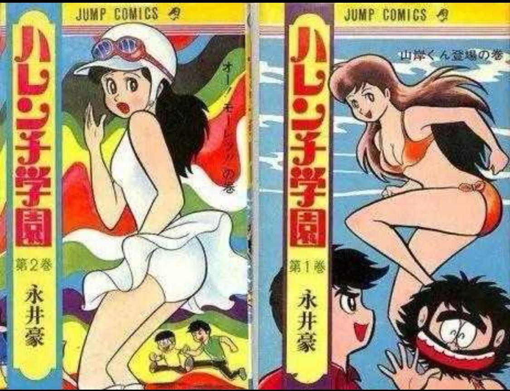

——但“学生联手对抗老师”这个主题，在两年后永井豪的作品《**学园无聊男**》（ガクエン退屈男，1970）中发展的淋漓尽致。

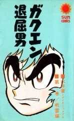
> 《学园无聊男》「ガクエン退屈男」于1970年发表于讲谈社旗下漫画杂志《週刊ぼくらマガジン》。设定背景为日本的教育机关（从大学到幼儿园）中，受教者（学生、儿童、幼儿）与教育者（官僚、教师、家长会）作为敌对的两方面，拿起武器进行全面战争的时代。同时作为副主人公的美型青年身堂龙马的存在感变得巨大了起来。另外，随着女主人公级别角色怪力无双的美少女锦织翼的出场。由此形成了门土、龙马、翼作为领导的抵抗组织和权力进行对峙的局面。在高潮的前段变成了以身堂作为主视点的故事，美于丑真实与谎言的主旨突然浮现，展开成为了以后永井所著恶魔类作品共同的主旨。本作的三位主人公在永井豪的另一部作品《暴力杰克》里均有登场。

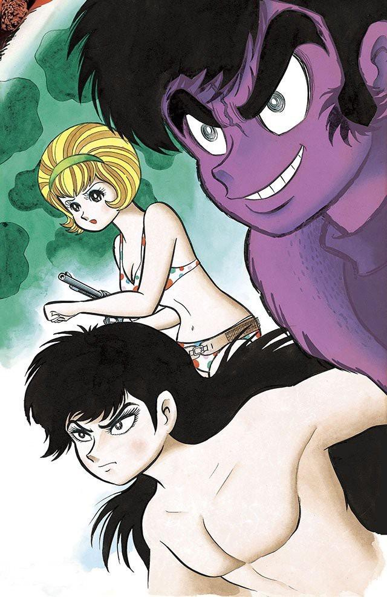

《学院无聊男》从日本60年代末愈演愈烈的学生运动出发，在1970年这个节点上将1971年之后的未来想象成所谓的“教育界西部剧时代”。从《破廉耻学园》中校园内的战争扩大到了整个社会。

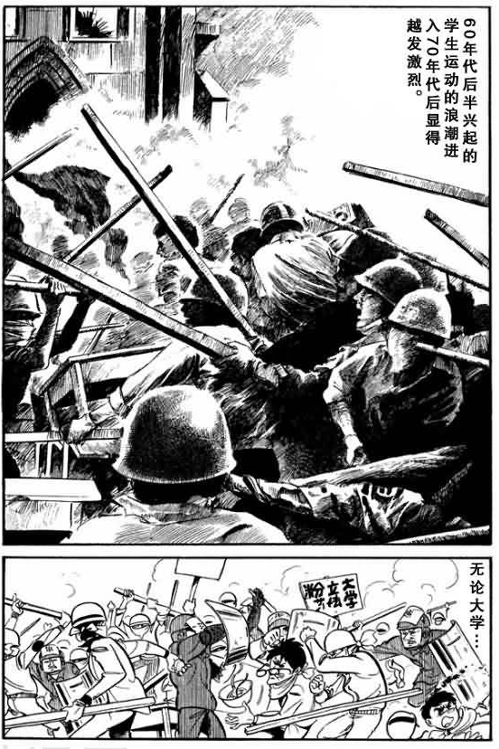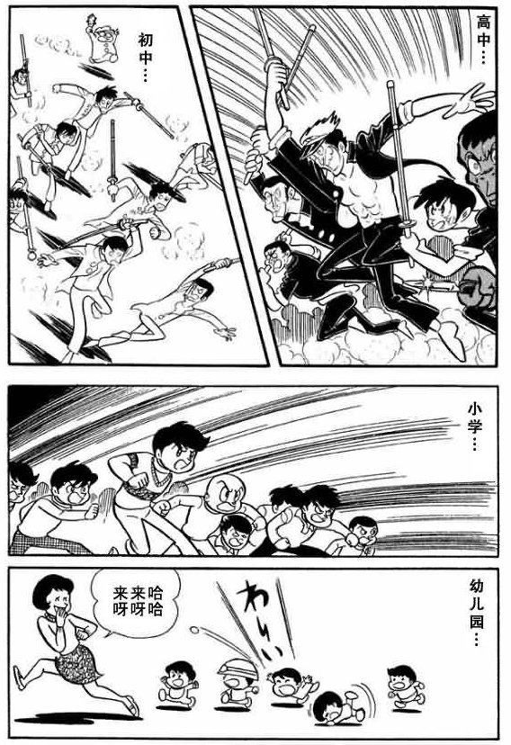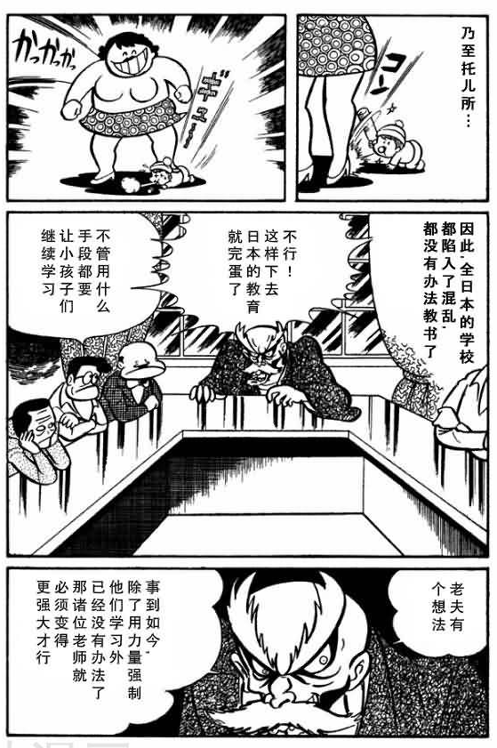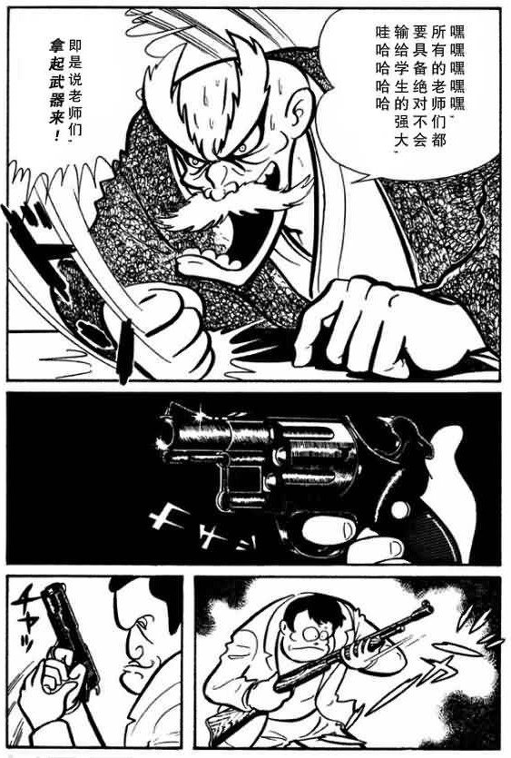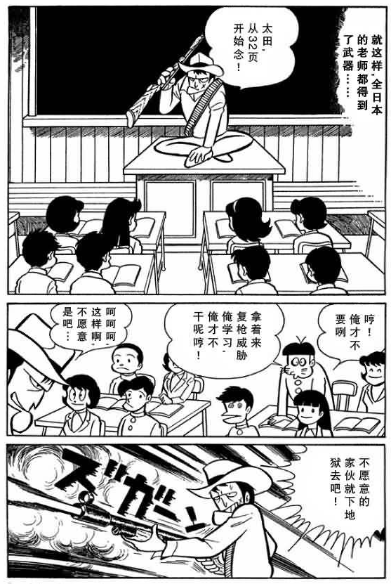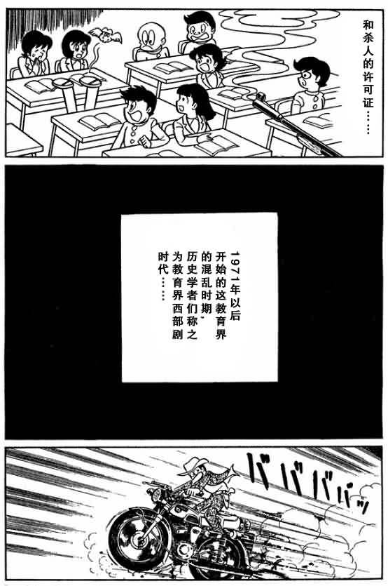

学生以解放学校为名建立游击队武力推翻教师统治，和各路学校游击队党同伐异，释放过剩荷尔蒙。

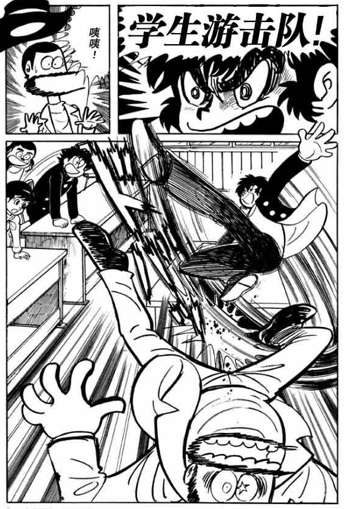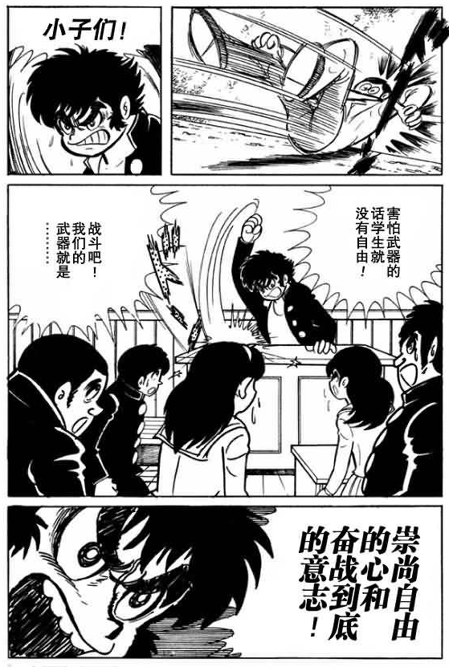

顺便，身堂龙马还是漫画史上最早的伪娘角色之一哦：

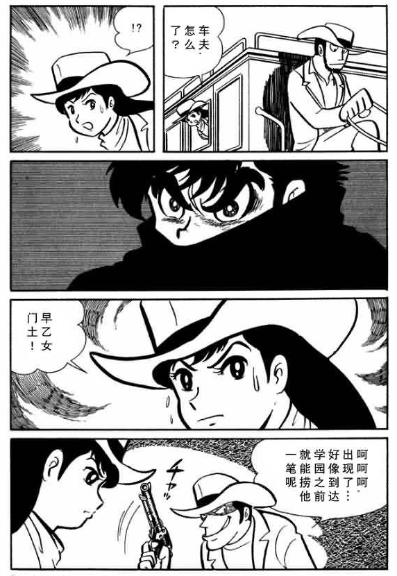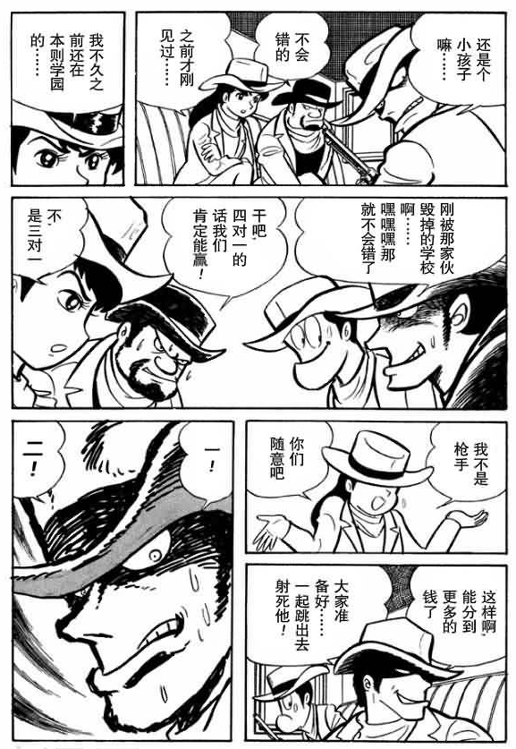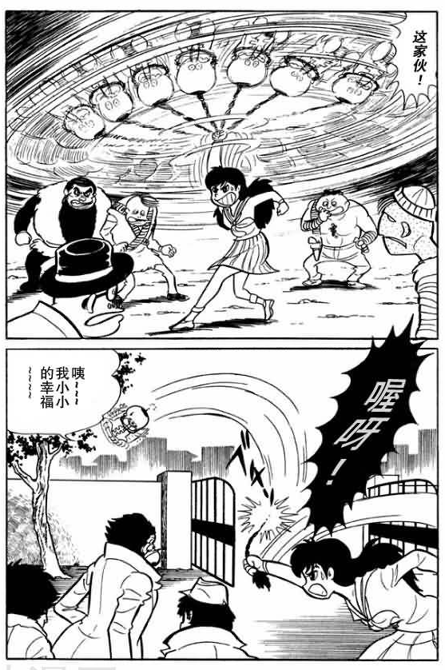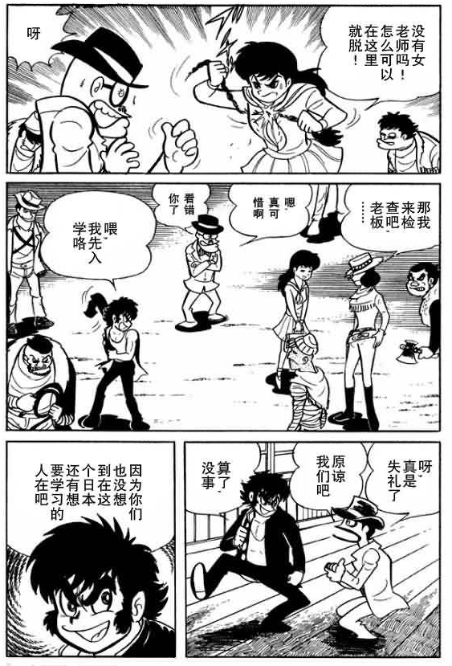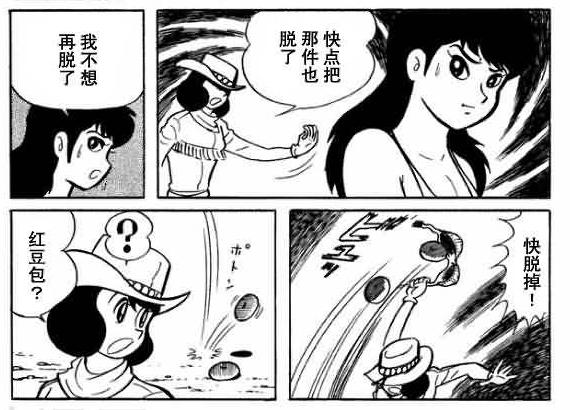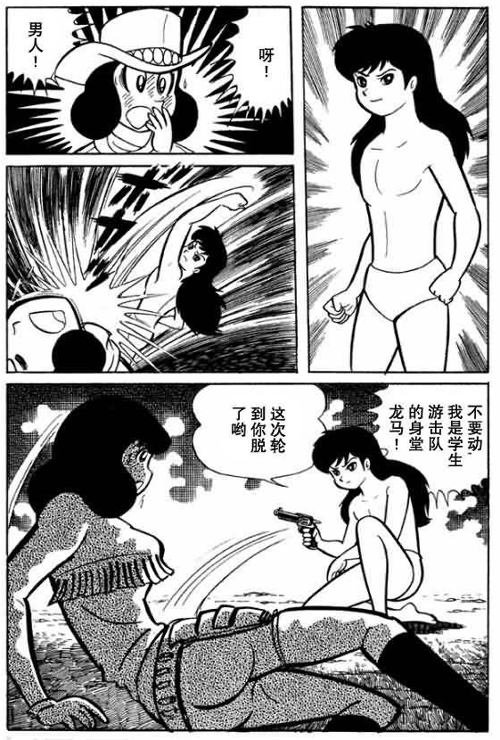

不过这漫画后面两卷完全偏离主题变成魔幻题材了。
