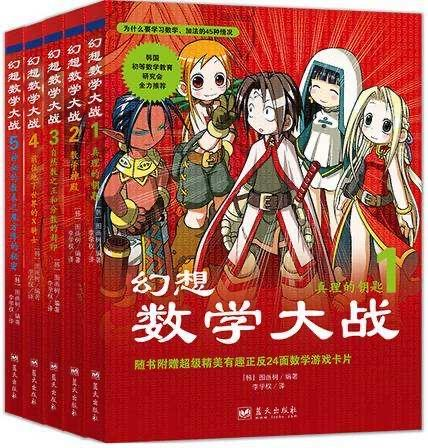

# 怎样创作出一部以学习为主题的少年漫?

**作者**：[陈子敏](http://www.zhihu.com/people/91949509989e39acc6e55e4216ac260b)

**原文**：https://www.zhihu.com/question/389890016/answer/1173318203

**发布时间**：2020-04-23T02:31:52

**编辑时间**：2020-04-23T14:54:35

赞同 87 · 收藏 27 · 喜欢 6 · 评论 9

幻想数学大战？
