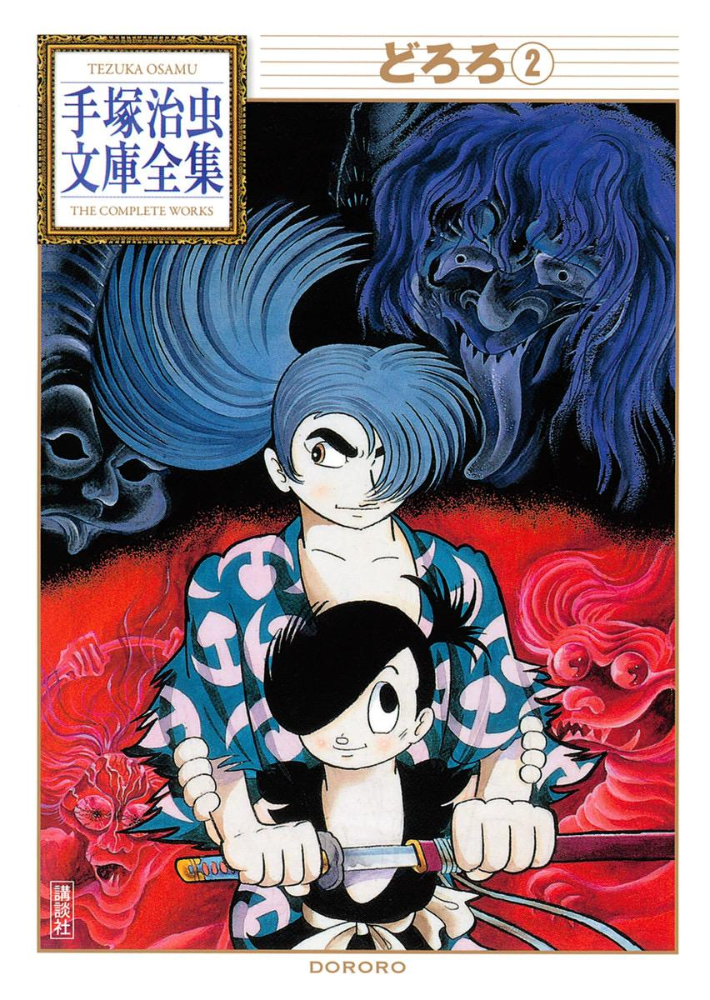
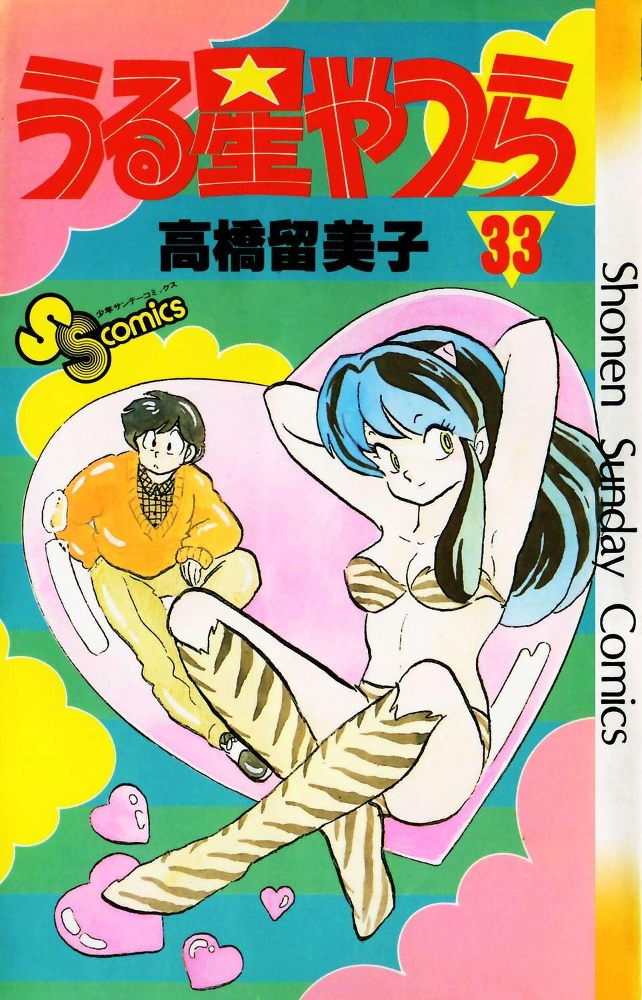
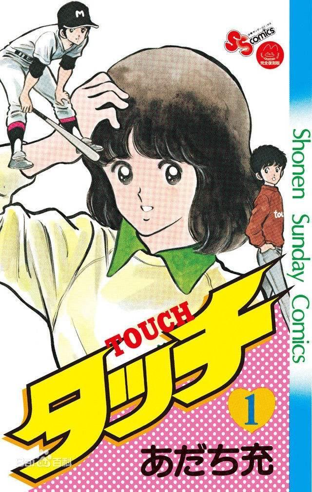
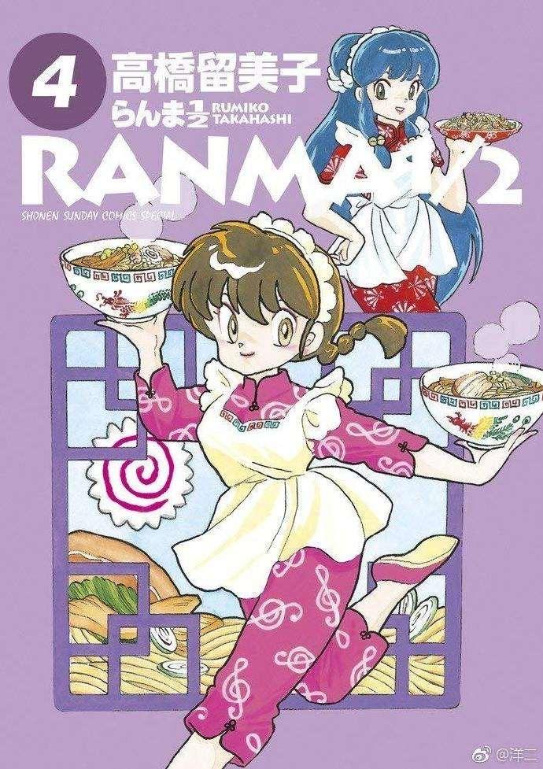
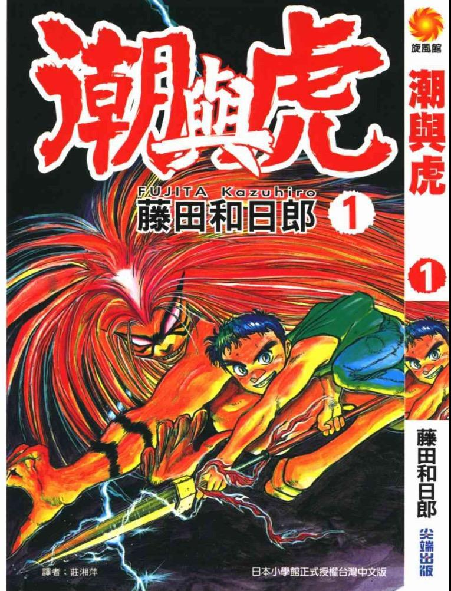
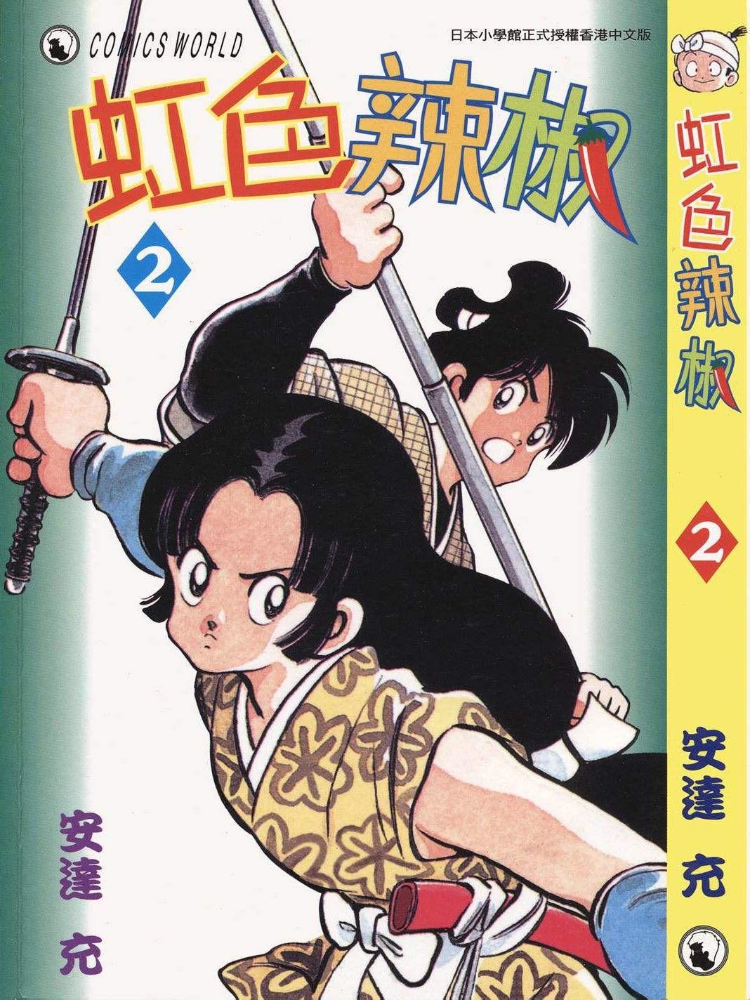
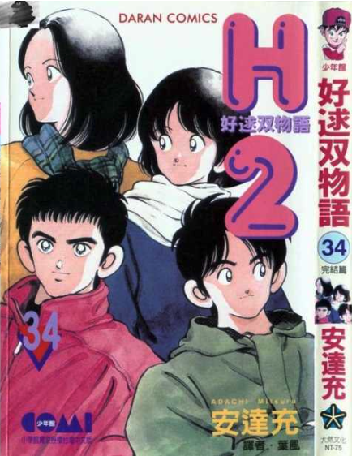
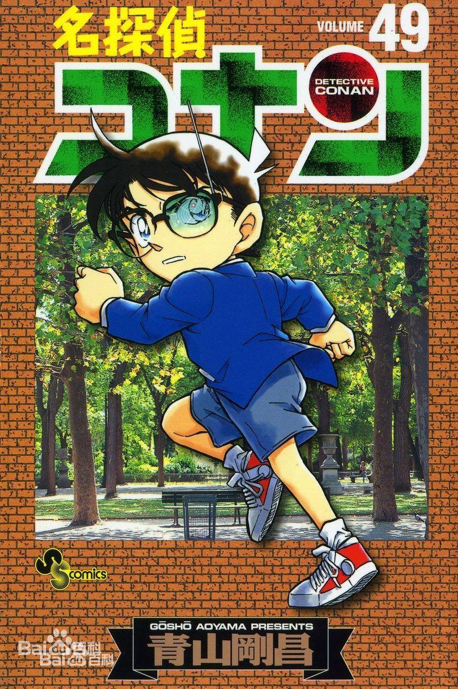
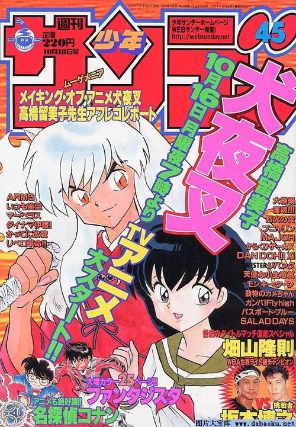

# 有哪些周刊少年magazine和周刊少年sunday的好作品推荐吗？

**作者**：[陈子敏](http://www.zhihu.com/people/91949509989e39acc6e55e4216ac260b)

**原文**：https://www.zhihu.com/question/419738052/answer/1463789959

**发布时间**：2020-09-10T02:11:31

**编辑时间**：2020-09-14T13:08:16

赞同 17 · 收藏 12 · 喜欢 3 · 评论 0

列个SUNDAY上的：

**《多罗罗》**（手冢治虫，1967）

在提到《周刊少年SUNDAY》上的名作时我们常常无意中忽略了《多罗罗》，这是因为《多罗罗》有两个从设定到剧情都大相径庭的平行版本，在许多延伸作品中两个版本的设定与登场角色常常混用。最初的版本在1967年连载于《周刊少年SUNDAY》，而另外一个版本于1969年连载于秋田书店旗下的《冒险王》杂志。我们现今所熟知的版本即是SUNDAY版，是手冢治虫与小学馆为抗衡水木茂在讲谈社《周刊少年MAGAZINE》上连载的《墓场鬼太郎》及其推动的妖怪漫画风潮而作出的回应。

在《多罗罗》之前，手冢治虫还于1966年在《周刊少年SUNDAY》上连载了《狼人传说》（バンパイヤ），这也是一部相当精彩的作品，作为SUNDAY早期的名作而言值得推荐。

2.《**福星小子**》（高桥留美子，1978）

《福星小子》在日本上世纪80年代前期极受欢迎，也是历史上最重要的漫画之一。最早于《周刊少年SUNDAY》1978年第39期揭载，原本仅预备以小品形式连载五回，由于反响热烈追加十回，并开始了长达近十年的连载。1980年高桥留美子大学毕业后，《福星小子》由不定期转为定期连载直至1987年完结。《福星小子》集科幻、动作、搞笑、恋爱、怪谈等种种元素于一身，作品中众多表现手法与各色经典人物属性后来被广泛继承，极大影响了日本漫画的发展进程。作品获得1987年第18届日本星云赏，是星云赏史上第十个获奖的漫画。

《福星小子》是SUNDAY所有名作中我最推荐的作品。

3.《**TOUCH**》（安达充，1981）

《TOUCH》普遍译为《棒球英豪》，于《周刊少年SUNDAY》1981年第36号揭载。作品开创性的将恋爱漫画与体育漫画结合起来，其中贯穿情感历程与角逐全国大赛两条主线，曾被水岛新司斥为“将棒球当作恋爱的小道具（野球を恋愛の小道具として扱っている）”。该作品销量超过一亿册，与《足球小将》、《灌篮高手》并称日本三大体育漫画。温润细腻的情感描写与相对松散自由的节奏构成了《周刊少年SUNDAY》最具代表性的特征之一。《TOUCH》与《福星小子》同为SUNDAY在1980年代前期的顶梁柱。

4.《**乱马1/2**》（高桥留美子，1987）

高桥留美子最著名的作品。继承了《福星小子》一贯的乱斗式无厘头恋爱喜剧风格，受到80年代香港武打电影风潮影响，换以武打竞技主题，围绕着神秘的中国青海省“咒泉乡”及其引发的各类离奇事件展开。小学馆有意将《乱马1/2》包装为与《周刊少年JUMP》的《龙珠》对标的作品，产生了现今我们熟知的所谓《乱马1/2》人气曾与《龙珠》分庭抗礼的论调。但无论如何，《乱马1/2》都是极为精彩的作品。

5.《潮与虎》（藤田和日郎，1990）

藤田和日郎的代表作，SUNDAY上罕见的王道系打斗漫画，对SUNDAY发展进程产生过重要影响，直接催生了《烈火之炎》、《犬夜叉》等SUNDAY打斗漫画大作，亦敌亦友的人与妖怪联手对抗各路妖魔成为经典的设定。作品发行量达到3100万册，获1997年第28届星云赏。《潮与虎》的打斗场面畅快淋漓，剧情丝丝入扣引人入胜，是不可多得的长篇杰作。

6.《虹色辣椒》（安达充，1990）

安达充粉丝经常会指名的一作。

7.《H2》（安达充，1992）

《H2》是安达充的巅峰之作，延续了《TOUCH》的恋爱棒球漫画路线，但相比《TOUCH》，《H2》在画工、剧情及人物刻画方面都更加成熟，大量紧张刺激扣人心弦的棒球比赛场面弥补了在《TOUCH》中为人所诟病的不足，同时恋爱纠纷也极为精彩。《H2》销量达5500万，名列SUNDAY历史上第四位。

8.《名侦探柯南》（青山刚昌，1994）

《名侦探柯南》自1994年连载至今，销量超过2亿，是《周刊少年SUNDAY》历史上销量最高的作品。

9.《犬夜叉》（高桥留美子，1996）

SUNDAY上的名作实在是太多了，相对于JUMP这种主打王道主线剧情热血战斗漫画的杂志而言，SUNDAY无论体裁还是故事节奏都更加自由而广泛，因此也诞生了很多风格迥异的作品，并且由于许多作品倾向于结构松散的传统单元剧（比如《福星小子》、《乱马1/2》《GS美神极乐大作战》，以及同为小学馆旗下杂志《Big Comic Spirits》连载的《相聚一刻》也属此类），有人笼统的将这种风格称作“SUNDAY系”以作为和JUMP系的王道主线类型漫画相对的概念，无论准确与否，算是很有代表性。
