# 如何看待 PS5 按键将出场设置统一为 O 取消、X 确定？

**作者**：[陈子敏](http://www.zhihu.com/people/91949509989e39acc6e55e4216ac260b)

**原文**：https://www.zhihu.com/question/424147943/answer/1509246714

**发布时间**：2020-10-06T09:52:38

**编辑时间**：2020-10-08T18:37:58

赞同 246 · 收藏 54 · 喜欢 25 · 评论 60

**这是一篇长答，分析了至今按键操作方式割裂的由来，但也包含了许多臆断和猜测。**

先说结论：

可能是索尼对日本市场失去信心的一个表现——不过当然还没到“完全放弃日本市场”的地步，毕竟没说PS5按键设置不能手动更改，只是在发售前公布这个绝对是婚前自宫行为，再怎么说也是伤害日本玩家感情的。

10.6.下午光速打脸：

新消息，**SIE确认用户无法自行更改PS5的按键设定。** ​​​SIE表态中说，这一改变是为了解决系统键位设计与游戏键位设计相反时可能造成的误操作，以及减轻游戏开发者的负担。收回前言，这已经形同放弃日本市场了。

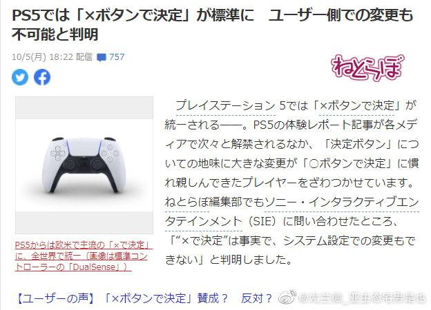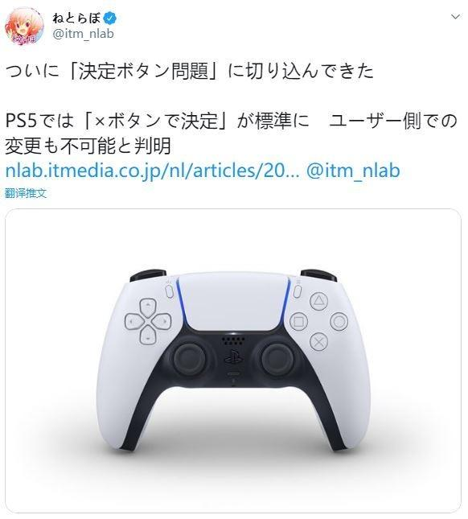

坏时代，来临了（悲）。

---

游戏按键符号功能定义一直是个游戏史复杂的遗留问题，包括任天堂和微软ABXY完全相反的键位，对于很多跨主机玩家来说是一种不得不长时间习惯的痛苦精分体验。PS玩家一旦跨区玩了欧美游戏，操作就更是错误百出。到现在大家还很难理解为什么欧美在PS的OX按键含义上和日本正相反。

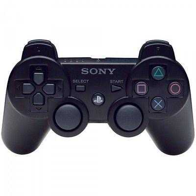

很多人解释说这是文化差异，说“X在欧美代表确定”，还用藏宝图上画叉标记宝藏位置来佐证观点，但这显然不能解释为什么欧美人普遍使用的Windows及Mac操作系统中无一不是用“X”而不是“O”来作为取消或关闭按钮的符号，怎么会有人把叉当作“确定”来按呢？

顺便，不会真有哪个美国索狗以为老师往试卷上打叉是夸你聪明吧？不会吧？

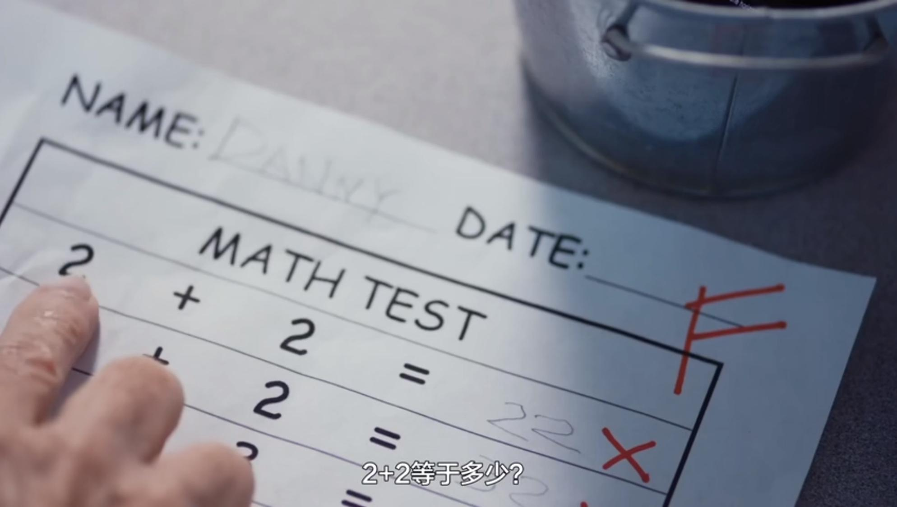

不论别的地区对“X”如何定义，我们至少知道美国人民当然是不会把“X”当“好”把叉当对勾打的。

至于“O”在欧美文化里是否有什么表“否定”的含义，我查阅了一些Reddit帖子和维基百科，问过了在美留学生和在英留学生，结论是“O”就连使用场合都很少，更别说固定的含义了。那位在英留学的朋友告诉我剑桥教授偶尔会用圈给写错的地方画重点，“不过欧洲人划重点更喜欢用荧光笔，画圈是很少见的”，而正常批作业更是以打勾表示对打叉表示错。

由此可见，“O”、“X”的含义在欧美文化里与日本大同小异，在东西方文化里“X”都是表负面居多，“O”在欧美甚至没有明确含义，——而归根结底，所谓“OX符号在日本和美国含义相反”之类的说法，我只在中文圈见过，你们看看就好：

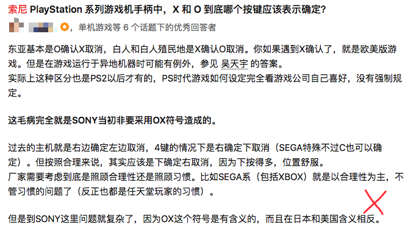

我这打的是美国的X哦

“文化差异说”当然不攻自破。我甚至怀疑所谓OX含义颠倒问题打从一开始就是自有PS以后牵强附会出来的事情。前面说到，“O”和“X”在欧美文化中与日本大同小异，**索尼很有可能只是单纯顺应欧美玩家习惯而将PS的OX按键功能互换，并没有考虑过什么文化环境问题**。

况且在UI设计中，**符号的含义常常只和它本身的应用有关**。也就是说，在PS应用这些符号之前，这些符号对玩家来说可以什么含义都没有。是功能赋予了符号内容。

而在大多数场合下，玩家是不会盯着按键见招拆招的，按键的使用往往仅凭肌肉记忆。为什么欧美玩家的肌肉记忆偏偏就选择了与日本玩家截然相反的“确认在下（X），取消在右（O）”，导致了流毒后世造成如此巨大的鸿沟，则是一个众说纷纭的复杂问题。

---

我们今天所熟知的ABXY菱形键位是任天堂SFC手柄上的设计。

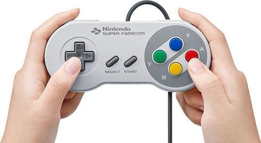

世嘉作为当时任天堂最大的竞争对手，想要通过操作习惯差别在玩家群体里制造壁垒，于是在MD手柄上将字母排列改为从左至右，与任天堂相反，并增加到A、B、C、X、Y、Z六键：

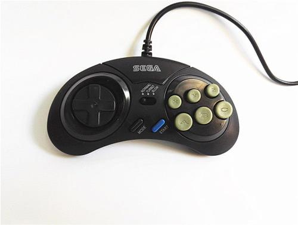

功能上同样是A确认、B取消（C键有时和A功能一样）

然后是SS手柄：

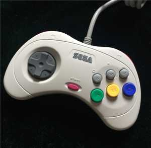

直到DC，世嘉将手柄改成了类似SFC菱形分布的ABXY四键，但依然沿用从左到右从下到上的顺序。这也是我们今天熟知的Xbox手柄设计雏形，除了键位外，包括左摇杆在上十字键在下，都是从DC开始的设计。

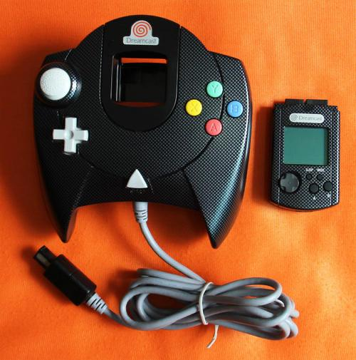

由于销量低迷，DC于2001年退市，世嘉也从此退出主机竞争，由微软代替了原来的位置。

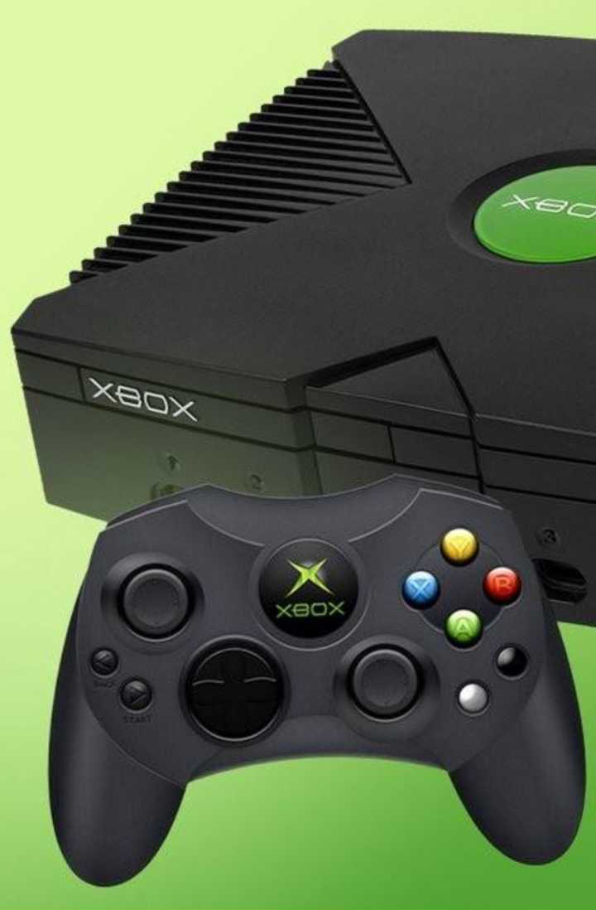

Xbox是DC的事实上的精神续作，在设计上有明显的继承关系，其中DC的键位“上Y下A左X右B”，就是至今Xbox手柄键位的由来，也是贻害无穷的日本欧美游戏之间操作习惯割裂的帮凶。初代Xbox通过微软铺天盖地不计成本的推广开始在北美普及，从此之后欧美玩家形成了统一的与日本截然不同的游戏按键操作习惯——到目前为止都是老生常谈的东西。然而这样我们就搞不清楚为什么PS早期针对美版的手柄设计OX键和日版也是相反的：

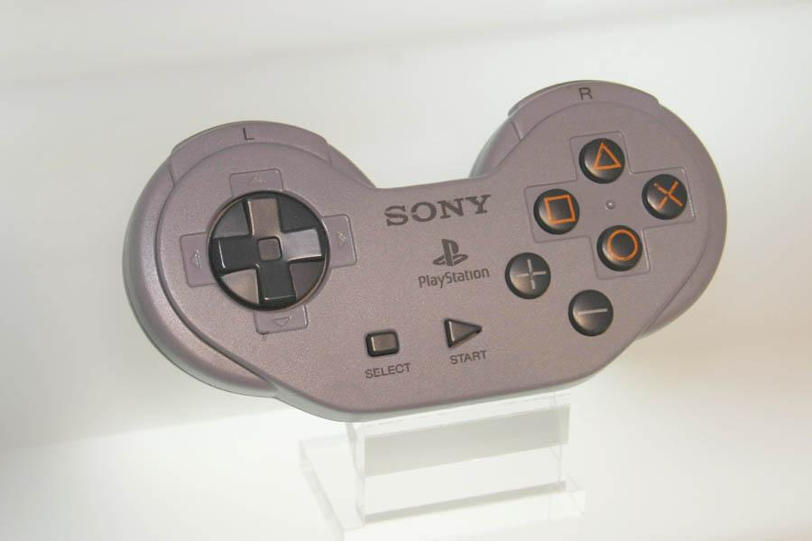

我的解释是，当时早在Xbox之前，北美玩家的“下确认、右取消”的肌肉记忆就已经是常识了。当年这种世嘉式按键方案得以扎根，跟任天堂每代按键方案断崖式换代有关。

众所周知，世嘉MD虽然全球销量风光不及SFC，但由于SFC发售过晚，MD提前两年就占领了北美市场，并获得了SFC难以企及的近2000万的装机量。从世嘉MD开始，从左至右排列的ABCXYZ按键在世嘉主机上作为一个传统按键方案继承了下去，**从MD到DC，不变的“下确认、右取消”操作习惯在北美就已经扎下了根**，反观任天堂家用机的手柄按键位置在SFC之后从来就没有彻底统一过，每一代手柄都在推翻前一代手柄按键逻辑基础上重新设计。虽然N64在北美市场吊锤SS，但它的手柄AB键位置是上下相反的，直接取消了XY键，右边菱形分布的四个黄色按键是用于操控视角方向的C键，这等于把SFC玩家形成的肌肉记忆都给扬了。

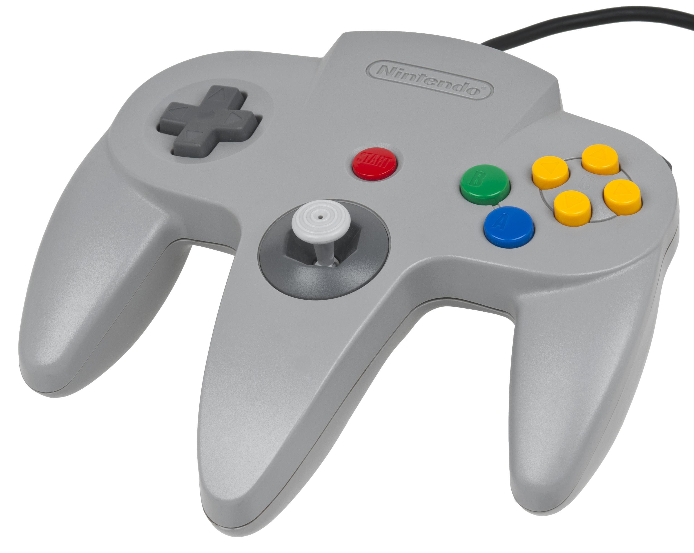

图中蓝色为A键，绿色为B键

NGC手柄的AB键上下位置又转回来了，然后任天堂把XY键给搞成了异形，这样按Y的位置和XBOX也没什么区别，X反倒像是在按MD手柄的C键：

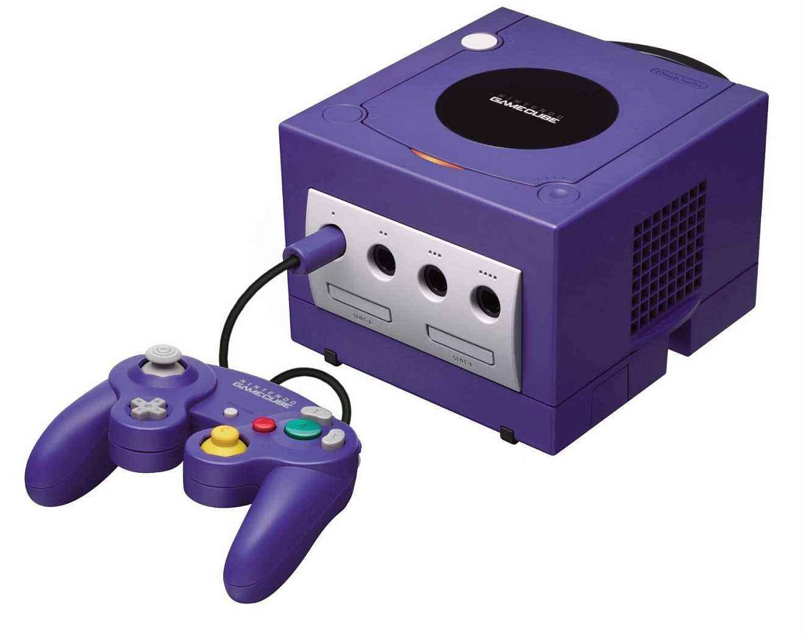

图中绿色为A键，红色为B键。我个人非常喜欢NGC手柄的设计，自己也收了一台NGC打阳马

至于Wii手柄就更过分了，直接推翻了以往任何一代主机对A、B、C、Z的传统定义，正面仅保留A一个功能键，将B放到背面，十字键放到右手边……任天堂的统一按键逻辑仅在掌机平台上得到体现。没有具有继承性的统一按键方案，任天堂自然也就没有一统玩家的操作习惯。

这些只是关于为什么世嘉键位得以在欧美广泛通行的一种解释，并不唯一，真实的历史中也许有更复杂的原因。PS在欧美XO按键功能相反的原因也未必真的完全只是顺应玩家的肌肉记忆而已。

假如这个解释真的与事实吻合，那么**世嘉即便折戟沉沙身名俱灭，却以这种阴魂不散的方式赢得了某种DNA意义上的最终胜利**，那还蛮令人唏嘘的。

---

写在最后。

本世代，PS4在日本失利已经成为共识，早在2014年9月TGS上SCE就过早的承认了这一点。

PS4在日本首发（2014.2.22）第二天就卖出32万2083台，然而从此断崖式跌落，在其后近一年的时间里居然只卖了60万台。2014年年内PS4的日本总销量一共970667台，而公认首发不利的PS3截止发售不到一年也有130万台左右。

下图那条跳楼般的蓝线就是PS4:

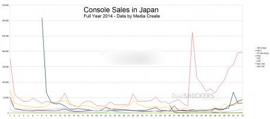

（由于PS4首发缺乏本土游戏，首发销量两天内的爆发和后续断崖下跌就已经勾勒出当时欧美游戏在日本受众人数的大体轮廓了…。）

六年后的今天，PS4的日本总销量在920万台左右，占全球销量（约一亿一千万台）的不到十分之一。PS4在日本卖得最好的2017年，销量约208万台，甚至不及PS2服役期间（截至2008年年初）日本的年平均销量（约298万台）。

总之，自PS4（第八世代）开始日本游戏市场就被认为是个正在萎缩的奇葩市场，大家还纷纷发现日本人压根不玩什么神海、美末这些索尼第一方游戏，对什么GTA、辐射4这些欧美主流大作也不感冒，因其相对封闭的特征被称为“ガラパゴス化”。仅就家用机第三方游戏而言，日本本土的游戏生态几乎自给自足，大部分主流海外游戏在日本市场占比很小；反之除了几个全球知名的系列以外，日本本土软件商的游戏在欧美也受众寥寥。顾及占比不到10%的却又相对孤立的日本市场对SIE而言显然已经成为一个包袱。

而统一欧美操作（并无法更改）无疑表示对SIE而言日本市场已经可有可无。相比江河日下的日本家用机市场，欧美本来就是PS最重要的立足点。**PS5无论定价、造型、甚至手柄大小都不是为东亚玩家设计的**，那么根据欧美操作习惯来统一X和O的定义也不过是无伤大雅的细枝末节。毕竟日本家用机市场是受到移动游戏挤压而不断缩小的，今后只怕是会越来越小，就算放弃日本市场由欧洲或北美来完成PS的历史，也是早晚的事。
