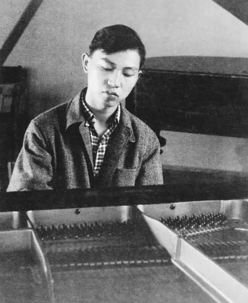
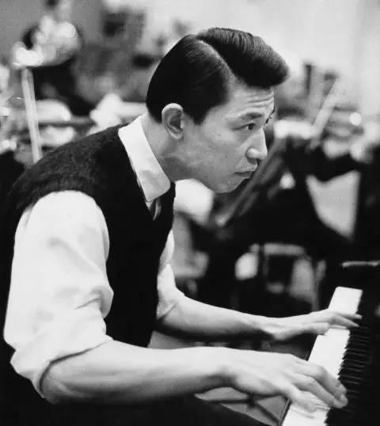
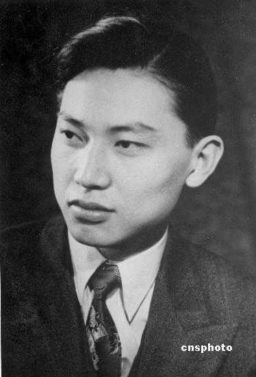

# 当地时间 28 日，著名钢琴家傅聪在英国感染新冠病毒去世，你对他有哪些记忆？

**作者**：[陈子敏](http://www.zhihu.com/people/91949509989e39acc6e55e4216ac260b)

**原文**：https://www.zhihu.com/question/436736385/answer/1651036430

**发布时间**：2020-12-29T11:43:23

**编辑时间**：2022-02-06T01:19:17

赞同 334 · 收藏 29 · 喜欢 36 · 评论 62

傅聪的德彪西前奏曲、练习曲，莫扎特奏鸣曲及斯卡拉蒂奏鸣曲都是非常精彩的演绎，强烈推荐。

我个人很喜欢他的肖邦第三钢奏，虽然目前留下的录音损坏很严重但刚劲有力的演奏风格还是很具感染力。除了速度控制非常保守，相比鲁宾斯坦（基辛也类似）的演奏，傅聪使用踏板更节制且慎重（第一乐章开头前4小节就很明显），这点我非常喜欢。

[QQ音乐](https://c.y.qq.com/base/fcgi-bin/u?__=XRuldzq)

傅聪先生去世无疑是非常可惜的，但对公众和对个人而言意义也不一样。

个人来说，傅聪的《望七了》这本书里各种文章和访谈还有教学笔录对我（不论好坏）影响很大，里面有些玄学的或是带艺术偏见之类的东西比较有误导性，但他真诚分享自己的演奏和聆听音乐的经验感悟等方面都启发了我对音乐的兴趣，就这一点而言我非常感谢他。

对公众而言，傅聪先生停止公开演出也很久了，他的逝世对于大家的影响并不重大，我认为媒体没有必要借题发挥大书特书，或是借老人家去世来发表凡尔赛言论。

至于有些连傅聪都没听说过的人为什么还要来强答呢？居然还有拿自己听没听说过当评价标准，说自己听说过郎朗没听说过傅聪那就是傅聪水平不到家的，也太可笑了吧，求您不要丢人现眼了好吗？

---

束棒们还是少丢人了吧，我一个字没提别的通篇在聊音乐，居然能从字缝里看出字来说我在“拼命洗地”，真是想象力丰富到了极点，这怕不是淫者见淫？

“你不骂他那你就是在给他洗地！”

不知道到底是什么样的二极管物种大脑能简单成这个样子？您内心戏这么多，自我意识过剩颅内狂想一堆有的没的我都替您感到累，极右束棒们有这精力您咋不找个对象啊？

别的答案讲父子关系家国大义的问题已经有很多了，我就单纯讲一下傅聪艺术成就，仅此而已。别的我也没什么好说的，很多答案都讲了，人确实有污点，非得逼所有人全部复读一遍表忠心是吧？

没有人是不容许批判的，傅聪于1964年加入英国籍确实为他的亲人造成了沉重打击，但你要先搞清楚，害死傅雷夫妇的，是你缄口不提的凶手，而不是远在天边的傅聪。
