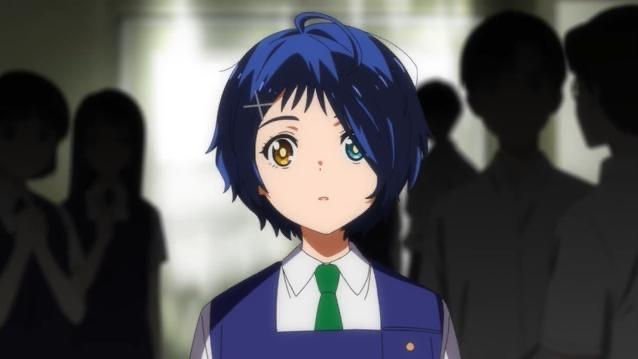
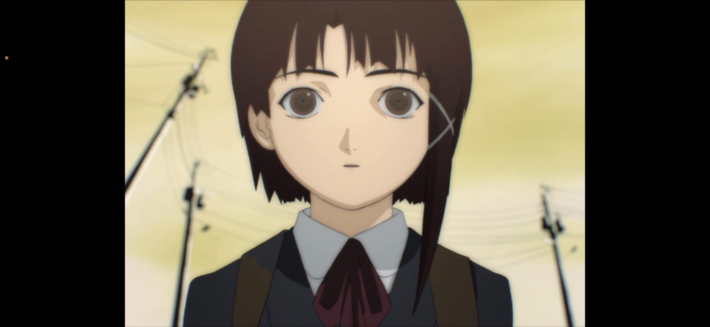
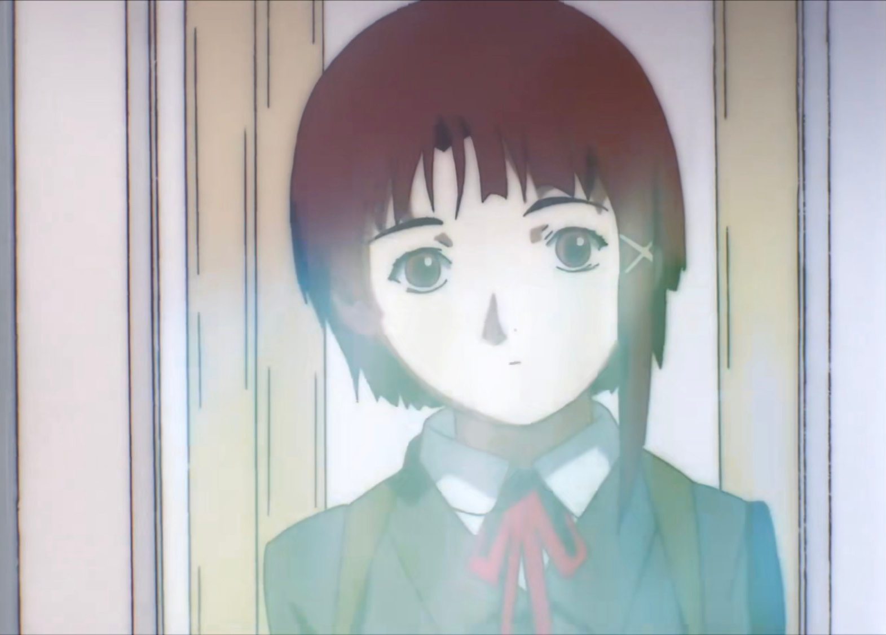
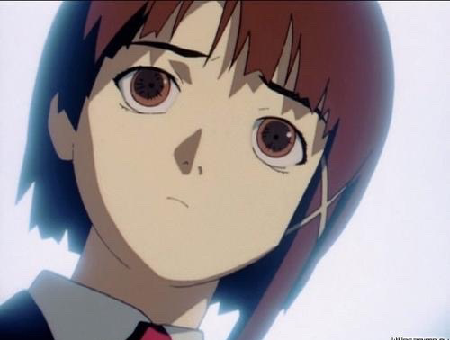
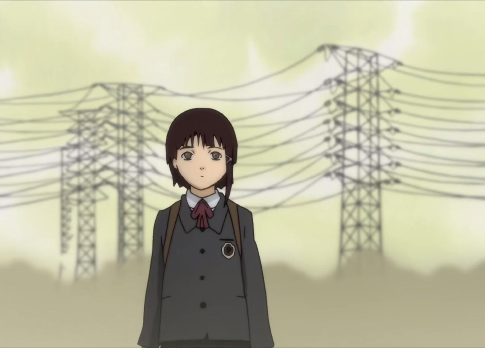
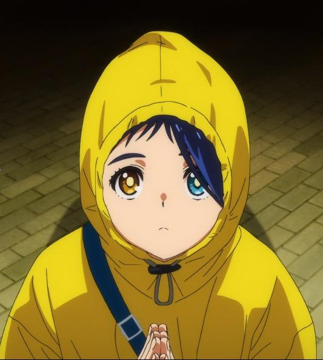
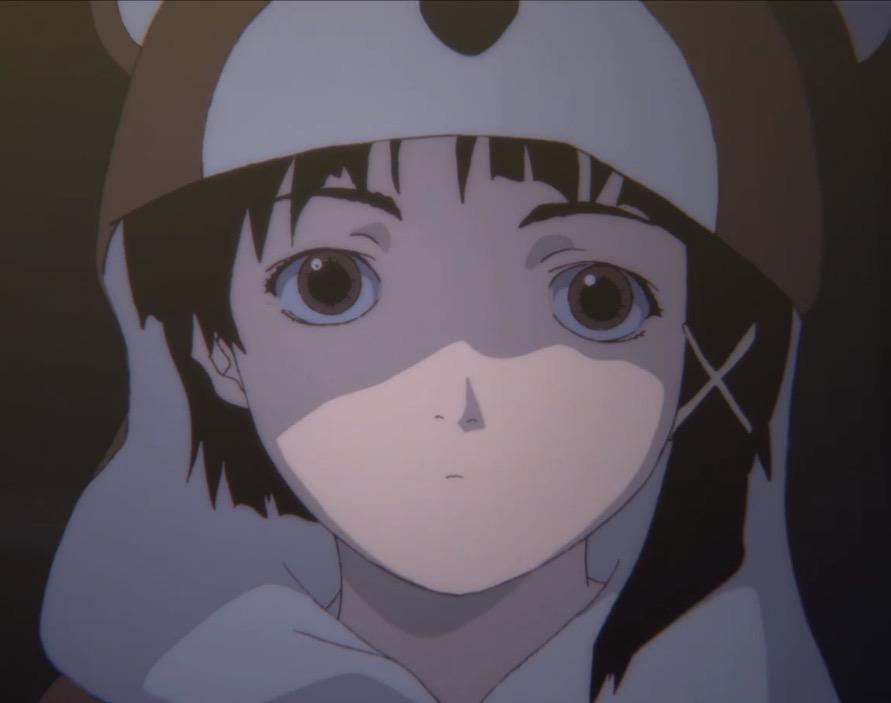
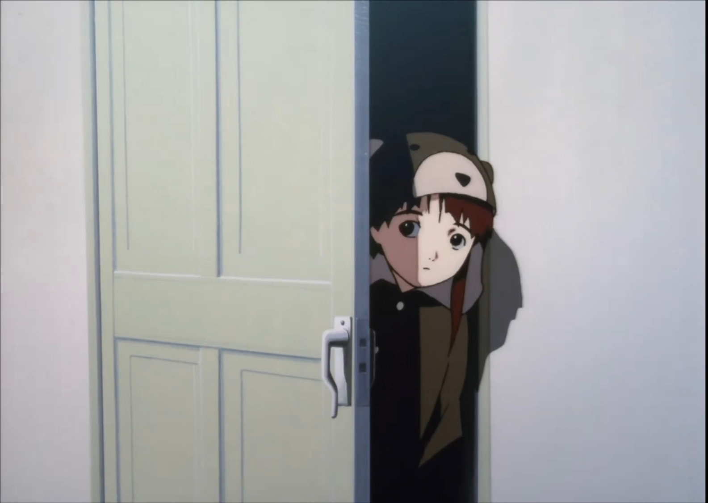
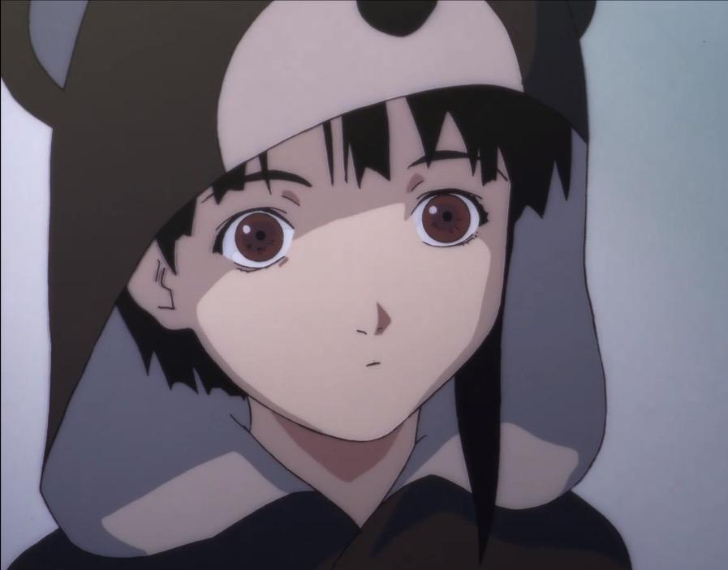

# 如何评价2021年1月新番《奇蛋物语/WONDER EGG PRIORITY》？

**作者**：[陈子敏](http://www.zhihu.com/people/91949509989e39acc6e55e4216ac260b)

**原文**：https://www.zhihu.com/question/438925755/answer/1678602316

**发布时间**：2021-01-15T03:43:38

**编辑时间**：2021-07-12T21:02:14

赞同 11 · 收藏 5 · 喜欢 2 · 评论 5

是不是很像Lain？

（甚至有同款发夹）

然后大户爱戴上兜帽的时候又让我想起了Lain的小熊套装：

其实两部作品开头也有些相似，是围绕着同学自杀展开的。（《Lain》开头岩仓玲音莫名收到了已经自杀的女同学四方田千砂的邮件）。也许《奇蛋物语》潜移默化的受到了《Lain》的影响。
