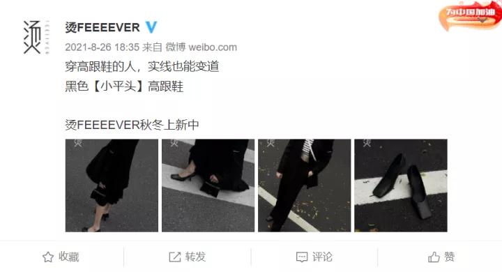
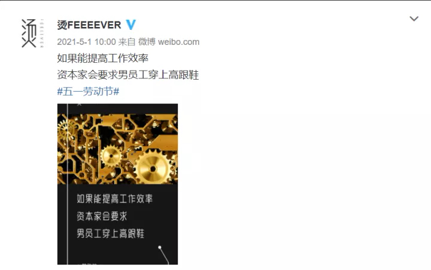
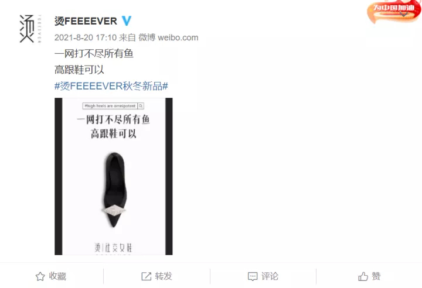
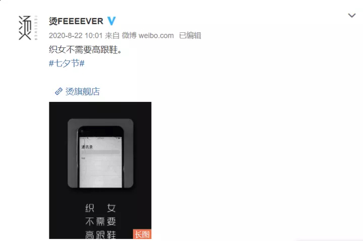
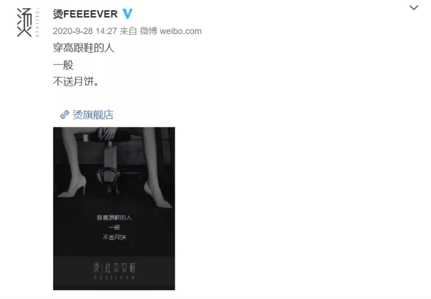

# 如何评价女鞋网店的三八节锯腿文案「这天，应该把所有男的腿平均锯断 10CM」？

**作者**：[陈子敏](http://www.zhihu.com/people/91949509989e39acc6e55e4216ac260b)

**原文**：https://www.zhihu.com/question/519140960/answer/2369968740

**发布时间**：2022-03-02T01:42:21

**编辑时间**：2022-03-02T02:08:31

赞同 8 · 收藏 2 · 喜欢 2 · 评论 0

这家网店平时的广告文案让我想起了前几年所谓的“苹果式中文”，指苹果产品广告文案的文风，以拙劣的翻译、语法结构破碎、主语缺失、幼稚的押韵等特征著称：

这个女鞋店充满癔症文风的广告文案也可以称作“烫式中文”，但前者是词不达意以及翻译润色的陌生化问题，而后者则是纯纯的谜语人，通过将任何毫不相干的概念、符号、意象与“高跟鞋”这一母题的语无伦次的无序组合鹦鹉学舌模仿所谓后现代解构主义风格：

而且，前者（苹果）是针对具体产品推出对应的广告文案，后者则似乎想以大规模量产垃圾话广撒网碰运气祈祷百发一中出奇制胜成为“网络热梗”“模因污染”“传播学典范”以博出位，也不知道是哪个高中肄业营销鬼才想出来的成本极低变现遥遥无期的战术。顺便把什么八竿子打不着的东西不知所云全跟“高跟鞋”扯到一起，也是拙劣的洗脑灌输消费主义脑癌污染视听的低级手法。

虽然手法拙劣，但这次也以挑唆男女对立掌握流量密码尝到了甜头，很难想象以后又要从哪个敏感话题下手，也许是领土争议、历史纠纷、地域歧视、性少数，不一而足。

但问题却不在于敏感话题本身，**而在于为什么会有这样能够让人纯靠碰瓷发财的网络环境。**
