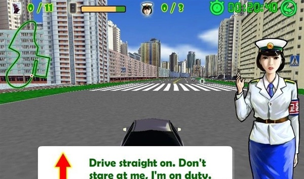

# 中宣部称「推出一批主旋律鲜明、正能量充沛的高品质网络游戏」，其中还有哪些信息值得关注？

**作者**：[陈子敏](http://www.zhihu.com/people/91949509989e39acc6e55e4216ac260b)

**原文**：https://www.zhihu.com/question/521886081/answer/2396726909

**发布时间**：2022-03-19T13:03:14

**编辑时间**：2023-06-27T14:57:40

赞同 56 · 收藏 5 · 喜欢 9 · 评论 2

游戏相比于一切其他艺术形式的重要不同就在于游戏并非**强作者主导**的，玩家有权利用游戏所提供的完整形式系统中的材料来尝试交互的任意可能性（而不是像电影或其他艺术形式那样单方面的接受）。在游戏内容足够丰富的前提下，越是满足这样的特性，游戏的自由度就越高；越是强作者主导，游戏就相对越是线性（也越靠近游戏的坐标系的边缘）。也许能做成叙事性强的游戏如《底特律》，做不好就变成三步一播片，跟《龙穴》一样看着动画打qte。

归根结底，这是因为**游戏的内容**（指叙事、主旨等）**是几乎严格建立、并依赖于形式**（机制、系统）**上**的。**如果先想好要表达什么“主旋律正能量”之类的价值观，然后才去考虑要做哪种游戏，根本就是本末倒置。**

既然要求“主旋律鲜明”，是不是题材上要选用光辉革命历史内容？还要做“网游”，如果不是PvP我玩红军你玩白匪，那难道是PvE打本那类的MMO？那么游戏内容如何更新？是不是做完红军三大主力会师陕甘宁之后就停更，或打完蒋匪攻占南京就关服？

既然要求“正能量充沛”，那还能做PvP吗？如果要做，那么这个PvP游戏的竞技方式是什么样的？不能打打杀杀，那要比谁互相敬礼作揖的速度快吗？如何累计评分？玩家等级以什么来评价？

把游戏做的“主旋律鲜明正能量充沛”可以，但你怎么保证玩家不在游戏里作出丧尽天良的事情？你设计一个扶老奶奶过马路的任务，玩家就有一千种杀害老奶奶的玩法——老爷们压根没想过，“主旋律”、“正能量”竟先天和游戏这一艺术形式格格不入！在如此伟光正的游戏下，怎么能允许让玩家的自由度，去亵渎主旋律和正能量呢？

那恐怕能做的就只有：

很主旋律，也很正能量吧

---

我觉得其实可以做点乡村振兴题材的种田经营类游戏，把机制做丰富点收费项目少点应该能有可玩性，也很符合主旋律正能量。

也就是说，其实不是不能做，但就中宣部的发言来看，他们并没有搞清楚一部游戏是怎么做出来的，做出一款好的游戏有多难，并不是在发言中给游戏加一个“高质量”的定语，就能使拿了补贴的厂商真的做得出“高质量的游戏”。游戏不是大手一挥就能像雨后春笋一样自己蹦出来，历史证明玩家也不像韭菜那样割了一次还能再长起来的。如果老爷们总惦记着拿“主旋律”、“正能量”来指导他们不了解的东西，国家给的补贴大概率还是要落于给骗子们拿去打水漂的下场。
