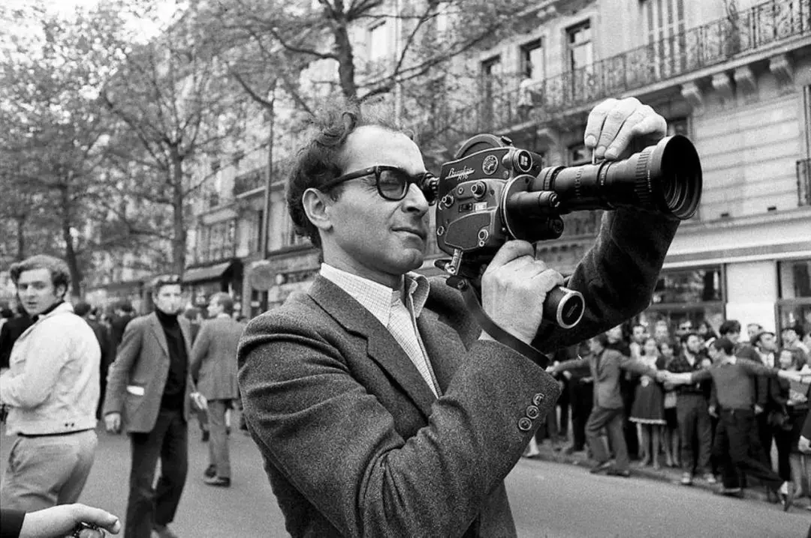

# 如何看待河北科大李家和「团队 6 人成本 5000 元的毕业作品入围戛纳」？影片成本与质量有大关系？

**作者**：[陈子敏](http://www.zhihu.com/people/91949509989e39acc6e55e4216ac260b)

**原文**：https://www.zhihu.com/question/530632763/answer/2464411797

**发布时间**：2022-04-30T13:24:50

**编辑时间**：2022-05-04T17:31:28

赞同 44 · 收藏 10 · 喜欢 6 · 评论 2

很多人有些误会，就是当代电影工业看起来好像花花全是钞票，动辄几千万上亿，但**其实资金大头都是用来请名演员的，**制作费用反倒是很灵活。演员费用一上来，什么场地、道具美术、设备器材、拍摄、后期的费用全跟着一起沾光，反正跟演员片酬比多一点不多少一点不少，和领导视察基层，群众顺带沾光改善下伙食差不多。哪天听说一个剧组设备租用（包括摄影机、镜头、监视器、轨道、摇臂、照明等）成本将近百万，望洋兴叹，然而可能也就是演员费用的零头。

另外一个误会，**就是大家至今还一概认为电影是工业，**那么想必层次分明秩序井然，一定高不可攀**。但其实这也是要分情况和看类型的**。

当今的民用摄影设备和民用后期技术是空前发达的，不花多少钱，凭几个人就可以创作出非常精彩的短片，好像完全可以称为手工业了。但这样的手工业生产方式，他所拍摄的类型风格一定是受限的，比如因为他的成本不允许拍摄需要大场面调度的电影或制作大规模的电脑特效，因此就与古装片、战争片、奇幻片、科幻片、灾难片，以及动画、cg电影等等类型无缘了，所以独立电影以现实主义文艺片、爱情片或犯罪片居多，并且导演中心制，事必躬亲，比较容易突出作者性。

维尔多夫或者戈达尔当年扛着摄影机上街的时候，没少拍到群众直视镜头的穿帮画面，可这重要吗

作者性强的电影往往决定于作者的品位、风格这些软的因素，虽然成本太低在设备、摄影和后期上不一定能达到院线电影的工业标准，但只要软的层面能达标，想要创作一个完整的作品是完全足够的。而且当今后期领域民用级别的工具门槛如此之低，稍下苦功都能学会一点够用的PR、AU、AE技术，至于学精是时间问题，除非要做动画和大规模电脑特效，小规模的电脑特效如贾樟柯那种，自己学一学也能做。

所以“影片成本与影片质量的关系”这个问题可以拆成两个，一个是**为什么我们平常看到有的高成本电影却名不副实拍的很差**（如《上海堡垒》），电影成本高不意味就用在了前期剧本立项或拍摄后期阶段，这个问题结论很明显就是演员片酬和制作成本比例不协调；另一个是**不花大钱可不可以做出质量高的电影**，结论是靠民用级的设备和后期技术可以做出好作品，但成本决定了这种影片的类型和规模非常受限。

虽然所谓成本5000元6人团队听起来不可思议，但以行业标准来看这绝不是真实成本——正确的说法应该是拍摄预算，只是作为学生电影他们没有把自己的劳动算进成本里而已。

说到底其实电影这个东西也就是那么回事，不要以为有多吓人。当今但凡有审美能力和想要记录或传达的思想，小型团队不花钱创作出完整的参奖作品是一点不奇怪的，重点不在于钱而在于人。
