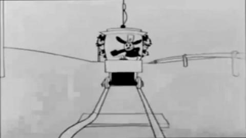
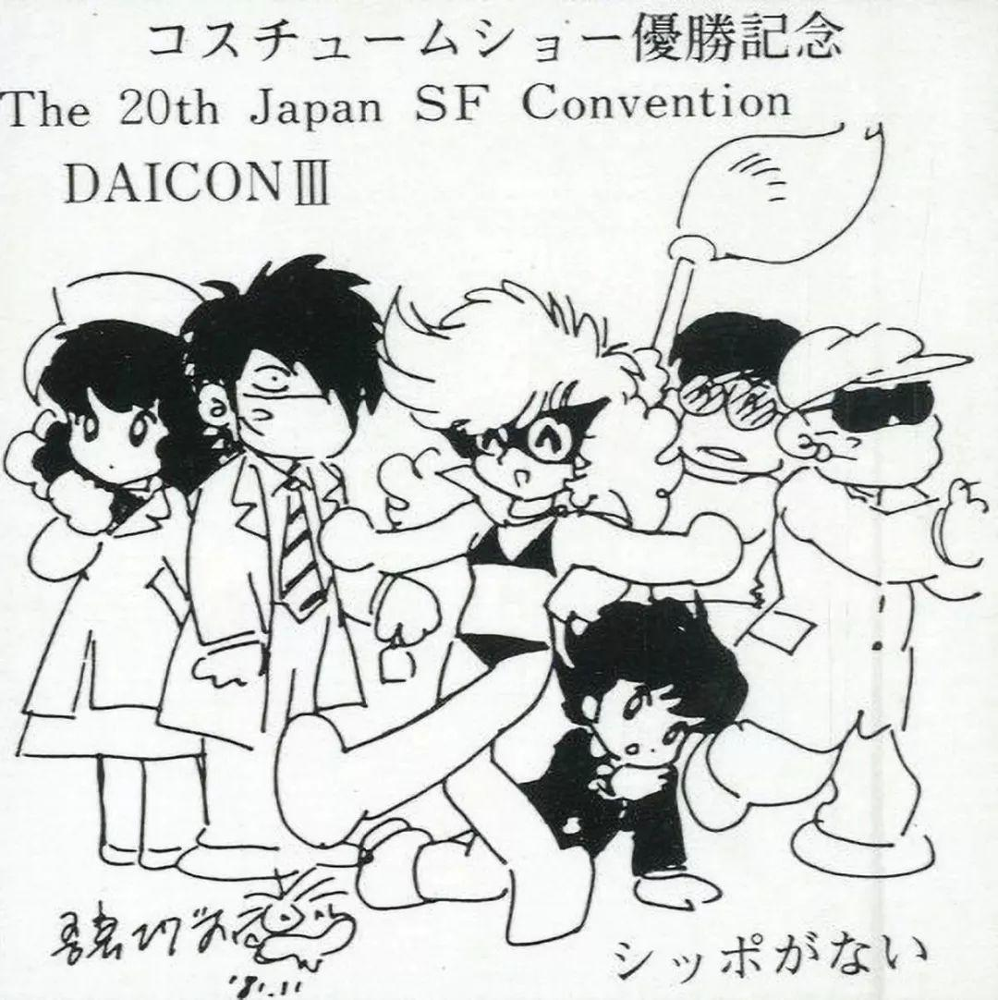
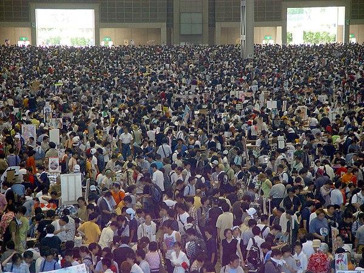
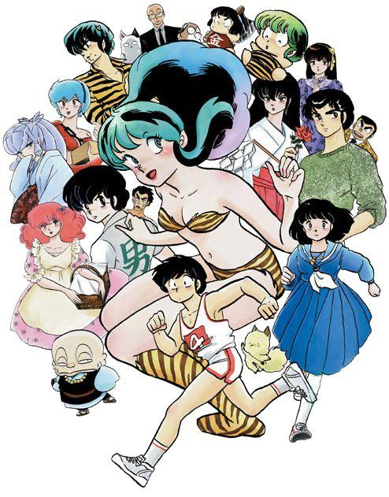
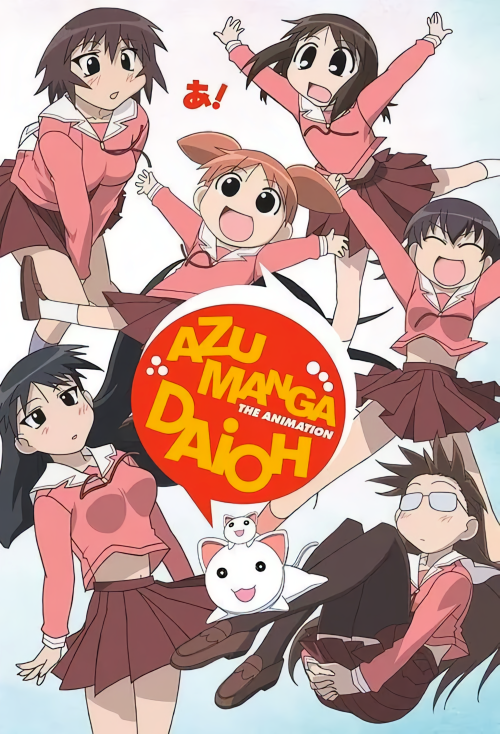
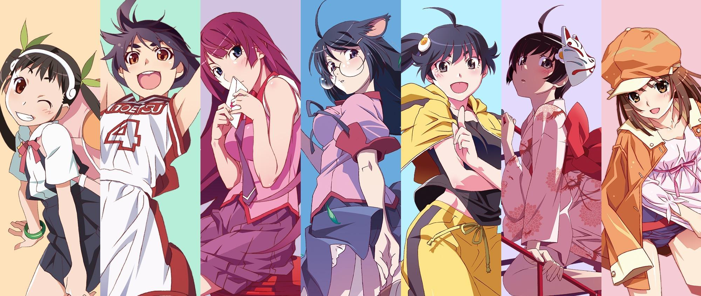
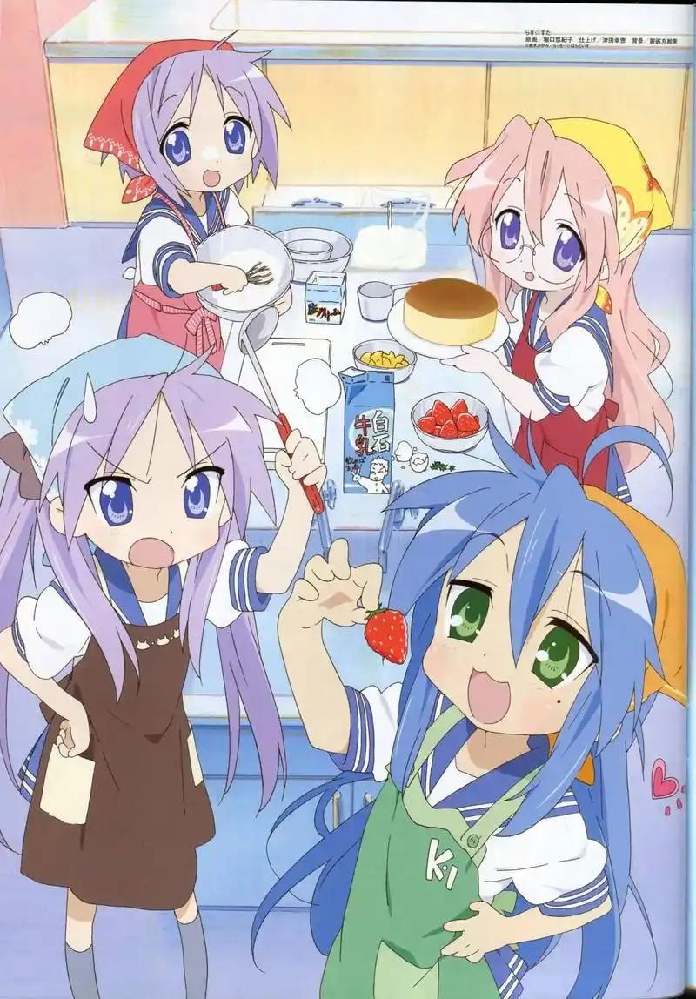
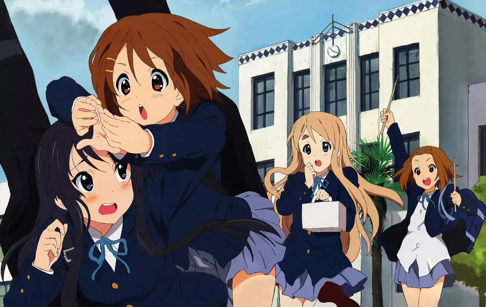
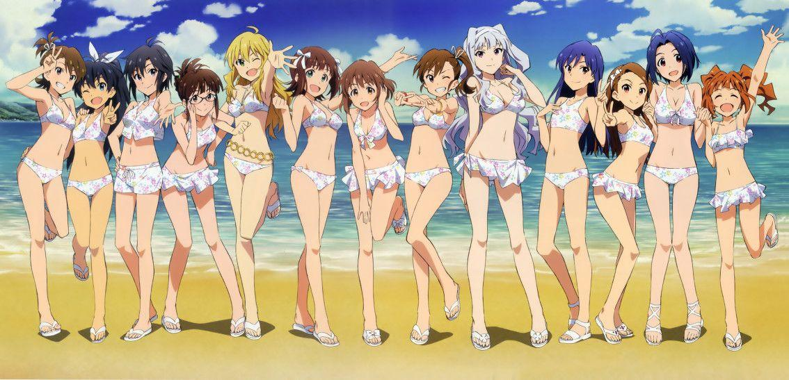

# 你认为究竟什么是二次元?

**作者**：[陈子敏](http://www.zhihu.com/people/91949509989e39acc6e55e4216ac260b)

**原文**：https://www.zhihu.com/question/659229462/answer/3542353533

**发布时间**：2024-06-26T08:28:12

**编辑时间**：2025-09-11T11:20:03

赞同 14 · 收藏 22 · 喜欢 0 · 评论 12

**二次元其实只是一种特殊的心照不宣的符号体系。现在一般称之为“萌”文化。**

我们归类于“二次元”的动画与漫画，都是符号的艺术。原本这种符号只体现在**图像上**，比如二维动画、漫画特有的无法还原到三维空间的表现方式、现实中人类无法做出的表情等，更有橡皮管动画极度夸张的身体的变形、拆卸等。

《幸运兔奥斯华》-“Trolly Trouble”(1927)

但是，正如动画并非单纯的对现实世界图像的夸张或简化，二次元必然会发展延伸出完全独立于现实的自己的符号系统。

到后期，尤其在日本，这种独立于现实的符号系统就不仅局限于图像上，而在各个方面都**与现实产生了分水岭**。最突出的在于故事角色的性格塑造，即**“萌元素”**的形成。“蹩扭”变成“傲娇”、“占有欲强”变成“病娇”、“狡猾”变成“腹黑”、“迟钝”变成“天然”，还有异瞳、非常规的发色等等，一系列相当脱离现实的“萌元素”成为消费者之间津津乐道的共同语言，是同人创作交流的通行证。这些萌元素除了作为一种内部的共同语言以外，还充当了标签化将二次元消费市场分野的作用。

吾妻日出夫为DAICONIII所留墨宝（1981）。同人交流与展会是“萌文化”的重要催生场所

自1970年代以来，尤其是自Comicmarket的举办作为御宅族群体活跃的标志性事件之一，**同人业的发达促使了二次元从“故事消费”逐渐转移到所谓“数据库消费”。这个概念是由日本批评家东浩纪（著有《动物化的后现代》）提出的。**

图为某届夏CM展会现场

> 精神医学家斋藤环（著有《战斗美少女的精神分析》）认为御宅族所使用的萌是他们对特定性喜好的表现。他指出，虽然御宅族透过创作来展现出这些性方面的喜好，但几乎没有御宅族将这些概念挪用到现实生活中，他们并不是不去在现实中实现萌，而是让萌维持在虚构的世界中，幻想的故事才是他们渴望的主体。  
>   
> 另一方面，东浩纪认为齐藤的论述“太过复杂了”。他认为“萌”是仅仅是将角色拆解成几个萌属性，以便做出明显的市场区隔，御宅族很单纯地是透过这些符号化的元素来满足自己的欲望，和受过训练的动物没有差别。（摘自维基百科）

以下是ACGN历史上其中一些比较典型的作品，它们在创造演变新的“萌元素”、“萌属性”方面具有里程碑的意义。

福星小子（1978）

阿兹漫画大王（1999，2002）

物语系列（2006、2009）

幸运星（2004，2006）

东浩纪认为御宅族文化的本质是“数据库消费”，二次元文化成熟的标志，**即是从描绘现实的、具体的对象，转变为架空的、抽象的数据库的再生产。二次元售卖的不再是具体的故事，而是用数据库中调取的萌元素精心排列组合的虚拟角色**。对具体故事的消费逐渐衰退，余下只有对虚拟角色的偶像崇拜。

K - ON! (2007，2009)

IDOLM@STER (2005,2011)

东浩纪的批评也许言过其实，但“二次元”与主流文化相比的最大特征之一确实就在于此。

有时二次元也因用户特性粘连着主流产品，并津津乐道于以二次元的符号体系来解构这些产品。比如主流的影视、电子游戏、文学著作。许多非动画、漫画的媒介类型都已经被泛二次元化，主流pc游戏、小说甚至特摄，都有二次元用户的一席之地。

**正因如此，从词义出发认为“二次元只是指所有二维平面动画”是机械的片面的。作为一种文化，“二次元”的必要条件依然是其特有的符号系统，其形式和媒介都只是充分条件。**
