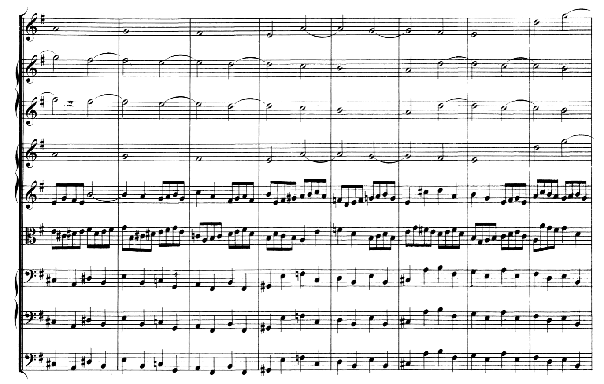

# 为何我觉得J. S. 巴赫作品的发展逻辑并不强？

**作者**：[陈子敏](http://www.zhihu.com/people/91949509989e39acc6e55e4216ac260b)

**原文**：https://www.zhihu.com/question/757526218/answer/7143838908

**发布时间**：2024-10-16T22:56:37

**编辑时间**：2024-10-27T16:50:16

赞同 168 · 收藏 102 · 喜欢 13 · 评论 20

巴赫的创作是天马行空非常自由的，听不出发展逻辑说明你是一个正常人。除开变奏曲外，巴赫许多作品的发展逻辑确实不强。比如他的赋格，精湛的对位（毋宁说是和声动力）都是依靠大量的自由对题来达到的，巴赫是天才的旋律大师，而不是逻辑或数学大师，现代人总想在巴赫作品中找到某种形而上的自我运动的神圣内核比方说数学、逻辑来为自己并不高明的音乐分析能力找补。

巴赫作品的发展性是有的，至于发展逻辑，其实18世纪初还没有严谨的根据调性布局规定发展逻辑的古典主义奏鸣曲式，发展方式除模仿复调和固定低音变奏外，没有太多余地。而巴赫作品的发展性是基于对位与和声动力来驱动的，不能说巴赫作品没有发展性，比如勃兰登堡第四协奏曲第三乐章天才的展开，只用了一个主题三个对题（可能还有一个主题变形），撑起了这么漂亮的赋格发展，同时还有主题的卡农、展开部还有自由对题的二部模仿、stretto，各个声部百花争艳此起彼伏，这不可能说是没有发展性，但你要说有什么发展逻辑，微观上和声进行与模仿复调的发展逻辑当然有，宏观结构上的发展逻辑就难说了。

谱例中，除低音部一直在延展主题材料外，二提和中提在这毫无规律凭着感觉行云流水倚马千言一会自由一会模仿固定对题一会穿插主题片段，这能用什么逻辑来解释，因为这就是狂欢啊

但凡认真分析过巴赫的谱子，你会发现巴赫是非常自由、非常浪漫的作曲家，巴赫的伟大并不是靠着什么严谨的逻辑，而是技艺精湛的和声语言和拓宽和声语言边界的想象力。在他大部分作品中，都有通过对位，内声部的流动制造的快速的和声节奏，充满了自由声部与多变的低音，很少停留在某个和弦原位，这点和亨德尔、斯卡拉蒂、维瓦尔第等人对比之下是极其明显的。

巴赫是旋律大师，天马行空的音乐诗人，他被后世的伟大作曲家推崇为最伟大的作曲家，难道是因为他的音乐基础扎实，逻辑性强？我很不理解一提巴赫就言必称“逻辑”的言论，像理工男直面克苏鲁，像刚进屠宰场的学徒以为自己的剔骨刀可以庖丁解牛般把万物都划剌一遍。巴赫在作曲家眼里都只能解释为天才和灵感的奇迹，如果他是靠“逻辑”、“技术”来完成他的音乐奇迹的，那我们也只好认栽觉得见鬼了。
