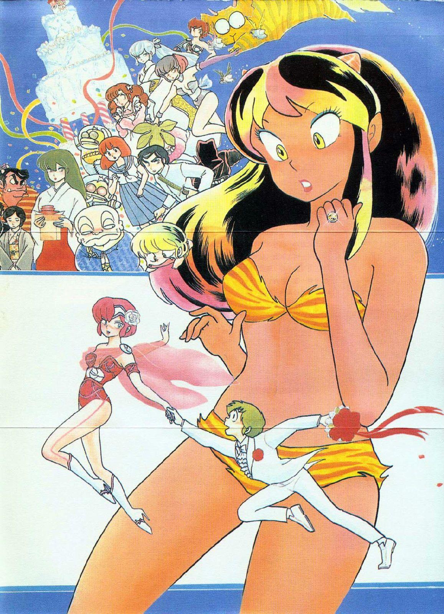
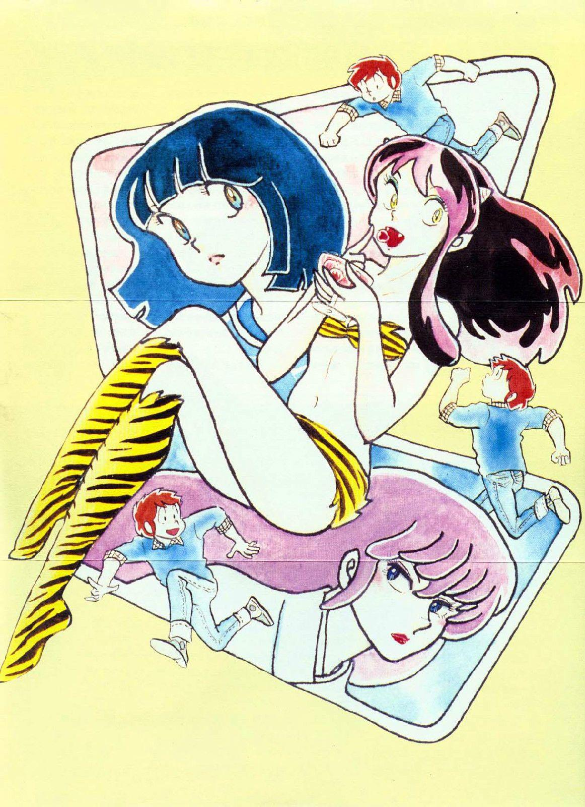
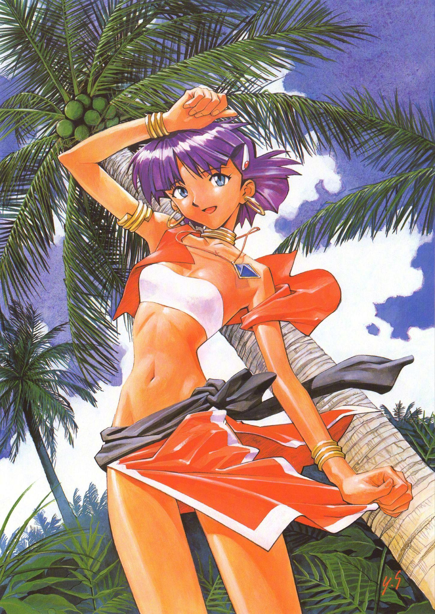
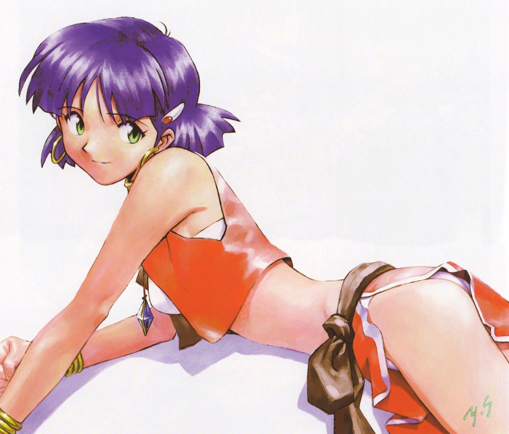
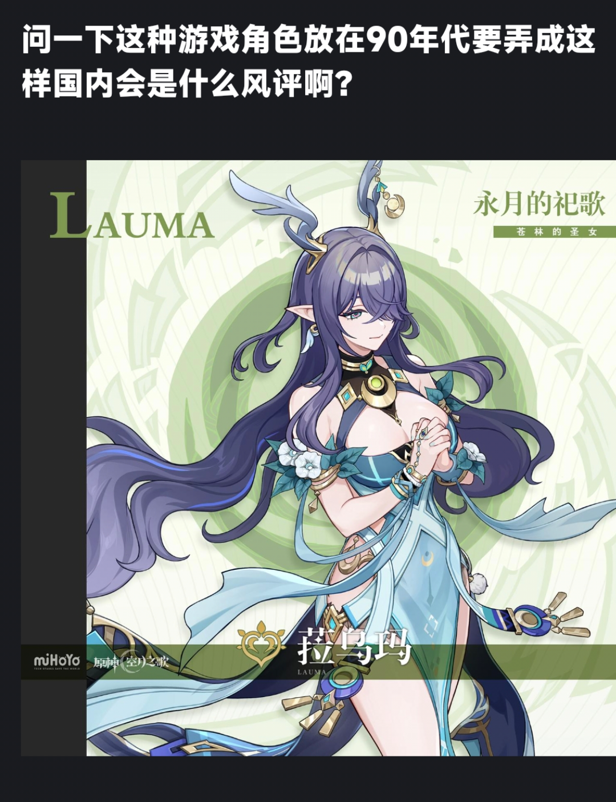

# 这种游戏角色放在90年代是否会有争议？

**作者**：[陈子敏](http://www.zhihu.com/people/91949509989e39acc6e55e4216ac260b)

**原文**：https://www.zhihu.com/question/1936784259949003429/answer/1938824365488739337

**发布时间**：2025-08-13T04:49:10

**编辑时间**：2025-12-24T04:31:10

赞同 24 · 收藏 7 · 喜欢 2 · 评论 1

真是牢保分娩期，保保肚肚打雷了

在绿坝娘时代下成长起来的孩子，反过来却会比绿坝娘本身更保守。日趋保守化让人不由忧心忡忡，就好像中国的游戏生态是游戏机禁令结的果，未来中国穆斯林化又会是谁结的果呢？

70年代的漫画角色be like:

うる星やつら(1978)

90年代的动画角色be like:

ふしぎの海のナディア（1990）

2025年的知乎be like: ————

