# 江口寿史的画到底好在哪？

**作者**：[陈子敏](http://www.zhihu.com/people/91949509989e39acc6e55e4216ac260b)

**原文**：https://www.zhihu.com/question/264516400/answer/1960189631472592504

**发布时间**：2025-10-11T03:47:06

**编辑时间**：2025-10-12T15:39:41

赞同 199 · 收藏 281 · 喜欢 17 · 评论 17

江口寿史又不是因为这些插画才被称为“现今仅存的鬼才”的，他在业界长期以来履历非常丰富。

他的插画作品并不是因为“画得好”才成为平面设计的一个经典模因，而是他切中了现代年轻时尚的某种倾向喜好而让他的插画大受欢迎。他用平涂套色版画这种简练具有冲击力的波普风格给年轻群体带来了一种清新活泼的感觉，这种风格可以说完全不新鲜甚至是非常传统，而且对于任何一个专业漫画家而言都是极其简单的伎俩。

但这种风格与一种对复古印刷品的怀旧风潮相联系后，就变成了年轻人喜闻乐见的潮流单品。比如下面这些你们多少也见过:

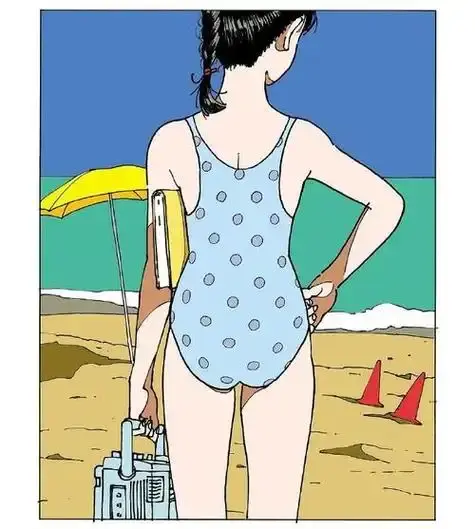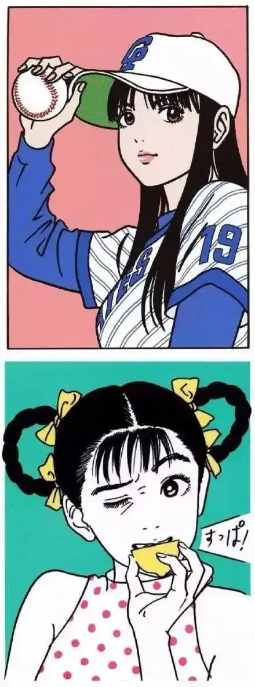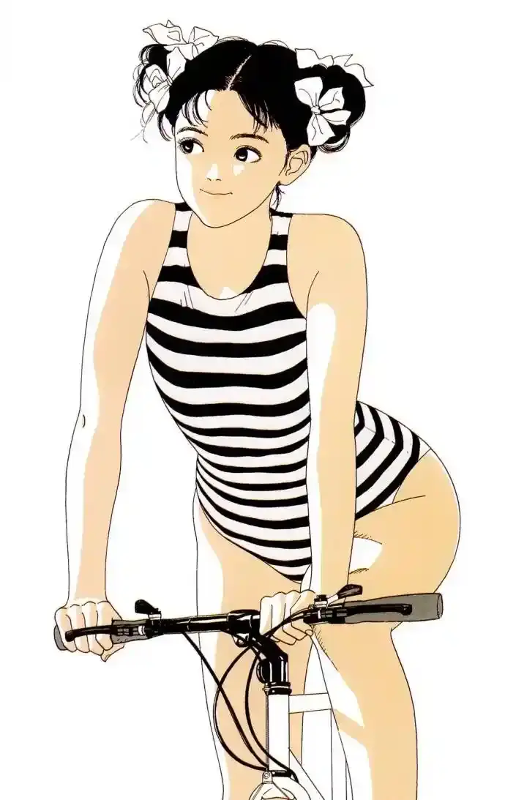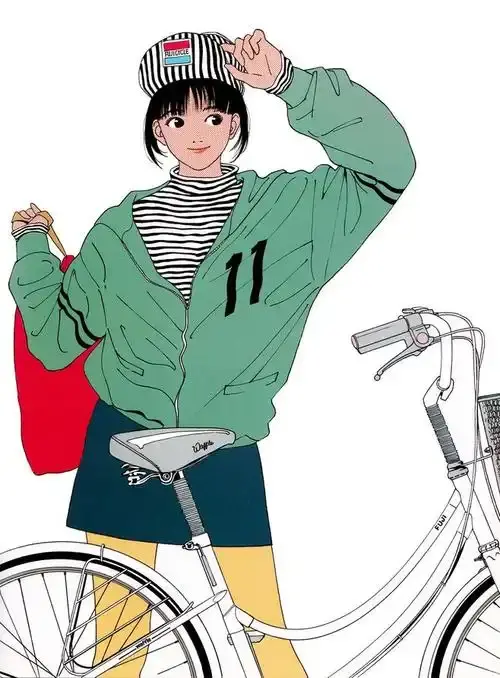

江口的美术水平毋庸置疑是顶尖的。前面提到，他的标志性平涂风格对于专业美术从业者而言的确没有任何难度，但这并不意味着谁来模仿都可以成功，就像模仿沃霍尔而去量产相似的波普艺术作品是没有意义的。江口寿史打下名气是从他早期的漫画连载开始的，也为他日后转入纯插画领域积攒了声誉。

要理解他后来那些看起来简单随性的插画作品为什么受到推崇，以及为什么他会在近70岁高龄之际传出无断使用照片描图商用的丑闻，就要联系他的历史、人生轨迹和创作倾向的转变来考虑。

江口早期是著名的漫画家，从1979年出道，1980年以《前进吧！海盗》成名，后来他最著名的创作当属1981年开始连载至1992年的《stop！云雀君》，处处闪耀着古灵精怪的青春活力的作品。寄宿黑道家庭、黑道家姐妹花、隐瞒性别的伪娘主角、恐同男主、体育社团美女经理、修学旅行荤段子、伪娘与顺性女争风吃醋，等等各种桥段，在当时大都属新鲜的发明创造。作为第一部以伪娘作为主题的校园恋爱漫画作品，也是伪娘属性大行其道的源头，这部作品可以说完全展示了他青年时期用之不竭的想象力。江口寿史在当时就打响了鬼才名号，是御宅界炙手可热的人物，不止作为原作，在tva、ova的原案、制作等方面都有涉足。他被称为鬼才主要是在漫画原作、动画原案、美术设计和随笔性的短篇漫画中展现的天才想象力和玩世不恭的巧妙戏仿恶搞。

（下图全是大空云雀）

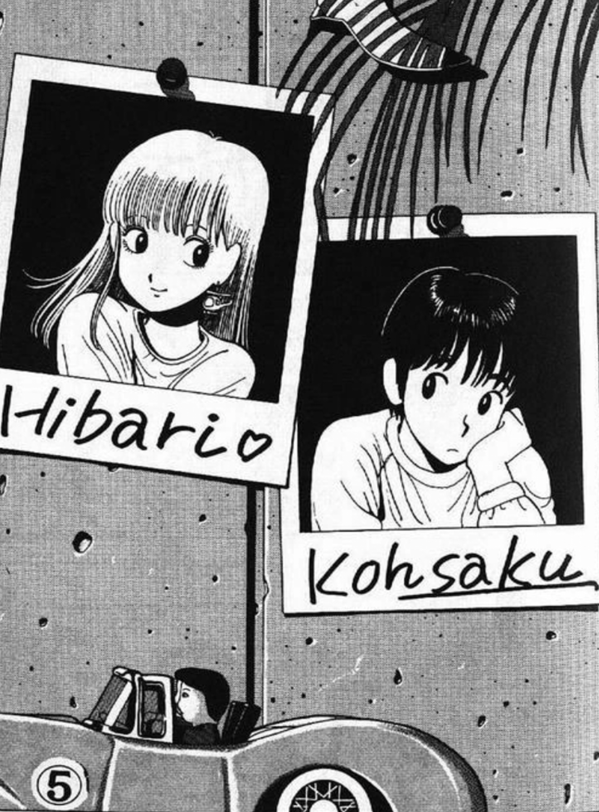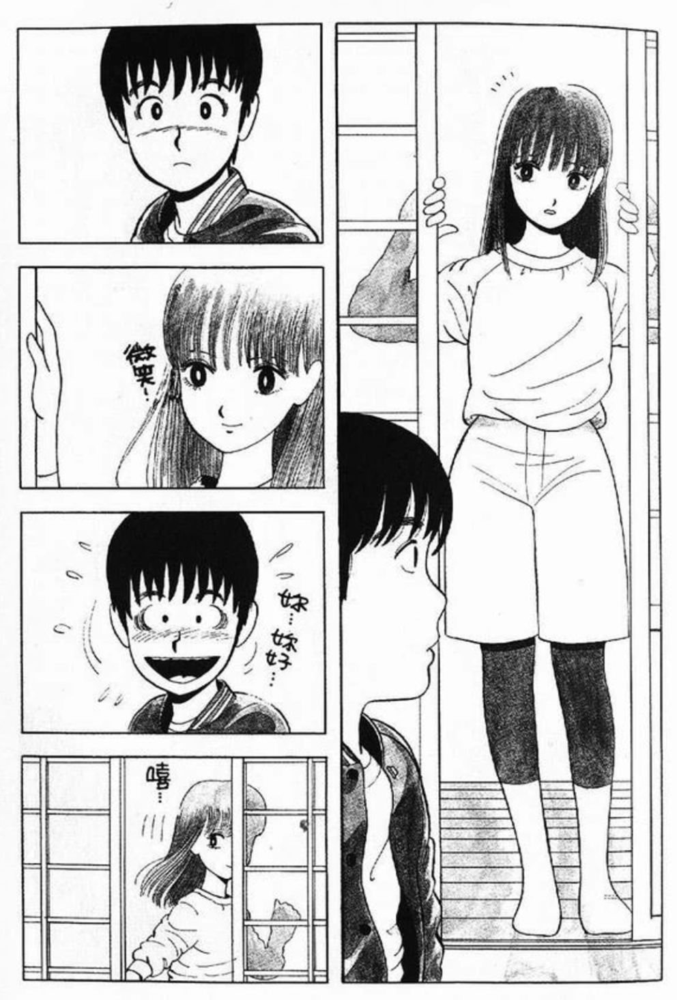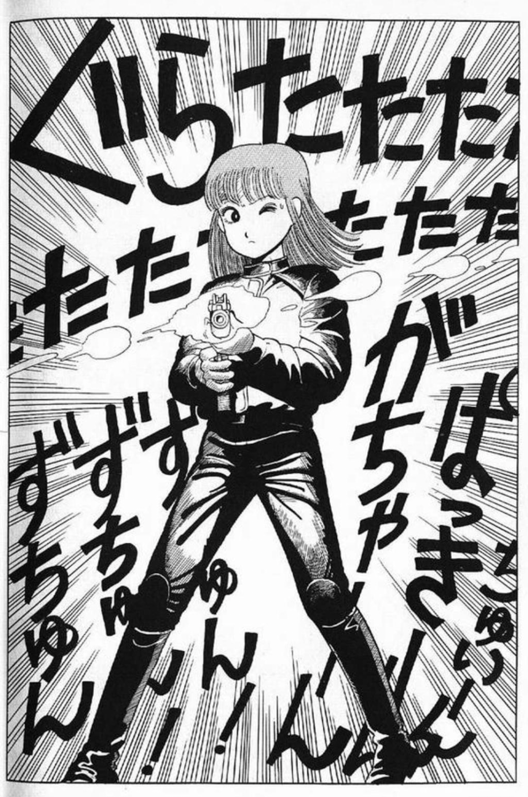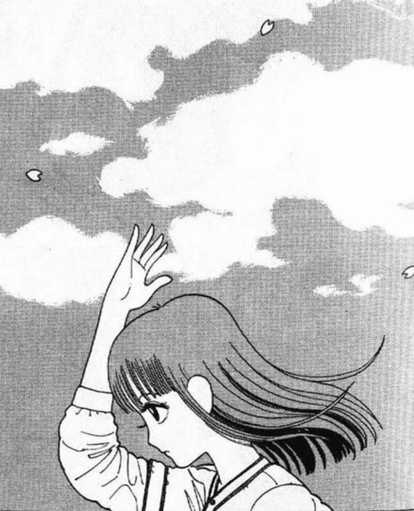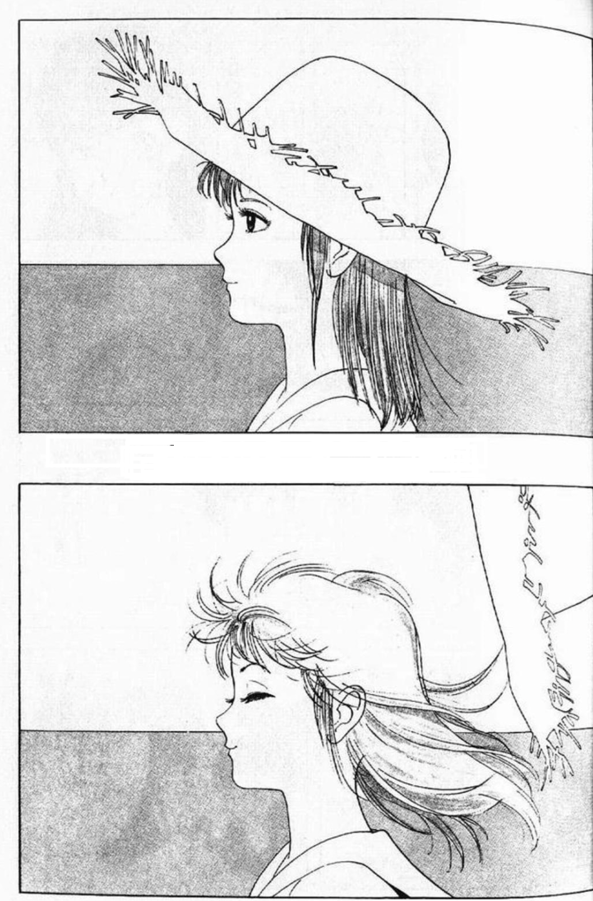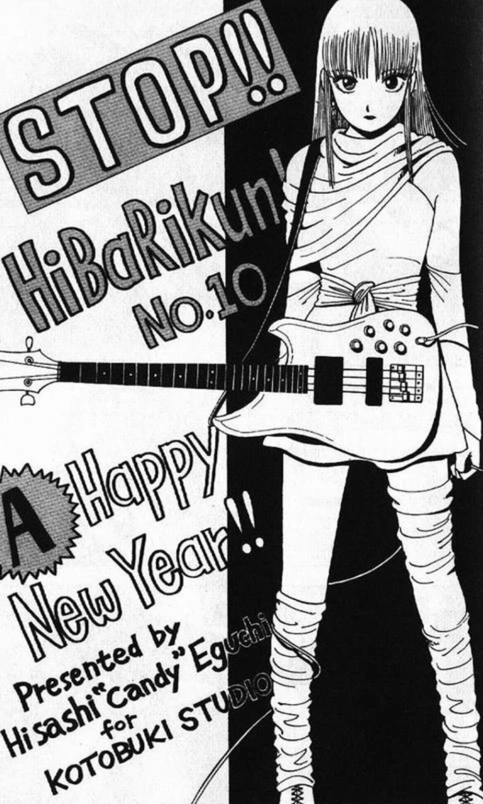

（顺带一提，当时在寄宿学校上学时这部漫画简直是我的精神寄托，打着灯反反复复阅读，其趣味性和自由奔放的气氛让我在宿舍中疲惫的状态时感到相当慰藉。）

但主攻漫画领域的这段时间据说是江口最痛苦的时期，周刊连载的压力和他本人的完美主义倾向使他透支身体熬夜赶稿，为此常常休刊，严重麻痹了江口对漫画创作的热情，可能是他日后转入插画领域的直接原因。

1990年江口寿史与水谷麻里结婚后，漫画创作大幅减少，开始转向商业插画或专做美术设计。江口寿史曾经为大友克洋的作品《老人Z》、今敏的《未麻的部屋》负责了人物和美术设计。在近年他为动画《漂流少年》担纲人物设计，《漂流少年》也以江口这种标志性的波普风格和无影作画为人称道。

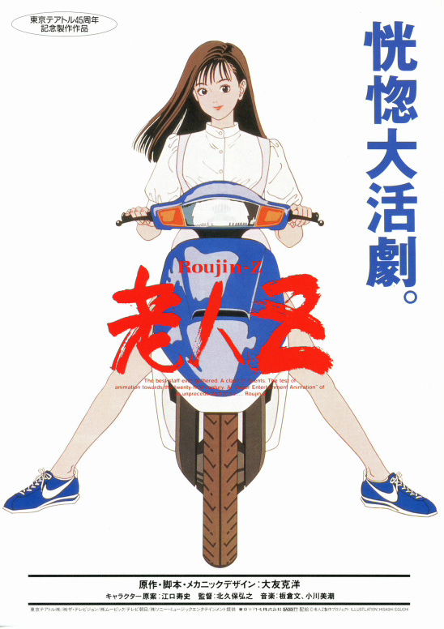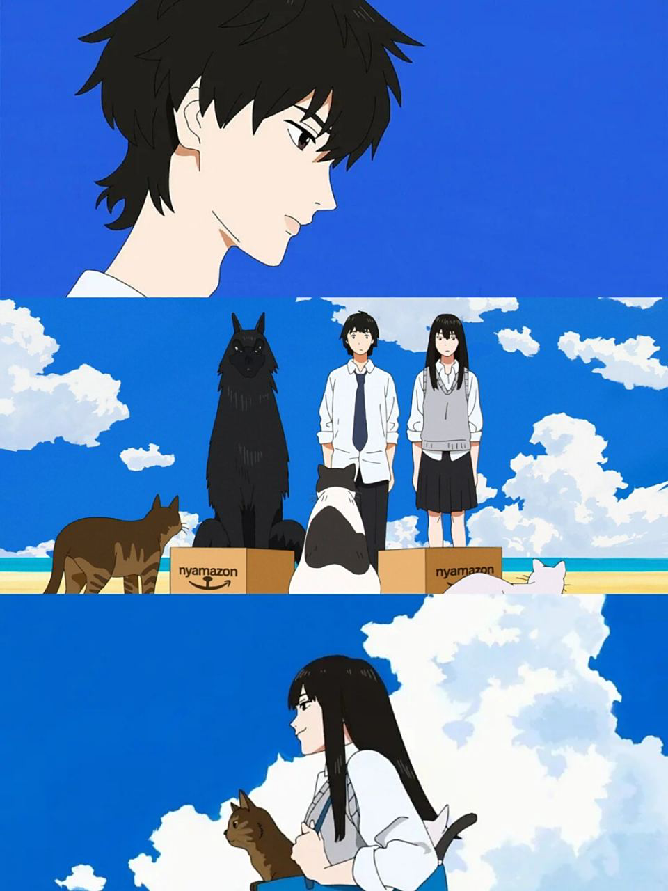

他后来被漫画领域以外的人所认识，一般是一些线稿平涂版画风格的杂志插画在国内互联网社交媒体传播使用并且被推崇，以至于经常有把浦泽直树《柔道少女》（YAWARA）的平涂水彩风格彩绘扉页等标注成江口寿史的作品（问题描述中有几张图就是浦泽直树的）。除此之外大部分年轻潮人对江口寿史一般是一无所知的。

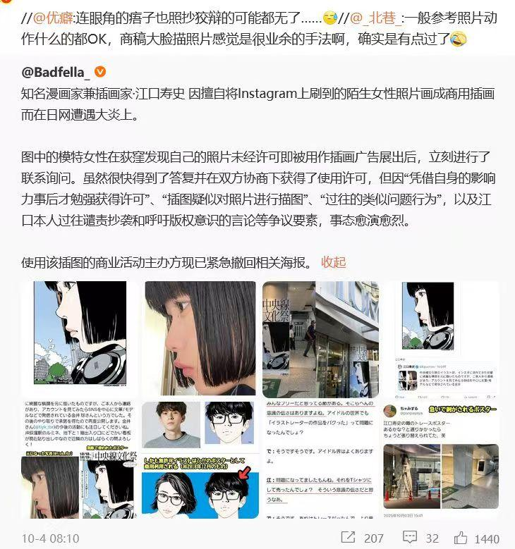

恐怕90年代之后江口寿史就活明白了，可能那时他就发现画商业插画、广告或给项目做美术设计赚的钱比透支身体独立画漫画还要多许多倍。如今出现这样严重的描图抄袭丑闻不必奇怪，完全也和他的摆烂心境一致。但从原来年轻时一个天才漫画家逐渐变成从心所欲之年毫无创作欲只能抄照片描图的老人，的确令人无限惋惜。
