# 卫国战争时期的米佳（上）

**作者**：[陈子敏](http://www.zhihu.com/people/91949509989e39acc6e55e4216ac260b)

**原文**：http://zhuanlan.zhihu.com/p/23817141

**发布时间**：2016-11-20T23:38:53

**编辑时间**：2019-08-31T16:39:55

赞同 90 · 收藏 33 · 喜欢 2 · 评论 8

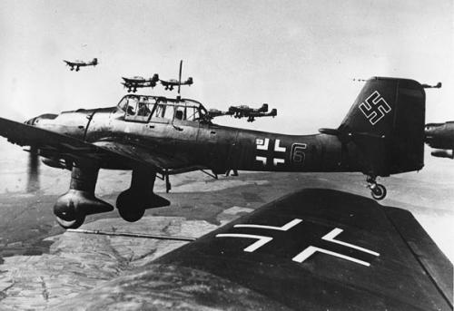

1941年6月22日，纳粹德国背信弃义的撕毁《德苏互不侵犯条约》，以190个师共550万人兵力对苏联发动突然袭击。伟大的苏联卫国战争全面爆发。在1936年大清洗余震中噤若寒蝉的作曲家**德米特里·肖斯塔科维奇**，在之前恐怖的几年里先后受到《真理报》两次批判，目睹了朋友与亲戚相继被捕或杀害，甚至自己唯一可以依托的保护人——红军元帅图哈切夫斯基，在1937年也因“叛国罪”的冤名枪毙在高墙后头。肖斯塔科维奇自然难逃池鱼之殃。在那之后，可怜的米佳（肖斯塔科维奇的小名）就一直被悲哀、恐惧以及受国安局监视的阴云所笼罩。那段时间，米佳曾写好遗书，把自己仅有的财物收进一个小小的行李箱，夜晚睡在寒冷的室外——以便随时逃走。虽然上一次的浩劫已过去了好几年，但灾难永远不会停止。6月22日那天，他听到苏联国家广播电台发出的悲惨宣告——战争爆发了！

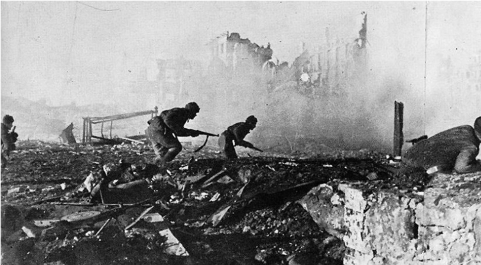

硝烟与炮火不可遏止的迅速蔓延，9月，米佳赖以生存的家乡列宁格勒被德军彻底封锁。德国人视列宁格勒为无比重要的战略之地，他们甚至扬言要在地球上抹掉这座城市。仅仅在九月，纳粹向列宁格勒总共投下了331颗爆破炸弹和31398颗燃烧弹。

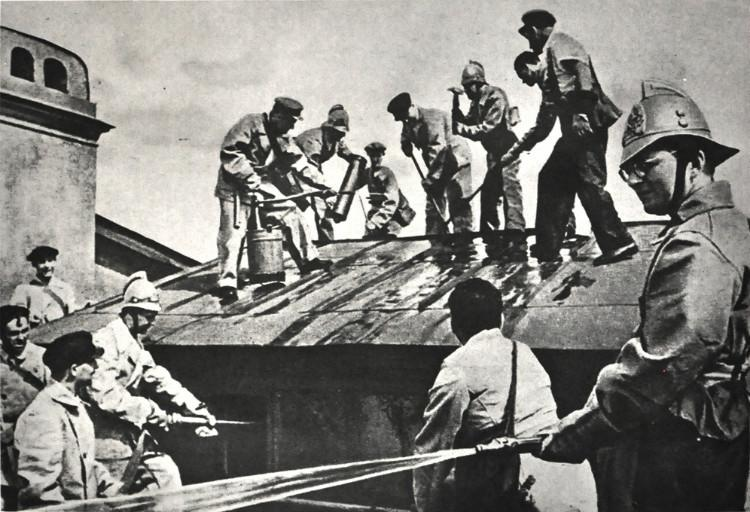

*（上图：参加消防训练的肖斯塔科维奇与奋战中的列宁格勒音乐学院学生）*

米佳在这期间参加了消防兵，还参加了一场募捐音乐会，演奏他自己的作品《24首前奏曲》（op.34），那场音乐会所筹得的10000卢布全部捐给苏联国防基金会。作为苏联文化的重要人物，他的作用与号召力再次被凸显出来。他知道，那几首单薄而忧伤的前奏曲并不鼓舞人心。列宁格勒人民需要规模宏大，气势高涨的音乐。而在两天后，9月16日的一场与炮火声同时进行的广播讲话中，他宣布了这件事：“一个小时之前，我写完了新的大型交响曲第二乐章的总谱，如果我能够把这部作品写完，那么这部作品就可以叫做《第七交响曲》。”

**它后来被称为《列宁格勒交响曲》(op.60)。**

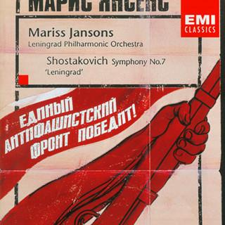

战争带给米佳近乎毁灭性的体验。围困的近百天中，整个列宁格勒水电供应相继停止，公共设施被破坏，粮食紧张。许多人身患重病，挨饿受冻。严寒下，米佳目睹着像土豆般成堆的尸体被遗弃在城市的各个角落。他发现那些从遥远的市郊领取补给归来走在雪地里的人们已经意识不清。许多人在寒冷中倒下，被冻死与饿死的尸体一点点堆积增多。随着德军进攻的愈发猛烈，寒冷、饥饿与灾难也更加深重。女诗人薇拉·因贝尔在报纸上得知这部《第七交响曲》谱写的情况后深感不安，因为作曲家是在“受围困与炮火连天的处境下”创作这部作品的。

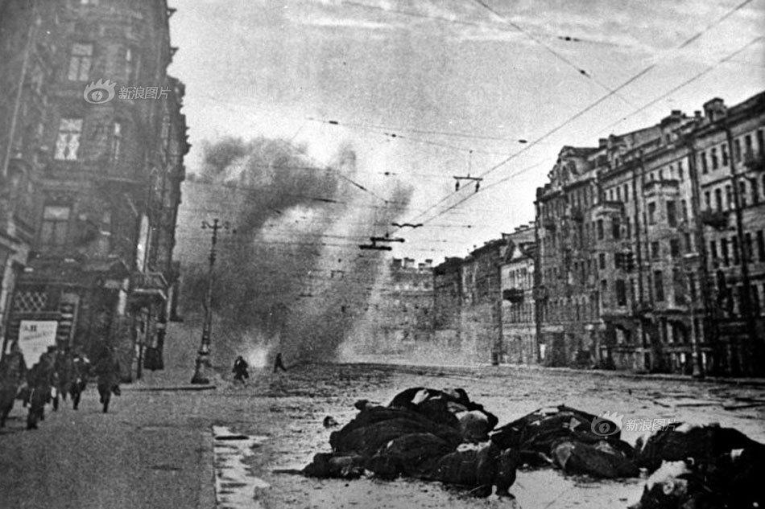

苏联政府将住在受围困的列宁格勒前线的米佳转移至古比雪夫安心创作。12月，米佳终于完成了这部交响曲。这部作品宏大辉煌，具有伟大的乐观主义精神和鼓舞人心的力量。作曲家将这部作品题献给列宁格勒这座英雄城。

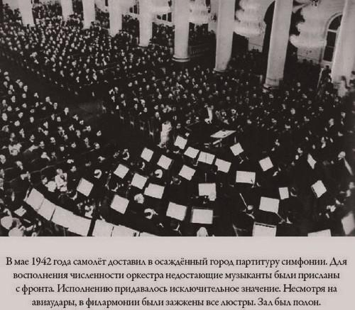

*（上图：《C大调第七交响曲》在莫斯科首演实况）*

1942年，作品先后在古比雪夫、莫斯科举行首演。为了使列宁格勒的人民能够听到属于自己的交响曲，鼓舞前线士兵的战斗士气，苏联政府出动了空军将这部作品的总谱空运至列宁格勒。

在纳粹数百天的围困与猛烈进攻中，列宁格勒早已惨不忍睹。留守在这里的唯一一个交响乐团残缺不全：担任指挥的埃利阿斯贝格曾接到一份乐手的名单，其中有27人的名字被画上黑框——他们已经死去。为此指挥不得不召集全列宁格勒市的演奏家以组建一支临时乐队，他们应召而至时，早已瘦得不成样子，看见的人们无不伤心落泪。

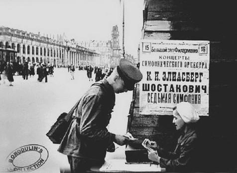

*（上图：1942年列宁格勒市的街拍。张贴了《第七交响曲》首演的海报）*

8月9日，当德军计划攻克列宁格勒时，《C大调第七交响曲》第一次响彻在列宁格勒市上空。为了防止德军炮击音乐厅并保证演出在一个安静的环境下正常进行，苏联红军事前向德军炮兵阵地发射了约3000发炮弹进行压制。列宁格勒苏军集中所有大炮猛轰德军阵地，当山摇地动的爆炸渐弱时，离基诺夫工厂、车站仅1公里多的德军前沿阵地突然传来一浪高过一浪惊天动地般的交响乐曲，日丹诺夫命令把能够找到的尽可能多的高音喇叭对准德军阵地猛播。这对德国人而言是一个重大的打击——前线战报中早已沦为死城的列宁格勒实际上依然生机勃勃，斗志高涨。参与这场演出的人们都相信，是列宁格勒广播交响乐团的反攻抵御了希特勒的进攻

“人们在街上，在掩体里，在住所里以极大的热情倾听这英雄的乐章。”

苏联举行的几场首演引起了国际音乐界的关注。《第七交响曲》在美国由伟大的指挥家托斯卡尼尼指挥演出，全世界数千家电台转播了这场首演。该作在世界各地的演出都获得了最辉煌的成功。他的音乐鼓舞了整个同盟国人民反法西斯的力量。

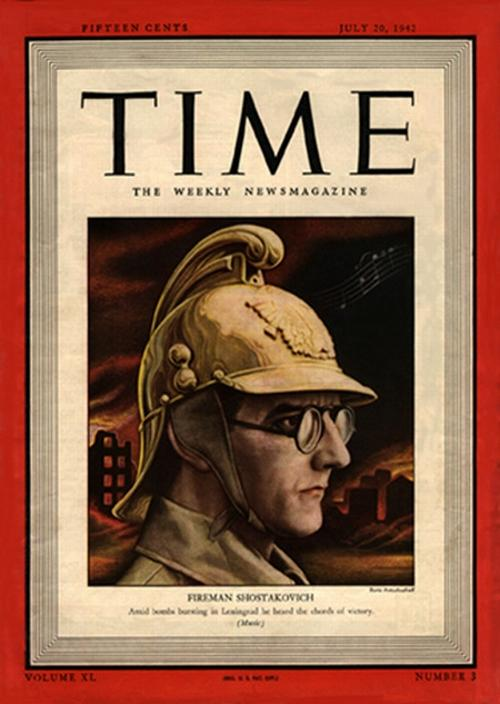

*（上图：1942年《时代》杂志封面的肖斯塔科维奇）*

米佳获得了无与伦比的世界荣誉。他是“那个时代最为炙手可热的作曲家”。然而他依旧悲伤，这点我们可以从音乐中窥见端倪——第一乐章呈式部副部中，在那个著名的描写希特勒军队进攻的“侵犯插部”之前，短笛和小提琴奏出哀婉凄凉的旋律，异常诡异——也许这就是受侵略前，大恐怖时期飘荡在列宁格勒空气中最真实的声音；终乐章并不振奋人心，在几个主题变奏发展到达高潮后，一段失落而哀伤的萨拉班德舞曲迅速占据了全曲情感的中心。这段沉闷的低潮一直持续到该乐章的末尾，然后才由一个**几乎是牵强的**宏大凯旋乐段以震耳欲聋的音响进行收尾——这一切都很难让人感到振奋。

另一个近乎决定性的证据是，末乐章尾声在再现第一乐章的正主题后，高昂地持续着长达半分钟的终止和弦时，在厚厚堆叠下的低音部重复再现了末乐章暴虐的第二主题（G-bA-G-bB-G-bE-D）。

在木管部狂欢着尖叫出胜利号角的同时，恐怖与黑暗在低音部潜伏着。

在回忆录《见证》中，作曲家称《第七交响曲》是“我的安魂曲”。对于这种令人费解的定性可以不作评价。但与“安魂曲”的意义相联系起来，至此我们也不得不承认《第七交响曲》**惊人的悲观主义倾向**。

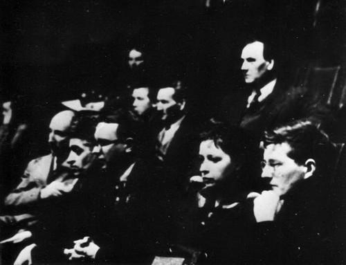

*（上图：肖斯塔科维奇在古比雪夫聆听《C大调第七交响曲》的排练）*

我并不想浓墨重彩的描写这部交响曲的宏大辉煌，或是列宁格勒人民在反侵略战斗中的英勇形象，因为那早已是不言自明的。也许，在围困中惨重的伤亡与人民毁灭性的痛苦体验最具有说服力——一组最直接的数据资料可以精确描述围困长达872天的列宁格勒的悲惨情形：

> 由于能源粮食的运输受到破坏而导致空前的大饥荒，造成最多150万人死亡；经济上的破坏及人命损失超过了莫斯科保卫战、斯大林格勒战役、广岛市原子弹爆炸或长崎市原子弹爆炸；在1941年至1942年间的冬季，当所有雀鸟、老鼠及宠物被生还者吃光后，城内出现人类同类相食的情况。列宁格勒围城战被列入世界历史上最血腥的战役，一些历史学家更称围城行动为种族灭绝。

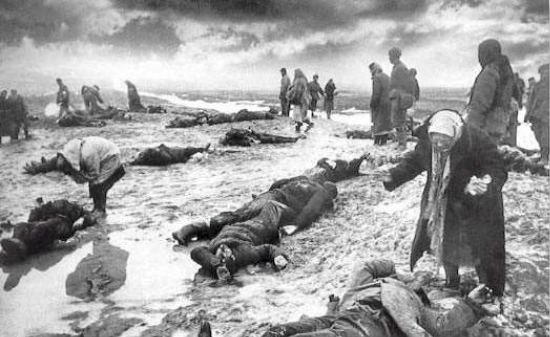

米佳生性敏感悲伤，在悲剧主题创作中，他总是用最深沉和暴虐的音符描绘灾难、恐惧与疯狂。《第七交响曲》里的哀伤的片段同样来自于仍然在进行着的灾难。作曲家始终无法忘记在列宁格勒所目睹的人民生活的惨状，他必须描绘人民在战争中的真实体验。《第七交响曲》中，胜利凯旋的形象并不具有真正的代表性——虽然第二与第三乐章的追忆式的忧伤旋律通向了人类最真挚的情感——但这并不与全世界人民的灾难与痛苦密切相关。

1943年，米佳完成了《c小调第八交响曲》（op.65），题献给指挥家E.A.穆拉文斯基。

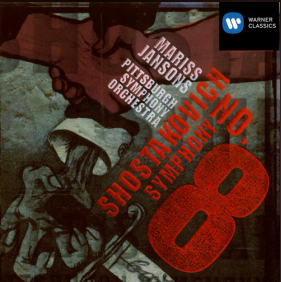

**这是他最具悲剧色彩的作品。**

接下篇：卫国战争时期的米佳（中）预定12月24日更新
